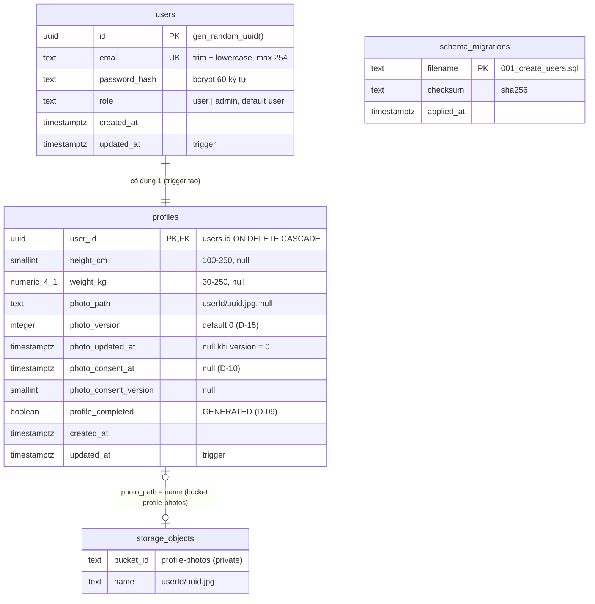

# Sprint 01 — Database & Storage

> Stories: US-01, US-02 · Quyết định: D-02, D-03, D-07, D-09 → D-15, D-19 · SQL: [`001_create_users.sql`](001_create_users.sql), [`002_create_profiles.sql`](002_create_profiles.sql)

## Mục lục
1. [ERD](#1-erd)
2. [Tách `users` / `profiles` — lý do](#2-tách-users--profiles--lý-do)
3. [Schema](#3-schema)
4. [Index](#4-index)
5. [Bảo mật DB: RLS & quyền](#5-bảo-mật-db-rls--quyền)
6. [Supabase Storage](#6-supabase-storage)
7. [Migration, setup & seed](#7-migration-setup--seed)

---

## 1. ERD

Sprint 01 là sprint đầu: **mọi bảng đều mới**. Sprint sau đánh dấu phần thay đổi so với sơ đồ này.



`storage_objects` là bảng `storage.objects` do Supabase quản lý (chỉ thao tác qua Storage API). `schema_migrations` do script migrate tạo (mục 7), không liên kết bảng khác.

## 2. Tách `users` / `profiles` — lý do

| Tiêu chí | Tách 2 bảng (chọn) | Gộp 1 bảng |
|---|---|---|
| Dữ liệu nhạy cảm (D-03, D-14) | Số đo, ảnh, consent ở bảng riêng → query auth (`login`, middleware, danh sách user Epic 4) không bao giờ chạm vào | Mọi `select *` vô tình đều kéo theo số đo/đường dẫn ảnh |
| Admin (D-07) | Admin chỉ cần `users`; hồ sơ admin rỗng, không dùng | Nhiều cột null vô nghĩa cho admin |
| Mở rộng | Epic 3/4 thêm cột hồ sơ không đụng bảng auth | Bảng phình to |
| Chi phí | Thêm 1 join (theo PK) ở `/me` và login | — |

Hồ sơ được tạo bằng **trigger `trg_users_create_profile`** trong cùng transaction với INSERT `users` → không cần transaction ở backend (supabase-js không hỗ trợ transaction) và mọi user luôn có đúng 1 dòng `profiles`.

## 3. Schema

SQL đầy đủ ở 2 file `.sql` cạnh tài liệu này (agent-coder chép nguyên văn sang `migrations/`).

### 3.1 `public.users`

| Cột | Kiểu | Null | Default | Ràng buộc |
|---|---|---|---|---|
| `id` | `uuid` | không | `gen_random_uuid()` | PK |
| `email` | `text` | không | | UNIQUE `users_email_key`; CHECK `email = lower(btrim(email))`; độ dài 3–254 |
| `password_hash` | `text` | không | | CHECK định dạng bcrypt `^\$2[aby]\$[0-9]{2}\$.{53}$` |
| `role` | `text` | không | `'user'` | CHECK `in ('user','admin')` |
| `created_at` | `timestamptz` | không | `now()` | |
| `updated_at` | `timestamptz` | không | `now()` | trigger `trg_users_updated_at` |

`role` dùng `text + CHECK` thay vì `enum` để thêm vai sau này chỉ cần sửa CHECK (enum khó đổi/xóa giá trị).

### 3.2 `public.profiles`

| Cột | Kiểu | Null | Default | Ràng buộc / ý nghĩa |
|---|---|---|---|---|
| `user_id` | `uuid` | không | | PK, FK → `users.id` `ON DELETE CASCADE` |
| `height_cm` | `smallint` | có | | CHECK 100–250 |
| `weight_kg` | `numeric(4,1)` | có | | CHECK 30–250. **Lưu ý:** numeric tự làm tròn `52.55 → 52.6`, nên backend bắt buộc từ chối trước khi ghi |
| `photo_path` | `text` | có | | `<user_id>/<uuid>.jpg`, CHECK regex + tiền tố đúng `user_id` |
| `photo_version` | `integer` | không | `0` | CHECK ≥ 0; +1 mỗi lần tải/thay/xóa ảnh (D-15) |
| `photo_updated_at` | `timestamptz` | có | | null ⇔ `photo_version = 0` |
| `photo_consent_at` | `timestamptz` | có | | Thời điểm đồng ý (D-10) |
| `photo_consent_version` | `smallint` | có | | ≥ 1; null ⇔ `photo_consent_at` null |
| `profile_completed` | `boolean` | không | generated stored | `photo_path`, `height_cm`, `weight_kg` đều khác null (D-09) |
| `created_at` / `updated_at` | `timestamptz` | không | `now()` | trigger `trg_profiles_updated_at` |

CHECK liên cột:
- `(height_cm is null) = (weight_kg is null)` — số đo luôn lưu cùng nhau.
- `photo_path is null or photo_consent_at is not null` — không thể có ảnh khi chưa consent (chốt chặn DB cho AC-02). Việc consent đúng **phiên bản hiện hành** do backend kiểm.

**Vì sao `photo_version` (số nguyên) thay vì chỉ `photo_updated_at`:** khóa cache Epic 3 (`userId:photoVersion:productImageId`) cần giá trị tăng đơn điệu, so sánh chính xác; timestamp có thể trùng/lệch đồng hồ. Giữ cả `photo_updated_at` để hiển thị/kiểm tra.

### 3.3 Hàm & trigger

| Tên | Loại | Mục đích |
|---|---|---|
| `set_updated_at()` | trigger fn | Cập nhật `updated_at` (dùng chung mọi bảng) |
| `create_profile_for_user()` + `trg_users_create_profile` | trigger AFTER INSERT `users` | Tạo `profiles` rỗng |
| `set_profile_photo(p_user_id, p_new_path)` | function (rpc) | `SELECT … FOR UPDATE` lấy `old_path` → UPDATE `photo_path`, `photo_version + 1`, `photo_updated_at`. Trả `out_old_path`, `out_photo_version`, `out_photo_updated_at`. `p_new_path = null` = xóa ảnh; xóa khi không có ảnh → không đổi |

Backend gọi: `supabase.rpc('set_profile_photo', { p_user_id, p_new_path })`. Hàm bảo đảm 2 upload đồng thời không làm mất dấu file cũ (mỗi request nhận đúng file nó thay thế).

## 4. Index

| Bảng | Index | Phục vụ |
|---|---|---|
| `users` | PK `id` (btree) | Middleware auth: `WHERE id = sub` mỗi request |
| `users` | UNIQUE `users_email_key` (btree) | Login/đăng ký: `WHERE email = ?`; chặn trùng (E8) |
| `profiles` | PK `user_id` (btree) | Mọi query hồ sơ, join `/me` |

Không thêm index khác ở sprint 01 (dữ liệu nhỏ, mọi truy vấn theo khóa). Epic 4 (danh sách user cho admin) cân nhắc index `users(created_at)` nếu cần phân trang.

## 5. Bảo mật DB: RLS & quyền

| Biện pháp | Áp dụng | Lý do |
|---|---|---|
| `ENABLE ROW LEVEL SECURITY`, **không tạo policy** | `users`, `profiles`, `schema_migrations` | Supabase tự mở Data API (PostgREST) cho schema `public`; nếu anon key lộ, RLS không policy = từ chối mọi dòng cho `anon`/`authenticated` |
| `REVOKE ALL … FROM anon, authenticated` | 3 bảng trên | Phòng thủ lớp 2 (kể cả khi ai đó lỡ thêm policy) |
| `GRANT … TO service_role` tường minh | `users`, `profiles` | Không phụ thuộc default privileges của project |
| `REVOKE EXECUTE … FROM public, anon, authenticated` | mọi function sprint 01 | Supabase mặc định cho `anon`/`authenticated` gọi hàm mới qua `/rpc` |
| Backend dùng `SUPABASE_SERVICE_ROLE_KEY` | toàn bộ | `service_role` bỏ qua RLS; key chỉ ở env backend (D-02) |
| Frontend không có URL/key Supabase | — | D-02 |

Kiểm tra sau migration (T-10/T-23, có thể dùng Supabase MCP read-only `get_advisors` loại security): không còn cảnh báo "RLS disabled in public"; gọi `GET {SUPABASE_URL}/rest/v1/users` bằng anon key → mảng rỗng hoặc 401/403.

## 6. Supabase Storage

### 6.1 Bucket

| Thuộc tính | Giá trị |
|---|---|
| Tên / id | `profile-photos` (env `PROFILE_PHOTO_BUCKET`) |
| `public` | **`false`** (D-03) |
| `fileSizeLimit` | `10MB` (lưới an toàn; ảnh sau xử lý ≤ 2048 px thường < 2 MB) |
| `allowedMimeTypes` | `['image/jpeg']` (backend luôn xuất JPEG) |
| Tạo bằng | Script `backend/scripts/setup-storage.js` dùng Storage API (`getBucket` → `createBucket` hoặc `updateBucket` nếu cấu hình lệch); idempotent |

**Không tạo bucket bằng SQL** (`insert into storage.buckets`): tài liệu Supabase khuyến nghị coi bảng `storage.*` là read-only, mọi thay đổi qua Storage API. Vì vậy bucket không nằm trong file migration `.sql`.

### 6.2 Quy ước đường dẫn

```
profile-photos/
  <user_id>/
    <uuid v4>.jpg      ← ảnh hiện hành (đúng 1 file / user khi hệ thống ổn định)
```

- `<uuid>` sinh bằng `crypto.randomUUID()` mỗi lần tải → tên mới mỗi lần, không ghi đè (`upsert: false`), tránh CDN/browser cache ảnh cũ.
- Không chứa email, tên file gốc. Thư mục theo `user_id` để dọn dẹp/kiểm tra theo user.
- Upload với `contentType: 'image/jpeg'`, `upsert: false`; vì tên file đổi mỗi lần nên không cần cấu hình cache đặc biệt.

### 6.3 Chính sách truy cập

| Ai | Quyền | Cách |
|---|---|---|
| Backend (`service_role`) | upload, remove, createSignedUrl | Bỏ qua RLS của `storage.objects` |
| `anon` / `authenticated` | **Không gì cả** | `storage.objects` có RLS bật sẵn; **không tạo policy nào** cho bucket này |
| Người xem ảnh (user) | Chỉ đọc qua **signed URL** TTL `SIGNED_URL_TTL_SECONDS` (900 s) | Backend tạo mỗi lần trả hồ sơ |
| URL public `/storage/v1/object/public/profile-photos/...` | Bị từ chối | Bucket private (AC-10) |
| Admin | Không có endpoint nào trả ảnh user | D-14 |

Signed URL hết hạn → FE gọi lại `GET /api/profile` (E13). Lưu ý: signed URL còn hạn thì ai có link đều xem được trong ≤ 15 phút — chấp nhận ở MVP.

## 7. Migration, setup & seed

### 7.1 Danh sách file (theo thứ tự chạy)

| Thứ tự | File / script | Nội dung | Task | Branch |
|---|---|---|---|---|
| 0 | `backend/scripts/migrate.js` (tự tạo `schema_migrations`) | Runner | T-07 | `chore/sprint-01-setup` |
| 1 | `migrations/001_create_users.sql` | `set_updated_at()`, `users`, RLS | T-10 | `feature/US-01-auth` |
| 2 | `backend/scripts/seed-admin.js` | Admin từ env | T-11 | `feature/US-01-auth` |
| 3 | `migrations/002_create_profiles.sql` | `profiles`, trigger tạo hồ sơ + backfill, `set_profile_photo()`, RLS | T-23 | `feature/US-02-profile` |
| 4 | `backend/scripts/setup-storage.js` | Bucket `profile-photos` | T-23 | `feature/US-02-profile` |

Thay đổi so với sprint backlog: bucket tạo bằng **script Storage API** thay vì nằm trong migration SQL (lý do ở 6.1); backlog T-23 đã cập nhật.

### 7.2 Runner `migrate.js` (D-19)

- Kết nối `DATABASE_URL` bằng `pg` (connection string **direct/session**, không dùng transaction pooler cổng 6543 cho DDL).
- Tạo nếu chưa có: `public.schema_migrations(filename text primary key, checksum text not null, applied_at timestamptz not null default now())` + `enable row level security` + `revoke all … from anon, authenticated`.
- Đọc `migrations/*.sql`, sắp theo tên (`NNN_` 3 chữ số); bỏ qua file đã có trong `schema_migrations`.
- Mỗi file chạy trong **1 transaction** (`BEGIN … COMMIT`, lỗi → `ROLLBACK` và dừng toàn bộ), cùng transaction ghi dòng `schema_migrations`.
- Lưu `sha256` nội dung; file đã áp dụng mà checksum đổi → báo lỗi và dừng (không sửa migration cũ, viết file mới).
- Không có lệnh down ở sprint 01.

### 7.3 Seed admin `seed-admin.js` (D-07)

- Đọc `ADMIN_EMAIL`, `ADMIN_PASSWORD`; chuẩn hóa email; validate mật khẩu bằng **cùng zod schema đăng ký** (không đạt → thoát với lỗi, không ghi).
- `bcrypt.hash(ADMIN_PASSWORD, BCRYPT_COST)` rồi upsert theo email: `INSERT … ON CONFLICT (email) DO UPDATE SET role = 'admin', password_hash = excluded.password_hash`.
- Idempotent: chạy nhiều lần vẫn 1 admin; env là nguồn sự thật (đổi `ADMIN_PASSWORD` rồi chạy lại = đổi mật khẩu admin). Nếu email đã được đăng ký như user thường → bị nâng thành admin và đổi mật khẩu (log cảnh báo).
- Không có seed dữ liệu khác ở sprint 01 (không seed user mẫu; Postman tự đăng ký email ngẫu nhiên).
- Admin cũng có 1 dòng `profiles` rỗng (do trigger/backfill) — không dùng, API hồ sơ chặn admin bằng 403.
