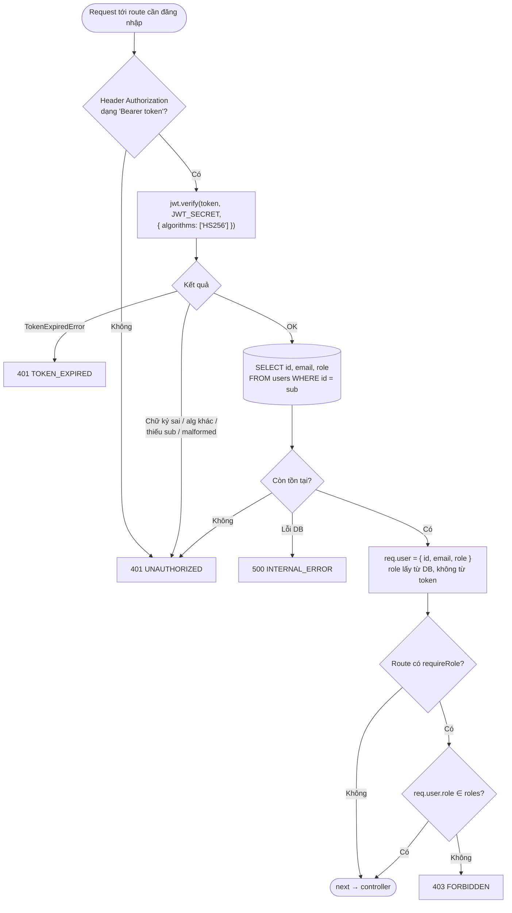

# Luồng: Middleware `auth` + `requireRole`

> US-01 §4.4, E5–E7, AC-08, AC-10 · Áp dụng cho `/api/auth/me`, `/api/profile/*`, `/api/admin/*`

## Phân quyền route sprint 01

| Route | Middleware | Ghi chú |
|---|---|---|
| `GET /api/health`, `POST /api/auth/register`, `POST /api/auth/login` | — (public) | 2 route auth có rate limit IP |
| `GET /api/auth/me` | `auth` | user + admin |
| `/api/profile/*` | `auth` + `requireRole('user')` | Admin → 403 (D-14: admin không có/không xem hồ sơ) |
| `/api/admin/*` | `auth` + `requireRole('admin')` | User → 403 (AC-10) |

## Ghi chú
- Kiểm tra user còn tồn tại ở mỗi request (1 query theo PK, rẻ) → token của user đã bị xóa mất hiệu lực ngay (E6). Sprint 01 chưa có trạng thái "khóa tài khoản".
- `role` lấy từ DB nên khi đổi quyền có hiệu lực ngay, không cần chờ token hết hạn.
- Chỉ định rõ `algorithms: ['HS256']` để chặn token `alg: none` / đổi thuật toán (T-16).
