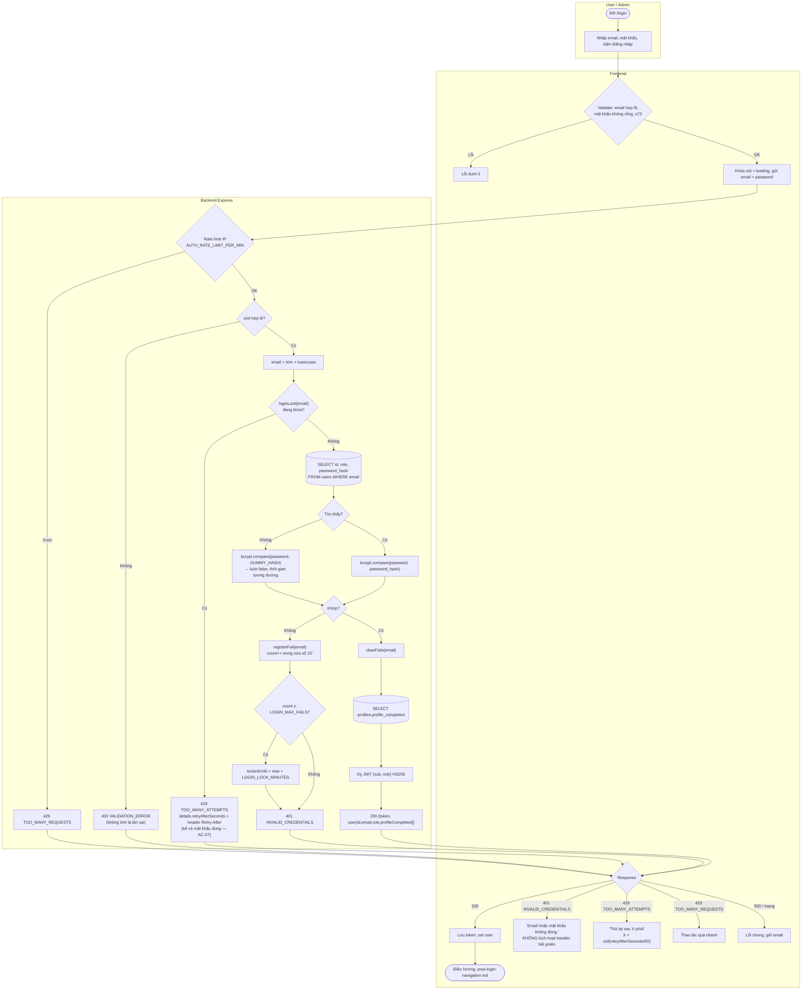

# Luồng: Đăng nhập (khóa 5 lần sai, rate limit IP, dummy hash)

> US-01 §4.2, E3, E4 · `POST /api/auth/login` · D-05, D-06

## Quy tắc bộ đếm khóa (in-memory, D-06)

| Mục | Quy tắc |
|---|---|
| Khóa theo | Email đã chuẩn hóa — **kể cả email không tồn tại** (để hành vi khóa không tiết lộ tài khoản có tồn tại) |
| Cửa sổ | Lần sai đầu tiên mở cửa sổ 15 phút; hết cửa sổ mà chưa đủ 5 lần → reset |
| Khóa | Lần sai thứ 5 vẫn trả 401 và đặt `lockedUntil = now + 15'`; từ lần thứ 6 → 429 cho tới `lockedUntil` |
| Hết khóa | Sau `lockedUntil` xóa entry, đếm lại từ 0 |
| Đăng nhập đúng | Xóa entry (chỉ khi không bị khóa) |
| Không tính | Lỗi validation (400), lỗi rate limit IP (429), lỗi server (500) |
| Bộ nhớ | `Map`; dọn entry hết hạn khi truy cập + `setInterval` mỗi 5 phút (`unref()`); mất khi restart — chấp nhận cho 1 instance MVP |

## Ghi chú
- `DUMMY_HASH` = `bcrypt.hash(<chuỗi ngẫu nhiên>, BCRYPT_COST)` tạo **một lần khi khởi động**, cùng cost với hash thật → chống dò email bằng thời gian phản hồi (AC-06).
- Admin đăng nhập cùng endpoint; khác biệt duy nhất là `role` trong token/response.
- `401 INVALID_CREDENTIALS` không phải "hết phiên": API client chỉ chạy handler hết phiên với `UNAUTHORIZED`/`TOKEN_EXPIRED` (xem `session-restore.md`).
