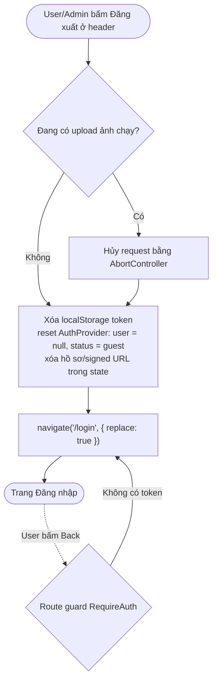

# Luồng: Đăng xuất

> US-01 §4.3.3, AC-09 · D-05 (không thu hồi token phía server, không gọi backend)

## Ghi chú
- `replace: true` + route guard đảm bảo Back không hiện lại trang cần đăng nhập (AC-09). Dữ liệu nhạy cảm (signed URL, số đo) bị xóa khỏi state nên không còn trong bộ nhớ trang.
- Đăng xuất ở 1 tab không tự đăng xuất tab khác (Could: lắng nghe sự kiện `storage` để đồng bộ — không bắt buộc sprint 01).
- Token cũ vẫn hợp lệ phía server tới khi hết hạn (rủi ro đã chấp nhận ở D-05).
