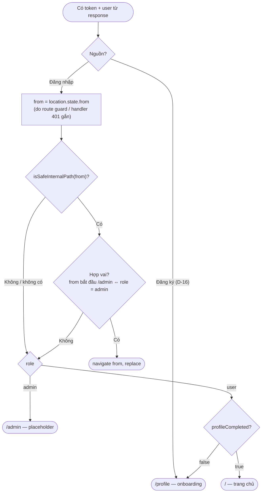
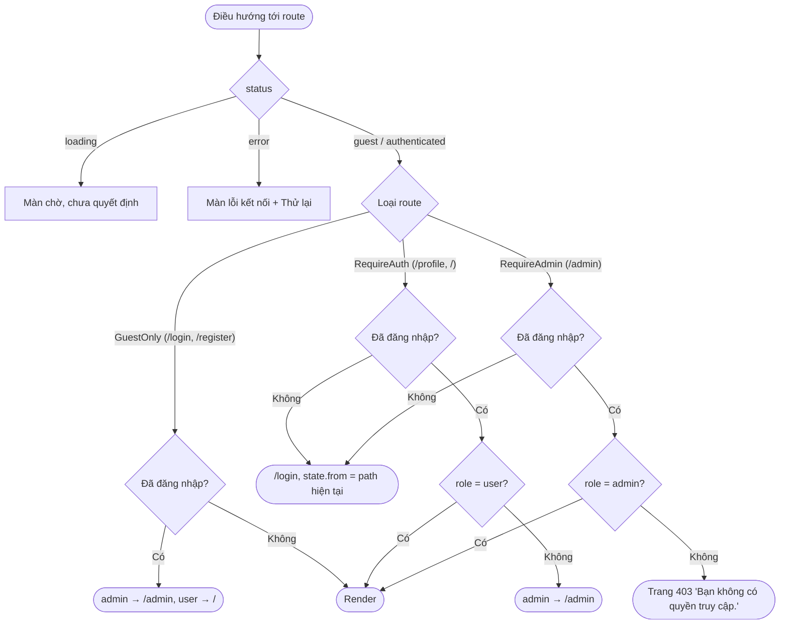

# Luồng: Điều hướng sau đăng nhập/đăng ký + route guard

> US-01 §4.2.4, §4.4, AC-08 · Chống open redirect

## 1. Sau đăng nhập / đăng ký

`isSafeInternalPath(p)`: là chuỗi, bắt đầu bằng `/`, **không** bắt đầu bằng `//` hoặc `/\`, không chứa `://`, không chứa ký tự điều khiển; không phải `/login` hoặc `/register`. Ví dụ: `/profile` ✓ · `//evil.com` ✗ · `https://evil.com` ✗ · `/\evil.com` ✗ (T-20).

## 2. Route guard

## Ghi chú
- Trang chủ `/` ở sprint 01 là placeholder cho user; admin luôn được đưa về `/admin` (admin không có hồ sơ — D-14, xem `auth-middleware.md`).
- Kiểm tra "hợp vai" tránh vòng lặp: user bị đá ra login từ `/admin` sẽ không bị đưa lại `/admin` sau khi đăng nhập.
- Sprint 01 chưa có điều kiện `profileCompleted` cho route nào (Phòng thử đồ thuộc US-05); trang chủ chỉ hiển thị banner nhắc hoàn thiện hồ sơ nếu cần.
- Thay đổi so với US-01 §4.4 (bổ sung, không mâu thuẫn): admin vào `/login`/`/register` khi đã đăng nhập → `/admin` thay vì trang chủ.
