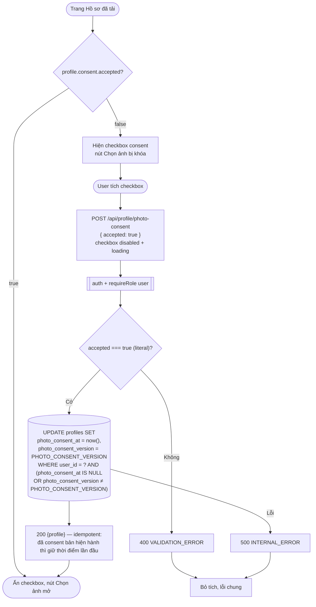

# Luồng: Ghi nhận consent ảnh

> US-02 §5.2.1, E2, AC-02 · `POST /api/profile/photo-consent` · D-10

## Ghi chú
- **Vì sao endpoint riêng** (không phải trường trong multipart upload): xem `api.md` §5.3.
- Không có endpoint rút consent (D-10). Xóa ảnh **không** xóa consent.
- `PHOTO_CONSENT_VERSION` là hằng số backend (sprint 01 = `1`) gắn với nội dung câu đồng ý trong US-02 §5.2.1. Khi Epic 3 đổi nội dung (ví dụ đổi nhà cung cấp AI), tăng version → hồ sơ có version cũ được coi là chưa consent và phải đồng ý lại.
- Bỏ tích checkbox sau khi đã đồng ý không có tác dụng (checkbox bị ẩn khi `accepted = true`).
