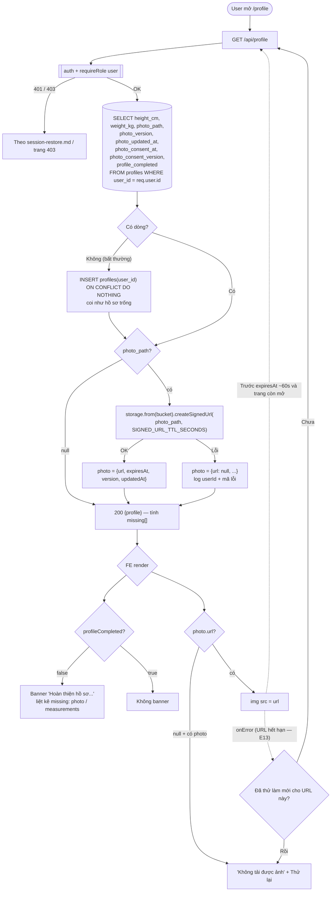

# Luồng: Lấy hồ sơ + signed URL

> US-02 §5.1, E13, AC-01, AC-10, AC-11 · `GET /api/profile` · D-09, D-12, D-14

## Ghi chú
- `user_id` luôn lấy từ token, API không nhận id từ client (AC-11).
- Frontend không bao giờ nhận `photo_path` thô hay URL public; chỉ nhận signed URL (AC-10).
- Giới hạn làm mới 1 lần / URL để tránh vòng lặp khi Storage lỗi.
- `missing[]` do backend tính (cùng hàm với `profile_completed`) để FE không tự suy luận.
