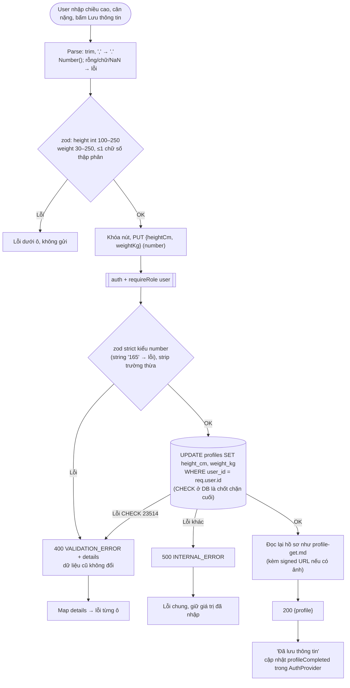

# Luồng: Lưu chiều cao / cân nặng

> US-02 §5.3, §7.2, AC-07, AC-08 · `PUT /api/profile/measurements` · D-13

## Ghi chú
- Kiểm tra "≤ 1 chữ số thập phân": `Number.isInteger(Math.round(w * 10 * 1e6) / 1e6)` hoặc so `Math.abs(w*10 - Math.round(w*10)) < 1e-9` — **không** dùng `toFixed`. `52.5` ✓, `52.55` ✗ (AC-08).
- Lưu độc lập với ảnh; luôn gửi cả 2 trường (không cho cập nhật một nửa — DB có CHECK "cả hai cùng null hoặc cùng có").
- Không log body của request này (pino `redact`: `req.body.heightCm`, `req.body.weightKg`).
