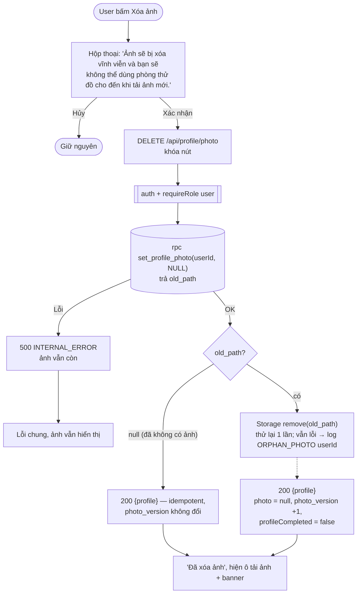

# Luồng: Xóa ảnh (Should have)

> US-02 §5.5, AC-12 · `DELETE /api/profile/photo` · D-10, D-12, D-15

## Ghi chú
- Ghi DB **trước**, xóa file **sau**: nếu làm ngược và DB lỗi, hồ sơ sẽ trỏ tới file không còn tồn tại.
- Rủi ro còn lại: Storage lỗi cả 2 lần → file mồ côi trong bucket private (không truy cập được nhưng chưa bị xóa thật). Xem câu hỏi mở về script dọn file mồ côi trong báo cáo bước 3.
- `photo_version` tăng cả khi xóa để Epic 3 vô hiệu hóa cache try-on của ảnh cũ (D-15).
- Consent giữ nguyên sau khi xóa ảnh (D-10).
