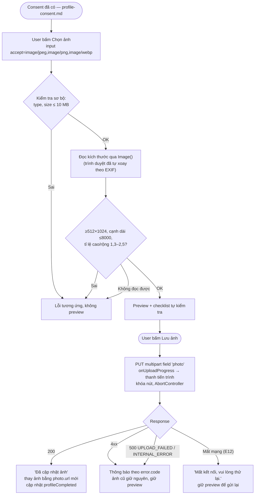
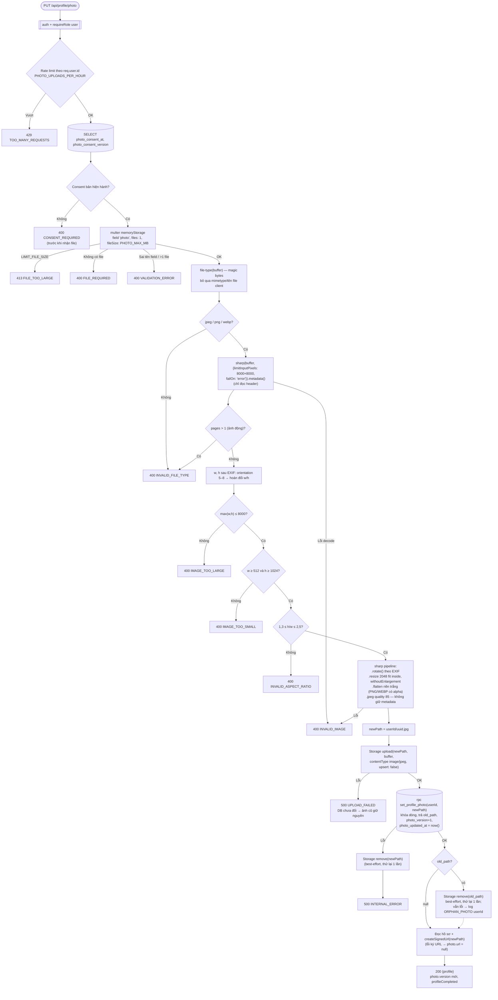

# Luồng: Tải lên / thay ảnh toàn thân

> US-02 §5.2, §7.1, E2–E12, E14–E16, AC-02 → AC-06, AC-09 · `PUT /api/profile/photo` · D-10, D-11, D-12, D-15

## 1. Frontend

Kiểm tra ở FE chỉ để phản hồi nhanh; backend kiểm tra lại toàn bộ.

## 2. Backend

## 3. Quy tắc quan trọng

| Quy tắc | Lý do |
|---|---|
| Thứ tự **upload file mới → ghi DB → xóa file cũ** | Lỗi ở bất kỳ bước nào trước khi ghi DB thì hồ sơ vẫn trỏ ảnh cũ (AC-05) |
| DB lỗi → xóa file mới vừa tải | Không để file mồ côi (E11) |
| Xóa file cũ là best-effort, **không** làm request lỗi | Ảnh mới đã có hiệu lực; trả lỗi lúc này sẽ khiến FE báo sai "ảnh cũ giữ nguyên" |
| Cập nhật đường dẫn bằng hàm SQL `set_profile_photo` (1 câu lệnh, khóa dòng) | Hai upload đồng thời: mỗi request nhận đúng `old_path` của mình → không mất dấu file nào; `photo_version` tăng nguyên tử (D-15) |
| Kiểm tra consent **trước** multer | Không nhận 10 MB vô ích; khớp AC-02 (`CONSENT_REQUIRED` ưu tiên hơn lỗi file) |
| Đọc `metadata()` (header) trước khi decode toàn ảnh | Chặn ảnh quá lớn/ảnh "bom" sớm, rẻ |
| Kích thước so sánh **sau** khi áp EXIF orientation | Ảnh dọc chụp bằng điện thoại thường lưu ngang + orientation 6 (T-25) |
| Rate limit đếm **mọi** request upload (kể cả bị từ chối) | Chống lạm dụng CPU xử lý ảnh; FE đã lọc sơ bộ nên user bình thường hiếm khi chạm ngưỡng |
| Log chỉ `userId` + mã lỗi, không log `newPath`/`old_path` | US-02 §9 |

Thứ tự ưu tiên mã lỗi khi một file sai nhiều quy tắc: `CONSENT_REQUIRED` → `FILE_TOO_LARGE` / `FILE_REQUIRED` → `INVALID_FILE_TYPE` → `INVALID_IMAGE` → `IMAGE_TOO_LARGE` → `IMAGE_TOO_SMALL` → `INVALID_ASPECT_RATIO`.
