# Luồng: Đăng ký + tự đăng nhập

> US-01 §4.1 · `POST /api/auth/register` · D-06, D-07, D-08, D-16

```mermaid
flowchart TD
  subgraph U[User]
    U1([Mở trang Đăng ký]) --> U2[Nhập email, mật khẩu, nhập lại mật khẩu]
    U2 --> U3[Bấm Đăng ký / Enter]
  end

  subgraph FE[Frontend]
    F0{Đã đăng nhập?} -- Có --> F0a[GuestOnly: chuyển về trang chủ]
    F1{"Validate zod<br/>(on blur + submit)"}
    F1 -- Lỗi --> F1a[Hiện lỗi dưới từng ô, không gửi]
    F1 -- OK --> F2["Khóa nút + loading<br/>gửi {email, password}<br/>(không gửi confirm)"]
    F3{Response}
    F3 -- "201" --> F4[Lưu token vào localStorage<br/>set user trong AuthProvider]
    F4 --> F5([Chuyển tới /profile — onboarding])
    F3 -- "400 VALIDATION_ERROR" --> F6[Map details → lỗi từng ô]
    F3 -- "409 EMAIL_ALREADY_EXISTS" --> F7["'Email này đã được đăng ký. Đăng nhập?' + link"]
    F3 -- "429 TOO_MANY_REQUESTS" --> F8[Thông báo thao tác quá nhanh]
    F3 -- "500 / mất mạng" --> F9[Lỗi chung đầu form<br/>giữ email, xóa ô mật khẩu]
    F6 & F7 & F8 & F9 --> F10[Mở khóa nút]
  end

  subgraph BE[Backend Express]
    B1{Rate limit IP<br/>/api/auth/*} -- Vượt --> B1a[429 TOO_MANY_REQUESTS]
    B1 -- OK --> B2{"zod: email trim+lowercase ≤254,<br/>password 8–72 ASCII in được,<br/>≥1 chữ + ≥1 số, ≠ email<br/>(strip trường thừa, kể cả role)"}
    B2 -- Lỗi --> B2a[400 VALIDATION_ERROR + details]
    B2 -- OK --> B3[(SELECT users WHERE email)]
    B3 --> B4{Đã tồn tại?}
    B4 -- Có --> B4a[409 EMAIL_ALREADY_EXISTS]
    B4 -- Chưa --> B5["bcrypt.hash(password, BCRYPT_COST)"]
    B5 --> B6[(INSERT users role='user' cứng)]
    B6 --> B7{Lỗi?}
    B7 -- "23505 unique<br/>(đăng ký đồng thời E8)" --> B4a
    B7 -- Lỗi khác --> B7a[500 INTERNAL_ERROR]
    B7 -- OK --> B8["Ký JWT HS256 {sub, role}<br/>exp = JWT_EXPIRES_IN"]
    B8 --> B9["201 {token, user{id,email,role,<br/>profileCompleted:false}}"]
  end

  subgraph DB[Supabase Postgres]
    D1[[Trigger trg_users_create_profile:<br/>INSERT profiles user_id]]
  end

  U1 --> F0
  F0 -- Chưa --> U2
  U3 --> F1
  F2 --> B1
  B6 -.-> D1
  B1a & B2a & B4a & B7a & B9 --> F3
```

## Ghi chú
- Kiểm tra tồn tại trước (B3) để tránh tốn bcrypt; unique constraint ở DB (B7) là chốt chặn cuối cho race condition.
- Bản ghi `profiles` rỗng tạo bằng trigger trong **cùng transaction** với INSERT `users` → luôn tồn tại 1-1 (xem `db/README.md`).
- Admin không đăng ký được qua luồng này: `role` luôn là `'user'` (AC-04); admin chỉ có từ seed (D-07).
- Lộ "email đã tồn tại" ở bước đăng ký được chấp nhận vì UX, bù bằng rate limit IP (US-01 §8).
