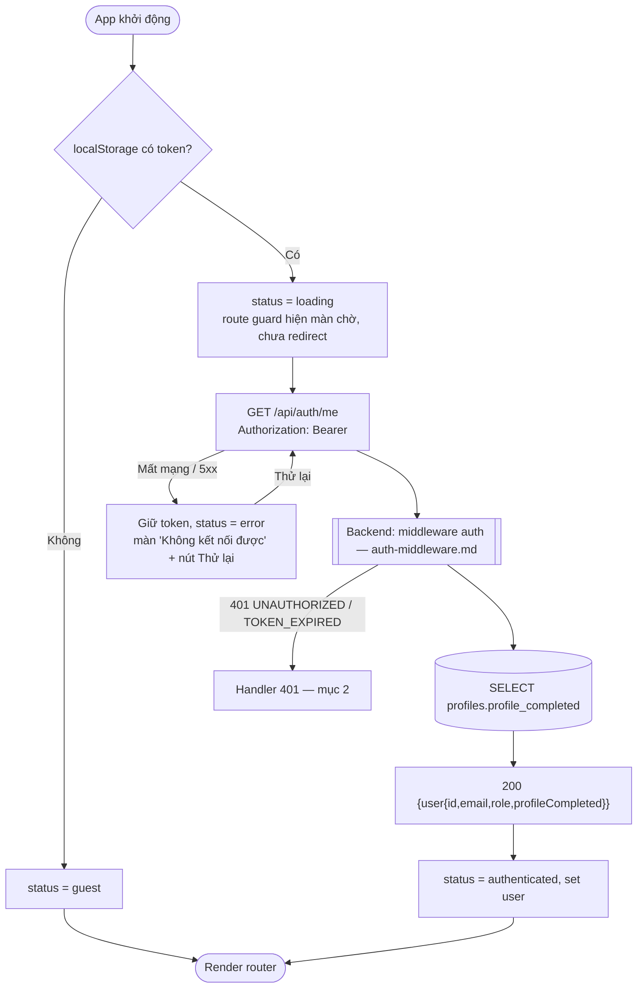
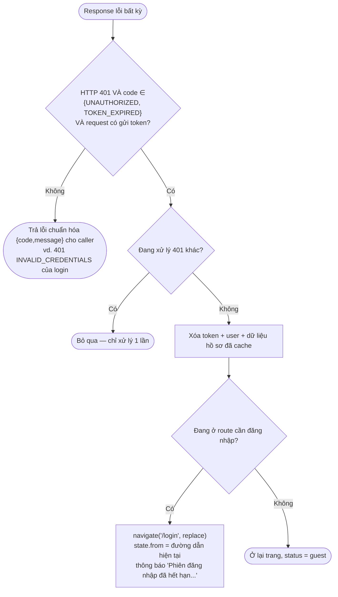

# Luồng: Khôi phục phiên (`GET /api/auth/me`) + xử lý 401 tập trung

> US-01 §4.3, AC-08, AC-11 · D-05

## 1. Khi tải / reload app

## 2. Handler 401 trong API client (một chỗ duy nhất)

## Ghi chú
- Không đăng xuất khi lỗi mạng/5xx (F6): tránh mất phiên vì mạng chập chờn.
- Nhiều request song song cùng nhận 401 → cờ `handling401` đảm bảo chỉ redirect + thông báo **một lần** (T-05).
- `state.from` được lọc theo quy tắc đường dẫn nội bộ ở `post-login-navigation.md` (AC-08: đăng nhập lại thì quay về trang đang xem).
- `GET /api/auth/me` là nguồn duy nhất cập nhật `profileCompleted` khi reload; sau các thao tác hồ sơ FE cập nhật từ response của API hồ sơ.
