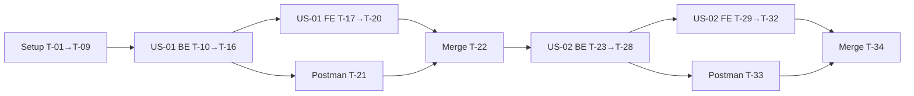

# Sprint 01 — Sprint backlog

> Epic 1: Thiết lập hồ sơ khách hàng · Stories: [US-01](US-01.md), [US-02](US-02.md) · Quyết định liên quan: D-01 → D-21 (`DECISIONS.md`)

## Mục lục
1. [Mục tiêu sprint](#1-mục-tiêu-sprint)
2. [Quy ước](#2-quy-ước)
3. [Thư viện & phiên bản đề xuất](#3-thư-viện--phiên-bản-đề-xuất)
4. [Biến môi trường](#4-biến-môi-trường)
5. [Danh sách task](#5-danh-sách-task)
6. [Thứ tự thực hiện](#6-thứ-tự-thực-hiện)
7. [Phụ thuộc vào thiết kế bước 3/4](#7-phụ-thuộc-vào-thiết-kế-bước-34)
8. [Definition of Done của sprint](#8-definition-of-done-của-sprint)
9. [Đã xác nhận](#9-đã-xác-nhận)

---

## 1. Mục tiêu sprint

User đăng ký/đăng nhập được (JWT), Admin đăng nhập bằng tài khoản seed; User cập nhật hồ sơ (ảnh toàn thân trong bucket private + chiều cao/cân nặng) và hệ thống tính `profileCompleted`.

## 2. Quy ước

| Mục | Quy ước |
|---|---|
| Ước lượng | **S** ≤ 2 giờ · **M** nửa ngày · **L** ~1 ngày (thời gian agent làm + user kiểm tra) |
| Branch | Setup: `chore/sprint-01-setup` (D-17) · US-01: `feature/US-01-auth` · US-02: `feature/US-02-profile`. Tạo bằng `/branch` từ `main` mới nhất |
| Merge | Chỉ `/merge` vào `main` khi unit test + Postman test của story pass **và user xác nhận**; ghi vào `PROGRESS.md` |
| Thứ tự trong story | Migration → Backend → Unit test BE → Frontend → Test FE → Postman → Merge |
| Trạng thái | `[ ]` chưa làm · `[x]` xong |

## 3. Thư viện & phiên bản đề xuất

Phiên bản mới nhất trên npm tại 2026-11-04. agent-coder vẫn phải tra Context7 trước khi dùng (đặc biệt Tailwind v4 + Vite, React Router, Express 5, Zod 4).

**Runtime:** Node.js 24 LTS. Backend dùng **ESM** (`"type": "module"`) vì `file-type` chỉ hỗ trợ ESM.

### Backend (`backend/`)

| Thư viện | Phiên bản | Mục đích |
|---|---|---|
| `express` | 5.3.x | REST API; Express 5 tự chuyển lỗi async tới error handler |
| `@supabase/supabase-js` | 2.118.x | DB + Storage bằng service role key |
| `bcrypt` | 6.0.x | Hash mật khẩu (D-01, D-06). Dự phòng: `bcryptjs` nếu không cài được bản native trên Windows |
| `jsonwebtoken` | 9.0.x | Ký/kiểm tra JWT HS256 (D-05) |
| `zod` | 4.x | Validate body + validate biến môi trường khi khởi động |
| `multer` | 2.5.x | Nhận `multipart/form-data`, `memoryStorage`, `limits.fileSize` 10 MB |
| `file-type` | 22.x | Xác định định dạng thật bằng magic bytes (D-12) |
| `sharp` | 0.35.x | Đọc kích thước, xoay EXIF, xóa metadata, resize 2048 px, xuất JPEG; đặt `limitInputPixels` chống ảnh "bom" |
| `express-rate-limit` | 8.x | Rate limit theo IP cho `/api/auth/*`, theo user cho upload ảnh |
| `helmet` | 8.x | Header bảo mật |
| `cors` | 2.8.x | Chỉ cho phép `CORS_ORIGIN` |
| `pino` + `pino-http` | 10.x | Log có `redact` (`authorization`, `password`, số đo) — Should |
| `pg` | 8.x | Chỉ dùng trong script migrate (D-19) |
| Dev: `vitest` 5.x, `supertest` 7.x | | Unit/integration test (mock Supabase ở tầng service) |

Không cần `dotenv`/`nodemon`: dùng `node --env-file-if-exists=.env --watch` của Node 24.

### Frontend (`frontend/`)

| Thư viện | Phiên bản | Mục đích |
|---|---|---|
| `vite` | 8.x | Build/dev server |
| `react`, `react-dom` | 19.x | UI |
| `react-router` | 8.x | Routing, route guard |
| `tailwindcss` + `@tailwindcss/vite` | 4.3.x | Styling (v4: plugin Vite, không cần `tailwind.config.js`/PostCSS) |
| `zod` | 4.x | Cùng bộ quy tắc validation với backend |
| `axios` (D-18) | 1.x | API client duy nhất: gắn JWT, xử lý 401 tập trung, có `onUploadProgress` cho thanh tiến trình tải ảnh |
| Dev: `vitest`, `@testing-library/react`, `@testing-library/user-event`, `jsdom` | | Test validation, route guard, API client |

### Công cụ khác
- Supabase project (dashboard) · Postman (MCP) · Git.
- Chạy migration (D-19): script `backend/scripts/migrate.js` dùng `pg` + `DATABASE_URL`, có bảng `schema_migrations`.

## 4. Biến môi trường

### `backend/.env.example`

| Biến | Ví dụ | Ghi chú |
|---|---|---|
| `NODE_ENV` | `development` | |
| `PORT` | `4000` | |
| `CORS_ORIGIN` | `http://localhost:5173` | Origin frontend |
| `SUPABASE_URL` | `https://<ref>.supabase.co` | |
| `SUPABASE_SERVICE_ROLE_KEY` | `<service-role-key>` | Chỉ backend, không commit |
| `DATABASE_URL` | `postgresql://...` | Chỉ cho script migrate (D-19) |
| `JWT_SECRET` | `<≥32 ký tự ngẫu nhiên>` | Validate độ dài khi khởi động |
| `JWT_EXPIRES_IN` | `7d` | D-05 |
| `BCRYPT_COST` | `10` | ≥ 10 (D-06) |
| `LOGIN_MAX_FAILS` / `LOGIN_LOCK_MINUTES` | `5` / `15` | D-06 |
| `AUTH_RATE_LIMIT_PER_MIN` | `20` | Theo IP cho `/api/auth/*` |
| `PROFILE_PHOTO_BUCKET` | `profile-photos` | Bucket private (D-03) |
| `PHOTO_MAX_MB` | `10` | D-11 |
| `PHOTO_UPLOADS_PER_HOUR` | `10` | Theo user |
| `SIGNED_URL_TTL_SECONDS` | `900` | 15 phút (D-12) |
| `ADMIN_EMAIL` / `ADMIN_PASSWORD` | `admin@tryon.local` / `<mạnh>` | Chỉ dùng cho seed (D-07) |

### `frontend/.env.example`

| Biến | Ví dụ |
|---|---|
| `VITE_API_URL` | `http://localhost:4000/api` |

Frontend **không** có biến Supabase nào (D-02).

## 5. Danh sách task

### 5.1 Setup (branch `chore/sprint-01-setup`)

| ID | Task | Story | Phụ thuộc | Ước lượng | Definition of Done | TT |
|---|---|---|---|---|---|---|
| T-01 | `git init` với nhánh mặc định `main`; `.gitignore` (node_modules, `.env`, dist, coverage); commit khởi tạo | — | — | S | `git status` sạch; `.env` bị ignore | [x] |
| T-02 | **(User làm, agent hướng dẫn)** Tạo Supabase project; điền project ref/token vào `.mcp.json`; lấy URL, service role key, `DATABASE_URL` vào `backend/.env` | — | — | S | Supabase MCP (read-only) `list_tables` chạy được | [x] |
| T-03 | Scaffold `backend/`: Express 5 ESM; cấu trúc `src/{config,routes,controllers,services,middlewares,utils}`; `config/env.js` validate env bằng zod (thiếu/sai → không khởi động); client Supabase dùng chung; helmet, cors, JSON body limit; helper response `{ success, data }` / `{ success:false, error:{code,message} }`; error handler (ẩn stack ở production, map lỗi multer/zod); 404 handler; `GET /api/health` | — | T-01 | M | `npm run dev` chạy; `/api/health` trả `{ success:true }`; route lạ trả 404 đúng format; unit test error handler | [x] |
| T-04 | Scaffold `frontend/`: Vite + React + Tailwind v4 (`@tailwindcss/vite`) + React Router; cấu trúc `src/{features,components,pages,services,routes}`; layout rỗng, trang Home placeholder | — | T-01 | M | `npm run dev` hiển thị trang có class Tailwind; `npm run build` pass | [x] |
| T-05 | `services/apiClient`: base URL `VITE_API_URL`, gắn `Authorization: Bearer`, chuẩn hóa lỗi về `{ code, message }`, hook xử lý 401 tập trung (logic điều hướng cắm vào ở T-16) | US-01 | T-04 | S | Unit test: gắn header khi có token; 401 gọi handler đúng 1 lần | [x] |
| T-06 | `backend/.env.example`, `frontend/.env.example` (mục 4); cập nhật lệnh `dev/test/build/migrate/seed` vào `CLAUDE.md` | — | T-03, T-04 | S | Đủ biến mục 4, không chứa giá trị thật | [x] |
| T-07 | Thư mục `migrations/` + script `backend/scripts/migrate.js` (D-19, thiết kế ở `design/db/README.md` mục 7) | — | T-02, T-03 | S | Chạy 2 lần liên tiếp không lỗi, không chạy lại file đã áp dụng *(đã viết runner + unit test logic; chưa chạy với DB thật do thiếu `DATABASE_URL`)* | [x] |
| T-08 | Cấu hình test: Vitest + Supertest (BE), Vitest + Testing Library + jsdom (FE); script `npm test`; sinh **ảnh fixture** bằng sharp (`backend/tests/fixtures/`): JPG 1080×1920 có EXIF GPS + orientation, PNG, WEBP, 400×800, 1920×1080, cạnh 9000 px, file > 10 MB, `.exe` đổi đuôi `.jpg`, file JPEG hỏng | — | T-03, T-04 | M | `npm test` chạy được ở 2 thư mục; fixture tái tạo được bằng script | [x] |
| T-09 | Postman: workspace, collection `Try-on API` (folder `Auth`, `Profile`), environment `local` (`baseUrl`, `userToken`, `adminToken`, `email` ngẫu nhiên) | — | T-03 | S | Request `/api/health` có test pass *(đã tạo workspace `Try-on` `a351cb34-487c-4e4a-b6c8-1c616e8ddb50`, collection `478c6b9e-13c1-42f1-ad2b-724790e10e37`, env `local` `992b1ad8-9e5c-4786-a982-42b9fc044eac`; chưa chạy collection bằng runner)* | [x] |

### 5.2 US-01 — Đăng ký & đăng nhập (branch `feature/US-01-auth`)

| ID | Task | Phụ thuộc | Ước lượng | Definition of Done | TT |
|---|---|---|---|---|---|
| T-10 | Migration `001_create_users.sql` (bảng user: email lowercase unique, password_hash, role `user`/`admin`, timestamps; RLS bật, không policy cho anon) theo ERD bước 3 | T-07, **thiết kế DB** | S | Bảng tạo trên Supabase; unique email chặn trùng (E8) | [x] |
| T-11 | Script seed admin `backend/scripts/seed-admin.js` từ `ADMIN_EMAIL`/`ADMIN_PASSWORD` (idempotent, hash bcrypt, role `admin`) | T-10 | S | Chạy 2 lần không tạo trùng; admin đăng nhập được | [x] |
| T-12 | Schema validation zod cho đăng ký/đăng nhập (email chuẩn hóa, mật khẩu 8–72 ký tự ASCII in được, chữ + số, không trùng email; bỏ trường thừa kể cả `role`) — cùng bộ quy tắc ở FE | **API contract** | S | Unit test các biên: 7/8/72/73 ký tự, thiếu số, có chữ có dấu/emoji (bị từ chối), trùng email khác hoa thường | [x] |
| T-13 | `services/auth`: hash/compare bcrypt, ký/verify JWT (`sub`, `role`, `iat`, `exp`), register (bắt lỗi unique → `EMAIL_ALREADY_EXISTS`), login (`INVALID_CREDENTIALS` chung cho 2 trường hợp, so sánh hash giả khi email không tồn tại để thời gian phản hồi tương đương) | T-10, T-12 | M | Response không bao giờ chứa `password_hash` | [x] |
| T-14 | Khóa đăng nhập theo email (in-memory, 5 lần sai/15 phút, reset khi đăng nhập đúng, trả số phút còn lại) + `express-rate-limit` theo IP cho `/api/auth/*` | T-13 | S | Lần thứ 6 (kể cả đúng mật khẩu) → 429 `TOO_MANY_ATTEMPTS` | [x] |
| T-15 | Middleware `auth` (thiếu/sai → `UNAUTHORIZED`, hết hạn → `TOKEN_EXPIRED`, user không còn → 401) và `requireRole('admin')`; routes `POST /api/auth/register`, `POST /api/auth/login`, `GET /api/auth/me` (có `profileCompleted`, sprint này trả `false` cho tới khi có US-02); `GET /api/admin/ping` để kiểm AC-10 | T-13, T-14 | M | Khớp API contract; AC-04, AC-05, AC-06, AC-10 pass qua Supertest | [x] |
| T-16 | Unit test BE tập trung rủi ro: không tự gán `role`; email hoa/thường + khoảng trắng; đăng ký đồng thời cùng email; token sai chữ ký/hết hạn/`alg: none`; user bị xóa còn token; bộ đếm khóa hết hạn đúng lúc | T-15 | M | Pass; không test trivia (getter, mapping đơn giản) | [x] |
| T-17 | FE: `AuthProvider` (token trong `localStorage`, khôi phục phiên bằng `/auth/me`), route guard `RequireAuth`/`RequireAdmin`/`GuestOnly`, nối handler 401 (xóa token → Login + thông báo hết phiên + lưu trang đích), hàm lọc redirect chỉ nhận đường dẫn nội bộ | T-05, T-15 | M | AC-08, AC-09, AC-11 thủ công pass | [x] |
| T-18 | FE: trang **Đăng ký** (validate on blur + submit, checklist độ mạnh, hiện/ẩn mật khẩu, nhập lại mật khẩu, chặn gửi trùng, lỗi 409 kèm link Đăng nhập, giữ dữ liệu khi lỗi mạng trừ mật khẩu) → chuyển tới trang Hồ sơ | T-17, **màn hình bước 4** | M | AC-01, AC-02, AC-03 trên UI; responsive ≥ 360 px | [x] |
| T-19 | FE: trang **Đăng nhập** + điều hướng sau đăng nhập (trang đích → admin placeholder → Hồ sơ nếu chưa đủ → Home); hiển thị 401/429; nút Đăng xuất ở header; trang Admin placeholder; trang Hồ sơ placeholder (thay ở US-02) | T-17, **màn hình bước 4** | M | AC-05 → AC-10 trên UI | [x] |
| T-20 | Test FE: schema validation dùng chung bảng case với T-12; lọc redirect (`//evil.com`, `https://…`, `/profile`); handler 401 | T-17 → T-19 | S | Pass | [x] |
| T-21 | Postman folder `Auth`: register (ok, 409, 400, có `role:admin`), login (ok user/admin lưu token vào env, 401 email lạ, 401 sai mật khẩu, 429 sau 5 lần), `me` (ok, không token, token rởm), `admin/ping` (user 403, admin 200) | T-15, T-09 | M | Toàn bộ test pass trên Supabase dev | [x] |
| T-22 | Review + user xác nhận → `/merge` vào `main`, ghi `PROGRESS.md` | T-16, T-20, T-21 | S | `main` có US-01, test pass sau merge | [x] |

### 5.3 US-02 — Hồ sơ: ảnh & số đo (branch `feature/US-02-profile`, tạo sau T-22)

| ID | Task | Phụ thuộc | Ước lượng | Definition of Done | TT |
|---|---|---|---|---|---|
| T-23 | Migration `002_create_profiles.sql` (1-1 với user: chiều cao int, cân nặng numeric(4,1), CHECK theo D-13, đường dẫn ảnh, phiên bản/thời điểm cập nhật ảnh (D-15), thời điểm consent (D-10); RLS bật) + script `backend/scripts/setup-storage.js` tạo bucket private `profile-photos` qua Storage API (giới hạn 10 MB, MIME jpeg) theo `design/db/README.md` | T-22, **thiết kế DB/Storage** | S | Bucket private; truy cập URL public bị từ chối (AC-10) | [x] |
| T-24 | Middleware upload: multer `memoryStorage`, 1 file, `fileSize` 10 MB → `FILE_TOO_LARGE` (413), thiếu file → `FILE_REQUIRED` | T-03 | S | Map lỗi multer đúng mã ở error handler | [x] |
| T-25 | `services/image`: `file-type` (chỉ jpeg/png/webp, còn lại `INVALID_FILE_TYPE`) → sharp `limitInputPixels` + `rotate()` theo EXIF → kiểm ≥ 512×1024, cạnh dài ≤ 8000, tỉ lệ 1,3–2,5 (sau xoay) → resize 2048 → JPEG không metadata; lỗi decode → `INVALID_IMAGE` | T-24, T-08 | M | Ảnh đầu ra không còn EXIF/GPS; ảnh xoay 90° được đánh giá đúng chiều | [x] |
| T-26 | `services/storage` (upload tên ngẫu nhiên `<userId>/<uuid>.jpg`, xóa, signed URL TTL env) + `services/profile`: lấy hồ sơ (kèm signed URL), ghi consent, lưu số đo, upload ảnh (upload mới → cập nhật DB → xóa ảnh cũ; DB lỗi → xóa file mới; Storage lỗi → giữ ảnh cũ), xóa ảnh, tính `profileCompleted`; cập nhật `/auth/me` dùng chung hàm tính | T-23, T-25 | L | E10, E11 không để lại file mồ côi; không log số đo/đường dẫn ảnh | [x] |
| T-27 | Routes hồ sơ theo API contract (chỉ thao tác trên `sub` của token, không nhận id user), validation số đo (int 100–250; 30–250, ≤ 1 chữ số thập phân), consent, rate limit 10 upload/user/giờ → `TOO_MANY_REQUESTS` | T-26, **API contract** | M | AC-02, AC-06 → AC-12 qua Supertest | [x] |
| T-28 | Unit test BE tập trung rủi ro: bộ fixture ảnh (T-08) → đúng mã lỗi; EXIF bị xóa; ảnh xoay EXIF; `52.55` bị từ chối, `52.5` nhận; upload khi chưa consent; lỗi Storage/DB giữa chừng (mock) → không file mồ côi, ảnh cũ còn; user X không chạm hồ sơ user Y | T-27 | M | Pass | [x] |
| T-29 | FE trang **Hồ sơ**: tải hồ sơ, banner "Hoàn thiện hồ sơ" liệt kê phần thiếu, form chiều cao/cân nặng (`inputmode`, nhận `,` và `.`), lưu độc lập với ảnh; cập nhật `profileCompleted` trong `AuthProvider` | T-27, **màn hình bước 4** | M | AC-01, AC-07, AC-08, AC-09 trên UI | [x] |
| T-30 | FE tải ảnh: checkbox consent khóa nút chọn ảnh lần đầu, hướng dẫn + ảnh minh họa đúng/sai, kiểm tra sơ bộ (loại, dung lượng, kích thước/tỉ lệ đọc qua `Image`), xem trước + checklist tự kiểm tra, thanh tiến trình, giữ ảnh xem trước khi mất mạng, ảnh lỗi tải (signed URL hết hạn) → tự gọi lại API hồ sơ | T-29 | L | AC-02 → AC-06 trên UI, mobile chọn được thư viện/camera | [x] |
| T-31 | FE xóa ảnh (Should): hộp thoại xác nhận, cập nhật trạng thái | T-30 | S | AC-12 trên UI | [x] |
| T-32 | Test FE: parse số đo (`52,5` → 52.5, `52.55`, rỗng, chữ); kiểm tra sơ bộ ảnh; làm mới signed URL khi ảnh lỗi | T-29 → T-31 | S | Pass | [x] |
| T-33 | Postman folder `Profile`: get hồ sơ trống; lưu số đo (ok, biên sai); upload chưa consent; consent; upload từng fixture (đúng mã lỗi); upload hợp lệ → `profileCompleted`; mở URL public của file → bị từ chối; thay ảnh; xóa ảnh; không token → 401 | T-27, T-09 | M | Toàn bộ test pass | [x] |
| T-34 | Review + user xác nhận → `/merge` vào `main`, ghi `PROGRESS.md`; main agent chạy `/wrap-up` | T-28, T-32, T-33 | S | `main` có US-02, toàn bộ test sprint pass | [x] |

**Tổng:** 34 task — Setup 9, US-01 13, US-02 12.

## 6. Thứ tự thực hiện

1. T-01 → T-02 (user) → T-03, T-04 song song → T-05 → T-06 → T-07 → T-08 → T-09.
2. US-01: T-10 → T-11 → T-12 → T-13 → T-14 → T-15 → T-16 → (T-17 → T-18, T-19 → T-20) song song T-21 → T-22.
3. US-02: T-23 → T-24 → T-25 → T-26 → T-27 → T-28 → (T-29 → T-30 → T-31 → T-32) song song T-33 → T-34.

Mọi task thuộc bước 5 (implement), chỉ bắt đầu sau khi bước 3 (thiết kế nghiệp vụ) và bước 4 (UI/UX) được user xác nhận. Riêng T-01 → T-03, T-05 → T-09 không phụ thuộc thiết kế, nhưng theo D-20 vẫn làm sau bước 4.

## 7. Phụ thuộc vào thiết kế bước 3/4

| Tài liệu | Bước | Task cần |
|---|---|---|
| `design/flows/register.md`, `login.md`, `auth-middleware.md`, `session-restore.md`, `logout.md`, `post-login-navigation.md` | 3 | T-13 → T-19 |
| `design/flows/profile-get.md`, `profile-consent.md`, `profile-photo-upload.md`, `profile-measurements.md`, `profile-photo-delete.md` | 3 | T-25 → T-31 |
| `design/api.md`: endpoints auth, `me`, `admin/ping`, hồ sơ; consent là endpoint riêng `POST /api/profile/photo-consent`; mã lỗi | 3 | T-12, T-15, T-21, T-27, T-33 |
| `design/db/README.md` + `001_create_users.sql`, `002_create_profiles.sql`: ERD, schema `users`, `profiles` (tách 2 bảng), index, RLS, bucket `profile-photos` + cấu trúc đường dẫn | 3 | T-10, T-11, T-23, T-26 |
| `design/design-system.md` (Stitch MCP, sprint đầu) | 4 | T-04 (token Tailwind), T-18 → T-19, T-29 → T-31 |
| `screens/`: Đăng ký, Đăng nhập, Hồ sơ (trống / có ảnh / lỗi / đang tải), header + Đăng xuất, Admin placeholder; ảnh minh họa ảnh đúng/sai | 4 | T-18, T-19, T-29 → T-31 |

## 8. Definition of Done của sprint

- [ ] Toàn bộ AC của US-01 (AC-01 → AC-11) và US-02 (AC-01 → AC-12) đạt, kiểm bằng test hoặc thủ công trên UI.
- [ ] Unit test tập trung edge case/rủi ro thật (bảo mật, validation biên, rollback upload, phân quyền); không có test trivia. `npm test` pass ở `backend/` và `frontend/`.
- [ ] Postman collection `Try-on API` (Auth + Profile) pass trên environment `local` với Supabase dev.
- [ ] Không có secret trong repo; `.env.example` đầy đủ; frontend không chứa key Supabase.
- [ ] Bucket `profile-photos` private; ảnh chỉ xem qua signed URL; log không chứa mật khẩu, token, số đo, đường dẫn ảnh.
- [ ] Migration trong `migrations/` khớp ERD sprint; seed admin chạy được.
- [ ] Mỗi story nằm trên branch riêng, merge vào `main` **sau khi user xác nhận**; `PROGRESS.md` ghi merge log; `CLAUDE.md` có lệnh dev/test/build/migrate/seed.
- [ ] Giao diện dùng được ở 360 px và desktop, thông báo lỗi tiếng Việt.

## 9. Đã xác nhận

User duyệt theo đề xuất ngày 2026-11-04 (ghi trong `DECISIONS.md`).

| # | Câu hỏi | Quyết định | Mã |
|---|---|---|---|
| Q1 | Task setup làm trên branch nào? | Branch `chore/sprint-01-setup`, merge vào `main` sau khi user xác nhận | D-17 |
| Q2 | API client: `axios` hay `fetch`? | `axios` (1 client, có `onUploadProgress` cho thanh tiến trình tải ảnh) | D-18 |
| Q3 | Chạy migration thế nào? | Script Node `backend/scripts/migrate.js` + `pg` + `DATABASE_URL`, bảng `schema_migrations`, chạy file `migrations/NNN_*.sql` theo thứ tự | D-19 |
| Q4 | Giới hạn 72 byte của bcrypt với chữ có dấu | Mật khẩu chỉ gồm ký tự ASCII in được, 8–72 ký tự (đã cập nhật US-01 mục 6) | D-06 |
| Q5 | Làm setup sớm song song bước 3/4? | Không — giữ đúng thứ tự quy trình | D-20 |
| Q6 | Validation dùng chung FE/BE | Chép schema zod ở 2 nơi + test cùng bảng case (T-12, T-20); không tạo `shared/` | D-21 |
