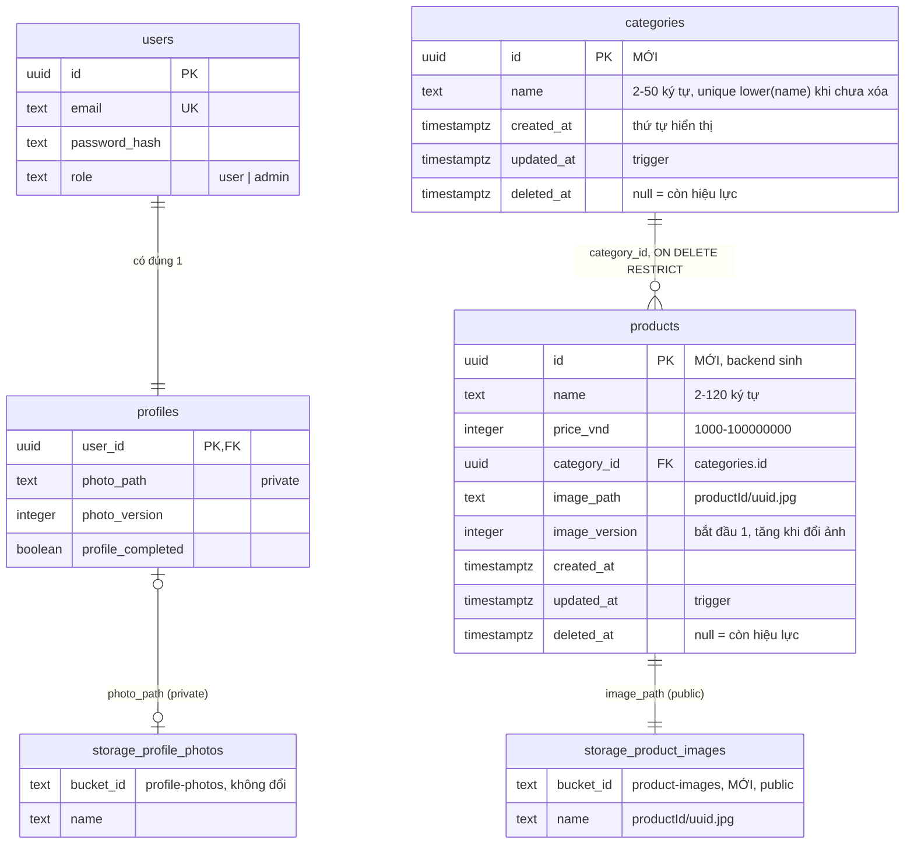

# Sprint 02 — Database & Storage

> Stories: US-03, US-04 · Quyết định: D-41 → D-55 · SQL: [`003_create_categories.sql`](003_create_categories.sql), [`004_create_products.sql`](004_create_products.sql)

**Kế thừa sprint 01:** [`sprint-01/design/db/README.md`](../../../sprint-01/design/db/README.md). Bảng `users`, `profiles`, `schema_migrations`, bucket `profile-photos` **không đổi**.

## Mục lục
1. [ERD](#1-erd)
2. [Thay đổi so với sprint 01](#2-thay-đổi-so-với-sprint-01)
3. [Schema](#3-schema)
4. [Hàm SQL](#4-hàm-sql)
5. [Index](#5-index)
6. [Bảo mật DB](#6-bảo-mật-db)
7. [Supabase Storage](#7-supabase-storage)
8. [Migration & setup](#8-migration--setup)
9. [Trade-off đã cân nhắc](#9-trade-off-đã-cân-nhắc)

---

## 1. ERD

Bảng đánh dấu `MỚI` là của sprint này; `users`, `profiles` giữ nguyên, chỉ liệt kê cột chính.



`schema_migrations` không liên kết bảng khác, không vẽ lại.

## 2. Thay đổi so với sprint 01

| Hạng mục | Thay đổi | Lý do |
|---|---|---|
| Bảng | Thêm `categories`, `products` | US-03, US-04 |
| Hàm | Thêm `list_categories_with_counts`, `soft_delete_category`, `create_product`, `update_product` | Thao tác nhiều bước cần nguyên tử |
| Bucket | Thêm `product-images` (**public**) | Xem mục 7 |
| Script | `setup-storage` tạo 2 bucket thay vì 1 | D-26 mở rộng, không đổi cấu hình bucket cũ |
| API contract | Điều khoản "không bao giờ trả URL public của Storage" (sprint-01 `api.md` mục 1) nay chỉ áp dụng cho ảnh người dùng | Ảnh sản phẩm không phải dữ liệu cá nhân |

## 3. Schema

SQL đầy đủ ở 2 file `.sql` cạnh tài liệu này. Đã chạy thử trên PGlite (PostgreSQL trong bộ nhớ, một kết nối) cùng migration 001, 002: tạo bảng, seed, hàm, ràng buộc, quyền đều đúng. **Chưa** kiểm tra được khóa đồng thời (để T-54).

### 3.1 `public.categories` (mới)

| Cột | Kiểu | Null | Default | Ràng buộc |
|---|---|---|---|---|
| `id` | `uuid` | không | `gen_random_uuid()` | PK |
| `name` | `text` | không | | CHECK đã trim; độ dài 2–50; UNIQUE một phần trên `lower(name)` khi `deleted_at is null` |
| `created_at` | `timestamptz` | không | `now()` | Dùng để sắp xếp |
| `updated_at` | `timestamptz` | không | `now()` | Trigger `trg_categories_updated_at` |
| `deleted_at` | `timestamptz` | có | | Xóa mềm |

**Seed:** Áo thun, Váy, Quần Jeans, `created_at` lệch nhau 1 giây để giữ thứ tự.

**`lower()` với tiếng Việt:** đã kiểm tra trên Supabase dev (PG 17.11, `en_US.UTF-8`): `lower('ÁO THUN QUẦN VÁY')` = `áo thun quần váy`. Backend chuẩn hóa NFC trước khi ghi, nếu không `Á` dựng sẵn và `Á` tổ hợp sẽ không bị coi là trùng.

### 3.2 `public.products` (mới)

| Cột | Kiểu | Null | Default | Ràng buộc |
|---|---|---|---|---|
| `id` | `uuid` | không | `gen_random_uuid()` | PK. Backend truyền vào vì đường dẫn ảnh chứa id |
| `name` | `text` | không | | CHECK đã trim; độ dài 2–120. Không unique |
| `price_vnd` | `integer` | không | | CHECK 1.000 – 100.000.000 |
| `category_id` | `uuid` | không | | FK → `categories.id` `ON DELETE RESTRICT` |
| `image_path` | `text` | không | | Regex `<uuid>/<uuid>.jpg`, tiền tố đúng `id` |
| `image_version` | `integer` | không | `1` | CHECK ≥ 1 |
| `created_at`, `updated_at` | `timestamptz` | không | `now()` | Trigger `trg_products_updated_at` |
| `deleted_at` | `timestamptz` | có | | Xóa mềm |

**Vì sao `integer` cho giá:** VND không có phần lẻ; số nguyên tránh sai số dấu phẩy động và khỏi xử lý `numeric` trả về dạng chuỗi. Trần `integer` (~2,1 tỷ) xa hơn nhiều so với giá tối đa. Epic 4 tính tổng giỏ hàng ở JS (an toàn tới 2^53) và nên dùng `bigint` cho cột tổng tiền của đơn.

**Khóa cache try-on cho Epic 3:** `userId + photoVersion + productId + imageVersion`. Cụ thể hóa ghi chú `productImageId` ở sprint 01, dùng cặp `productId + imageVersion`.

## 4. Hàm SQL

Tất cả `set search_path = ''`, chỉ `service_role` được gọi. Trả **trạng thái** thay vì `raise`, để backend map sang mã lỗi không phải phân tích thông báo lỗi.

| Hàm | Trả về | Mục đích |
|---|---|---|
| `list_categories_with_counts()` | `id, name, created_at, updated_at, product_count` | Danh sách danh mục kèm đếm sản phẩm chưa xóa |
| `soft_delete_category(p_id)` | `out_status` (`ok` / `not_found` / `has_products`), `out_product_count` | `FOR UPDATE` danh mục → đếm → xóa mềm |
| `create_product(p_id, p_name, p_price_vnd, p_category_id, p_image_path)` | `out_status` (`ok` / `category_not_found`) | `FOR SHARE` danh mục → insert |
| `update_product(p_id, p_name, p_price_vnd, p_category_id, p_new_image_path)` | `out_status` (`ok` / `not_found` / `category_not_found`), `out_old_image_path` | `FOR UPDATE` sản phẩm → kiểm danh mục nếu đổi → update. Tham số null = giữ nguyên |

**Cách khóa chặn tranh chấp xóa danh mục / tạo sản phẩm:** hai thao tác cùng khóa dòng danh mục, nên chạy nối tiếp. Nếu tạo sản phẩm đi trước, lệnh xóa chờ rồi đếm thấy sản phẩm mới. Nếu xóa đi trước, lệnh tạo chờ rồi kiểm tra lại điều kiện `deleted_at is null` và không thấy dòng.

Các thao tác không cần hàm riêng, gọi trực tiếp qua supabase-js: thêm/đổi tên danh mục, xóa mềm sản phẩm (`update … where id = ? and deleted_at is null`), đọc danh sách và chi tiết sản phẩm.

## 5. Index

| Bảng | Index | Phục vụ |
|---|---|---|
| `categories` | PK `id` | Mọi thao tác theo id, kiểm tra FK |
| `categories` | UNIQUE một phần `categories_name_active_key (lower(name)) where deleted_at is null` | Chặn trùng tên, kể cả race |
| `products` | PK `id` | Chi tiết, sửa, xóa |
| `products` | `products_active_created_idx (created_at desc, id desc) where deleted_at is null` | Danh sách admin không lọc; dự kiến dùng cho Epic 3 |
| `products` | `products_active_category_created_idx (category_id, created_at desc, id desc) where deleted_at is null` | Lọc theo danh mục, đếm sản phẩm, Epic 3 lấy "sản phẩm đầu tiên" |

Không có index tìm kiếm tên vì sprint này không có tìm kiếm.

## 6. Bảo mật DB

Giống sprint 01 (D-27): bật RLS không policy trên `categories`, `products`; `revoke all` với `anon`, `authenticated`; grant tường minh cho `service_role`; `revoke execute` các hàm mới với `public`, `anon`, `authenticated`.

Epic 3 đọc catalog **qua backend**, không mở policy đọc công khai cho 2 bảng này (D-02).

Kiểm tra sau migration (T-35): `get_advisors` loại security không có cảnh báo mới; `GET {SUPABASE_URL}/rest/v1/products` và `POST /rest/v1/rpc/create_product` bằng anon key bị từ chối.

## 7. Supabase Storage

### 7.1 Bucket mới

| Thuộc tính | Giá trị |
|---|---|
| Tên | `product-images` (env `PRODUCT_IMAGE_BUCKET`) |
| `public` | **`true`** |
| `fileSizeLimit` | `PRODUCT_IMAGE_MAX_MB` (10 MB, lưới an toàn; ảnh sau xử lý nhỏ hơn nhiều) |
| `allowedMimeTypes` | `['image/jpeg']` |
| Tạo bằng | `npm run setup:storage`, idempotent (D-26) |

### 7.2 Đường dẫn

```
product-images/
  <product_id>/
    <uuid v4>.jpg
```

Upload: `contentType: 'image/jpeg'`, `upsert: false`, `cacheControl: PRODUCT_IMAGE_CACHE_SECONDS`. Tên file mới mỗi lần nên không bao giờ hiển thị nhầm ảnh cũ, dù cache dài.

DB chỉ lưu `image_path`. URL do backend dựng bằng `getPublicUrl` tại thời điểm trả API, nên đổi bucket hoặc đổi sang CDN khác không phải sửa dữ liệu.

### 7.3 Chính sách truy cập

| Ai | Quyền | Cách |
|---|---|---|
| Backend (`service_role`) | Upload, remove | Bỏ qua RLS |
| Bất kỳ ai có URL | Đọc file | Bucket public |
| `anon`, `authenticated` | Không upload, xóa, liệt kê được | **Không tạo policy** trên `storage.objects`. Theo tài liệu Supabase, bucket public chỉ bỏ kiểm soát khi đọc file; upload, xóa, di chuyển vẫn bị kiểm soát |

### 7.4 Vòng đời file

| Sự kiện | File |
|---|---|
| Thêm sản phẩm lỗi sau khi upload | Xóa file mới |
| Thay ảnh thành công | Xóa file cũ, best-effort, lỗi thì log `ORPHAN_PRODUCT_IMAGE` |
| Thay ảnh lỗi sau khi upload | Xóa file mới, giữ file cũ |
| Xóa mềm sản phẩm | **Giữ file** |

**Cache sau khi xóa:** file đã xóa có thể còn truy cập được qua URL cũ. Tài liệu Supabase: Smart CDN (từ gói Pro) vô hiệu hóa trong tối đa 60 giây, cache trình duyệt theo `cacheControl`. Gói Free không có Smart CDN nên có thể lâu hơn. Không phải vấn đề với ảnh sản phẩm thông thường. Nếu lỡ tải nhầm ảnh nhạy cảm, cần biết URL cũ có thể còn sống tới 7 ngày.

## 8. Migration & setup

| Thứ tự | File / script | Nội dung | Task | Branch |
|---|---|---|---|---|
| 1 | `migrations/003_create_categories.sql` | `categories`, seed, RLS | T-35 | `feature/US-03-categories` |
| 2 | `migrations/004_create_products.sql` | `products`, index, 4 hàm, RLS | T-35 | `feature/US-03-categories` |
| 3 | `backend/scripts/setup-storage.js` (mở rộng) | Bucket `product-images` | T-46 | `feature/US-04-products` |

`004` chạy cùng US-03 vì `soft_delete_category` và `list_categories_with_counts` phải đọc `products`. Bảng sản phẩm trống cho tới khi US-04 xong, không ảnh hưởng gì.

Không có seed sản phẩm. Dữ liệu demo do admin tự nhập, hoặc do API test tạo rồi xóa.

## 9. Trade-off đã cân nhắc

### Xóa mềm hay xóa thật

| Tiêu chí | Xóa mềm (chọn) | Xóa thật |
|---|---|---|
| Giỏ hàng, đơn hàng sau này | FK vẫn hợp lệ, báo được "không còn bán" | Phải `SET NULL` hoặc cấm xóa khi đã có tham chiếu |
| Lỡ tay xóa | Khôi phục được bằng SQL | Mất dữ liệu và ảnh |
| Đổi hướng về sau | Dễ: chạy script xóa thật các dòng có `deleted_at` | Không lấy lại được dữ liệu đã mất |
| Chi phí | Mọi truy vấn phải lọc `deleted_at is null`; file ảnh ở lại Storage | Đơn giản hơn, sạch dữ liệu |

### Ảnh sản phẩm: public hay private

| Tiêu chí | Public (chọn) | Private + signed URL |
|---|---|---|
| Độ nhạy cảm | Ảnh sản phẩm vốn để công khai | Không cần thiết |
| Hiệu năng | CDN cache tốt, không phải ký URL | Tốn thêm thời gian ký cho mỗi sản phẩm; tài liệu Supabase khuyên dùng bucket public nếu tài sản không cần giới hạn theo người dùng |
| GenAI Epic 3 | URL cố định, dịch vụ ngoài đọc được ngay | Phải ký URL cho từng lần gọi |
| Sản phẩm đã xóa | Ai có URL cũ vẫn xem được | Hết hạn sau TTL |
| Đổi hướng về sau | Dễ: đổi cờ bucket + đổi cách dựng URL trong 1 service | — |
