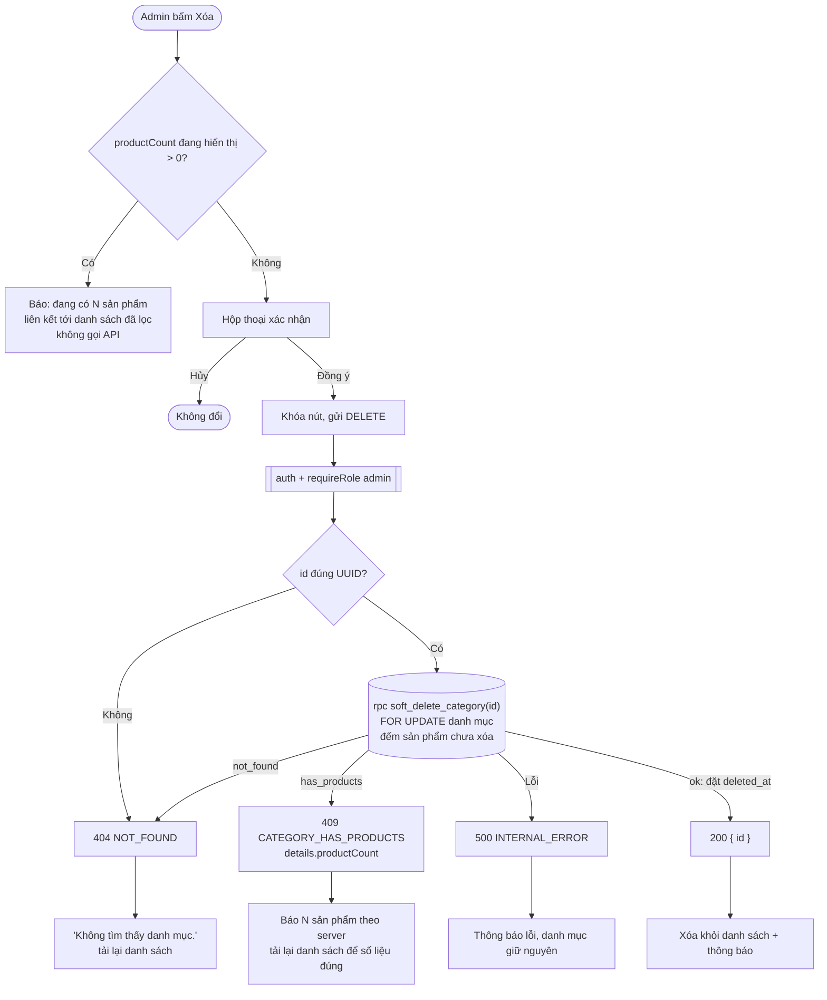

# Luồng: Xóa danh mục

> US-03 §4.4, §7 R1–R2, E5, E6, AC-06 → AC-08, AC-10 · `DELETE /api/admin/categories/:id`

| Quy tắc | Lý do |
|---|---|
| Frontend chặn sớm nhưng backend vẫn quyết định | Số hiển thị có thể cũ, ví dụ khi thêm sản phẩm từ tab khác (E5) |
| Khóa dòng danh mục trước khi đếm | Không lọt sản phẩm mới vào danh mục đang bị xóa (AC-08). Xem `db/README.md` mục 4 |
| Sản phẩm đã xóa mềm không tính | Admin xóa hết sản phẩm phải xóa được danh mục (AC-07) |
| Xóa mềm thay vì xóa dòng | Sản phẩm đã xóa mềm vẫn trỏ về danh mục, FK `RESTRICT` sẽ chặn xóa thật |
