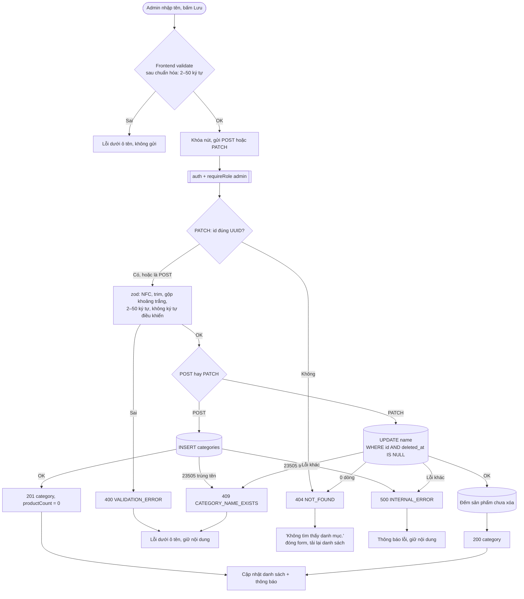

# Luồng: Thêm và đổi tên danh mục

> US-03 §4.2, §4.3, E3, E4, E6, E7, AC-02 → AC-05, AC-10 · `POST /api/admin/categories`, `PATCH /api/admin/categories/:id`

| Quy tắc | Lý do |
|---|---|
| Chống trùng dựa vào unique index, **không** kiểm tra trước bằng `SELECT` | `SELECT` rồi `INSERT` vẫn có race (AC-03) |
| Chuẩn hóa NFC trước khi ghi | Cùng chữ "Á" có thể có 2 dạng mã hóa, unique index sẽ coi là khác nhau |
| Danh mục đã xóa không giữ chỗ tên | Unique index một phần `WHERE deleted_at IS NULL` |
