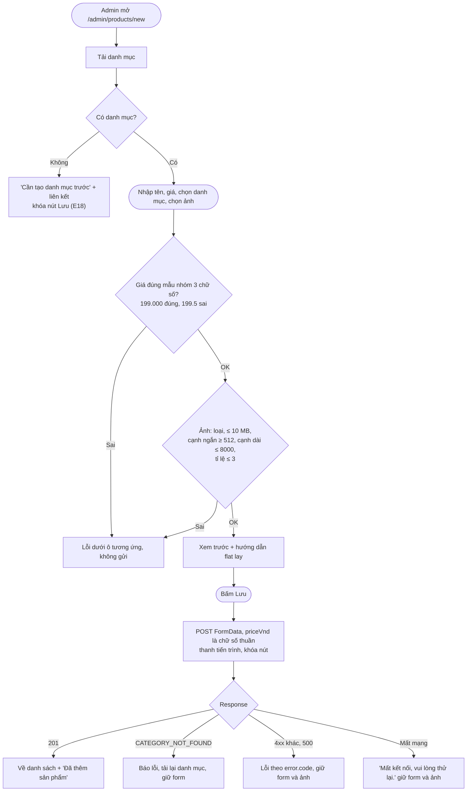
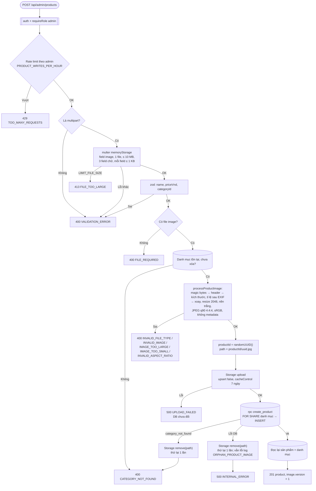

# Luồng: Thêm sản phẩm

> US-04 §4.2, §6, E3–E11, E13–E15, E17, E18, AC-01 → AC-05, AC-12 · `POST /api/admin/products` · D-12, D-25 (kế thừa kỹ thuật)

## 1. Frontend

## 2. Backend

## 3. Quy tắc quan trọng

| Quy tắc | Lý do |
|---|---|
| Kiểm tra trường và danh mục **trước** khi xử lý ảnh | Không tốn CPU sharp và không tạo file cho request chắc chắn sai |
| Backend sinh `productId` trước khi upload | Đường dẫn ảnh chứa id; CHECK ở DB bảo đảm ảnh thuộc đúng sản phẩm |
| Thứ tự **upload → ghi DB**, DB lỗi thì xóa file | Không bao giờ có sản phẩm trỏ tới file không tồn tại |
| Kiểm tra danh mục 2 lần: trước khi xử lý ảnh và trong `create_product` | Lần đầu để trả lỗi sớm, lần sau là chốt chặn chống race (US-03 AC-08) |
| Rate limit đặt **trước** multer | Giống D-31: chặn trước khi nhận file vào bộ nhớ |
