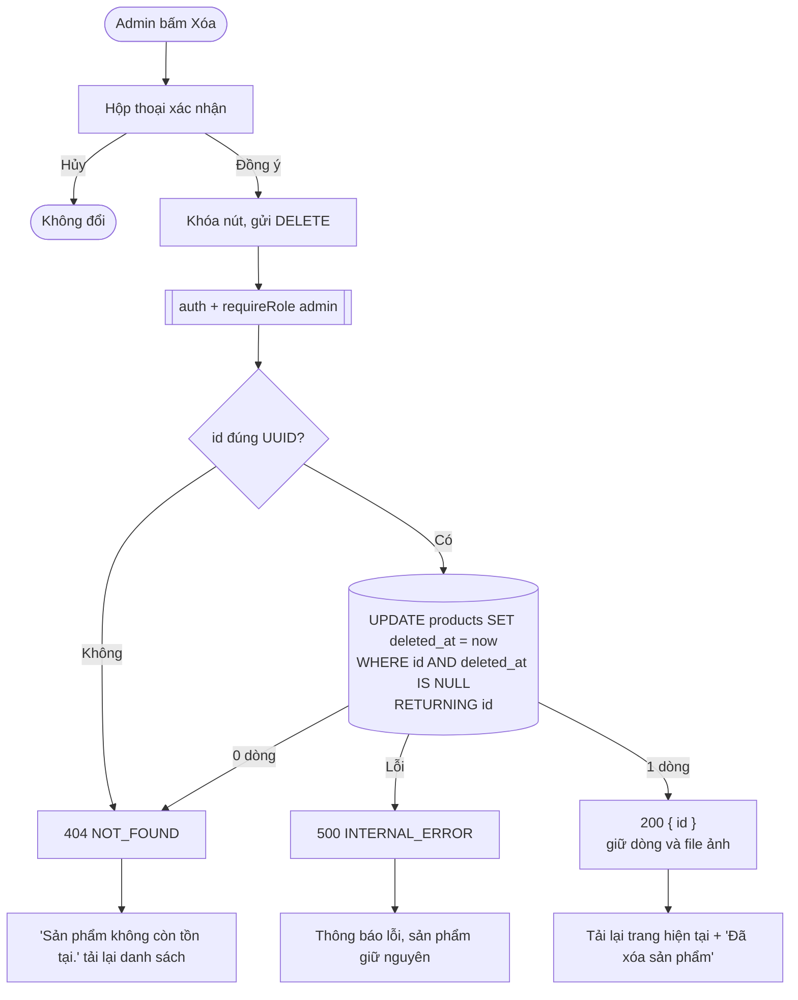

# Luồng: Xóa sản phẩm

> US-04 §4.4, §7 R2, E12, AC-10, AC-14 · `DELETE /api/admin/products/:id`

| Quy tắc | Lý do |
|---|---|
| Không xóa file ảnh | Giỏ hàng, đơn hàng, ảnh try-on ở sprint sau có thể tham chiếu; khôi phục được bằng SQL khi lỡ tay |
| Ảnh vẫn truy cập được nếu có URL | Bucket public, ảnh không nhạy cảm (`db/README.md` mục 7.4) |
| Sprint 03, 04 phải xử lý sản phẩm đã xóa | Xem US-04 §7 "Yêu cầu chuyển cho sprint sau" |
| Xóa đồng thời với `update_product` | Khóa dòng làm 2 lệnh chạy nối tiếp. Sửa sau xóa nhận `not_found` và dọn file mới |
