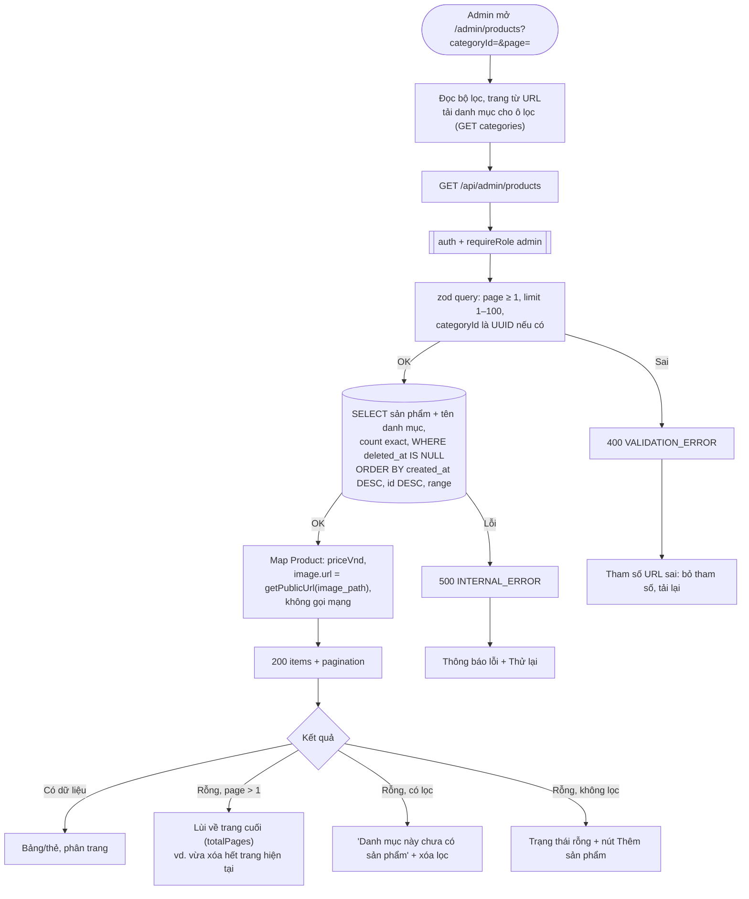

# Luồng: Danh sách sản phẩm

> US-04 §4.1, E3, AC-11, AC-12 · `GET /api/admin/products`

Sắp xếp có `id` để thứ tự ổn định khi nhiều sản phẩm cùng `created_at`, tránh lặp giữa các trang. Phân trang theo offset đủ dùng cho số lượng sản phẩm của MVP.
