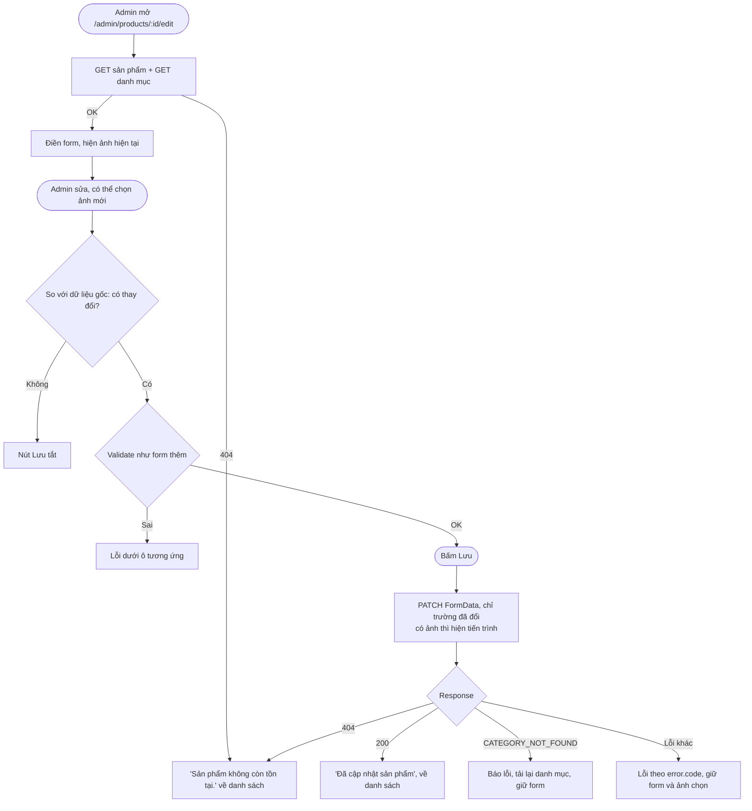
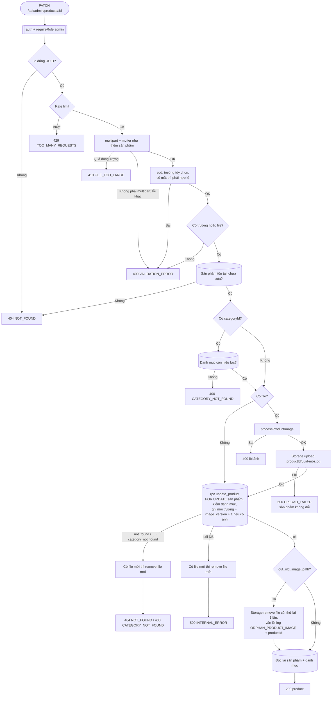

# Luồng: Sửa sản phẩm và thay ảnh

> US-04 §4.3, §7 R3–R4, R7, E3–E17, AC-05 → AC-09, AC-14 · `GET`, `PATCH /api/admin/products/:id` · D-25 (kế thừa thứ tự)

## 1. Frontend

Admin rời trang khi có thay đổi chưa lưu: hỏi xác nhận.

## 2. Backend

## 3. Quy tắc quan trọng

| Quy tắc | Lý do |
|---|---|
| Thứ tự **upload mới → ghi DB → xóa cũ** | Giống D-25. Trước khi ghi DB, sản phẩm vẫn trỏ ảnh cũ (AC-08) |
| Ghi mọi trường trong một lần gọi `update_product` | Không có trạng thái "đổi tên rồi nhưng ảnh lỗi" |
| Xóa file cũ lỗi không làm request lỗi | Dữ liệu mới đã có hiệu lực; báo lỗi lúc này là báo sai (E16) |
| Hàm trả `out_old_image_path` từ dòng đã khóa | 2 lần thay ảnh đồng thời: mỗi request xóa đúng file mình thay thế, không mất dấu file nào (T-54) |
| Đổi tên, giá, danh mục không tăng `image_version` | Không làm mất cache try-on vốn chỉ phụ thuộc ảnh. Nếu Epic 3 đưa loại trang phục vào prompt thì cân nhắc lại với đổi danh mục |
| Sửa cùng lúc: ghi sau đè ghi trước | Chỉ có 1 tài khoản admin (D-32) |
