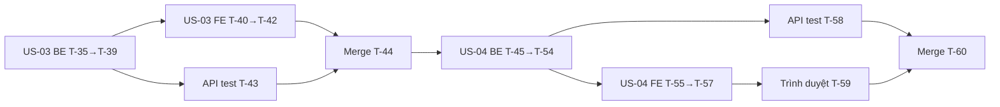

# Sprint 02 — Sprint backlog

> Epic 2: Quản lý kho hàng · Stories: [US-03](US-03.md), [US-04](US-04.md) · Thiết kế: [`design/`](design/api.md) · Quyết định: D-41 → D-55

## Mục lục
1. [Mục tiêu sprint](#1-mục-tiêu-sprint)
2. [Quy ước](#2-quy-ước)
3. [Thư viện](#3-thư-viện)
4. [Biến môi trường](#4-biến-môi-trường)
5. [Danh sách task](#5-danh-sách-task)
6. [Thứ tự thực hiện](#6-thứ-tự-thực-hiện)
7. [Phụ thuộc vào thiết kế bước 3/4](#7-phụ-thuộc-vào-thiết-kế-bước-34)
8. [Definition of Done của sprint](#8-definition-of-done-của-sprint)

---

## 1. Mục tiêu sprint

Admin quản lý được danh mục và sản phẩm có ảnh flat lay. Kết thúc sprint, hệ thống có dữ liệu quần áo sạch, an toàn để Epic 3 lấy làm đầu vào thử đồ.

## 2. Quy ước

| Mục | Quy ước |
|---|---|
| Đánh số | Tiếp nối sprint 01 (kết thúc ở T-34) |
| Ước lượng | **S** ≤ 2 giờ · **M** nửa ngày · **L** ~1 ngày |
| Branch | US-03: `feature/US-03-categories` · US-04: `feature/US-04-products`, tạo sau khi US-03 đã merge. Tạo bằng `/branch` từ `main` mới nhất |
| Merge | Chỉ `/merge` khi unit test + API test pass **và user xác nhận**; ghi `PROGRESS.md` |
| Thứ tự trong story | Migration → Backend → Unit test BE → Frontend → Test FE → API test → Merge |
| API test | Nguồn chuẩn: `backend/tests/postman/` + `npm run test:postman` (D-40) |
| Trạng thái | `[ ]` chưa làm · `[x]` xong |

## 3. Thư viện

**Không cần cài thêm thư viện.** Mọi thứ đã có từ sprint 01. agent-coder vẫn tra Context7 trước khi dùng API mới.

| Thư viện có sẵn | Dùng mới ở sprint này |
|---|---|
| `@supabase/supabase-js` 2.118 | `getPublicUrl`, `upload` với `cacheControl`, `createBucket` với `public: true`, `rpc`, `select` với `count: 'exact'` và `range` |
| `multer` 2.5 | Nhận file kèm trường chữ, `limits.fields`, `limits.fieldSize` |
| `sharp` 0.35 | `.jpeg({ quality: 90, chromaSubsampling: '4:4:4' })`. Mặc định đã chuyển sang sRGB và bỏ metadata |
| `zod` 4 | Schema trường chuỗi từ multipart, query phân trang |
| `axios` (FE) | `onUploadProgress` với `FormData` (để trình duyệt tự đặt boundary) |

Dùng `Intl.NumberFormat('vi-VN')` có sẵn của trình duyệt để hiển thị giá.

## 4. Biến môi trường

### `backend/.env.example` (thêm mới; thêm vào `src/config/env.js`, có default)

| Biến | Ví dụ | Ghi chú |
|---|---|---|
| `PRODUCT_IMAGE_BUCKET` | `product-images` | Bucket public |
| `PRODUCT_IMAGE_MAX_MB` | `10` | Giới hạn file gốc |
| `PRODUCT_IMAGE_CACHE_SECONDS` | `604800` | `cacheControl` khi upload (7 ngày) |
| `PRODUCT_WRITES_PER_HOUR` | `120` | Theo admin, đếm cả request bị từ chối |

### `frontend/.env.example`

Không đổi. Frontend vẫn không có biến Supabase nào (D-02); URL ảnh do backend trả.

### `backend/tests/postman/run.js`

Khi chạy API test, nâng `PRODUCT_WRITES_PER_HOUR` riêng cho tiến trình server (giống cách đang làm với `AUTH_RATE_LIMIT_PER_MIN`).

## 5. Danh sách task

### 5.1 US-03 — Danh mục (branch `feature/US-03-categories`)

| ID | Task | Phụ thuộc | Ước lượng | Definition of Done | TT |
|---|---|---|---|---|---|
| T-35 | Chép `design/db/003_create_categories.sql`, `004_create_products.sql` sang `migrations/`, chạy `npm run migrate`. Cả 2 file thuộc story này vì hàm xóa danh mục phải đọc `products` | Thiết kế DB | S | Có 3 danh mục seed đúng thứ tự; `get_advisors` security không có cảnh báo mới về RLS; gọi REST `categories`, `products` và `/rpc` bằng anon key bị chặn | [x] |
| T-36 | `validation/categorySchemas.js`: chuẩn hóa NFC, trim, gộp khoảng trắng; 2–50 ký tự; chặn ký tự điều khiển. Middleware `validateUuidParam`: id sai định dạng → 404 `NOT_FOUND` | API contract | S | Unit test biên 1/2/50/51 ký tự, chuỗi chỉ có khoảng trắng, chuỗi NFD, kiểu số, ký tự điều khiển | [x] |
| T-37 | `repositories/categoryRepository.js` (`list_categories_with_counts`, insert, update lọc `deleted_at is null`, `soft_delete_category`; map `23505` → `CATEGORY_NAME_EXISTS`) + `services/categoryService.js` (map `out_status`, DTO). Chuẩn hóa `timestamptz` bằng `toISOString()` | T-35, T-36 | M | Service không biết tới Express; response khớp `api.md` mục 6.1 | [x] |
| T-38 | `controllers/categoryController.js`, routes `/api/admin/categories` (`GET`, `POST`, `PATCH /:id`, `DELETE /:id`), lắp vào `container.js` | T-37 | S | Khớp API contract; mọi route có `authenticate` + `requireRole('admin')` | [x] |
| T-39 | Test BE tập trung rủi ro (Supertest, repository giả): trùng tên khác hoa thường → 409; xóa còn sản phẩm → 409 có `productCount`; id `abc` → 404; 401/403; `updatedAt` kiểu Postgres được chuẩn hóa | T-38 | S | Pass; không có test trivia | [x] |
| T-40 | FE: `features/admin/` khung điều hướng quản trị; route `/admin/categories` trong `RequireAdmin`; bật mục "Danh mục" đang "Sắp có" ở `/admin` | Màn hình bước 4 | S | User thường thấy trang 403; admin điều hướng được | [x] |
| T-41 | FE trang **Danh mục**: danh sách kèm số sản phẩm, thêm, đổi tên, xóa có xác nhận, chặn sớm khi còn sản phẩm; xử lý lỗi E1–E8; schema zod giống BE (D-21). Liên kết sang danh sách đã lọc được thêm ở T-55 | T-38, T-40 | M | AC-01 → AC-04, AC-07 (danh mục trống) trên UI, ≥ 360 px | [x] |
| T-42 | Test FE: schema dùng chung bảng case với T-36; 409 `CATEGORY_HAS_PRODUCTS` từ server hiện đúng số lượng; 404 thì tải lại danh sách | T-41 | S | Pass | [x] |
| T-43 | API test `categories.collection.json`, thêm vào `run.js`: AC-02 → AC-04, AC-07 (danh mục trống), AC-09, AC-10. Chưa có API tạo sản phẩm nên AC-05, AC-06 kiểm ở T-58. Tên có hậu tố ngẫu nhiên; collection tự xóa danh mục đã tạo, không đụng 3 danh mục seed | T-38 | M | `npm run test:postman` pass trên Supabase dev; chạy lại lần 2 vẫn pass | [x] |
| T-44 | Review + user xác nhận → `/merge`, ghi `PROGRESS.md` | T-39, T-42, T-43 | S | `main` có US-03, test pass sau merge | [x] |

### 5.2 US-04 — Sản phẩm (branch `feature/US-04-products`, tạo sau T-44)

| ID | Task | Phụ thuộc | Ước lượng | Definition of Done | TT |
|---|---|---|---|---|---|
| T-45 | Thêm 4 biến mục 4 vào `.env.example` + `env.js` | T-44 | S | Test env: thiếu thì dùng default, sai kiểu thì không khởi động | [ ] |
| T-46 | Tổng quát `storageSetup.js` thành `ensureBucket(client, { name, public, maxMb })`; `npm run setup:storage` tạo cả 2 bucket; cập nhật mô tả lệnh trong `CLAUDE.md`. Chạy trên Supabase dev | T-45 | S | Chạy lần 2 báo `unchanged`; `product-images` public, `profile-photos` vẫn private; unit test cũ vẫn pass. Kiểm tra AC-13 một lần bằng publishable key (lấy qua Supabase MCP, không lưu vào repo) | [ ] |
| T-47 | Thêm fixture sản phẩm vào `generate-fixtures.js`: 800×800 JPG có GPS; 3000×3000 PNG trong suốt; WEBP; 512×512; 512×1536; 400×800 có sẵn; 600×2000 | T-45 | S | `npm run fixtures` tạo đủ; test fixture pass | [ ] |
| T-48 | `services/image.js`: tách bộ quy tắc khỏi logic, thêm `processProductImage` theo US-04 §6.2. Giữ nguyên hành vi `processProfilePhoto` và message lỗi của nó | T-47 | M | Test cũ của ảnh hồ sơ pass không sửa; ảnh sản phẩm: biên 512, tỉ lệ đúng 3, xoay EXIF đổi chiều, PNG trong suốt ra nền trắng, không còn metadata | [ ] |
| T-49 | `services/productImageStorage.js` (`upload(productId, buffer)` đặt `cacheControl`, `remove`, `publicUrl`), `middlewares/uploadProductImage.js` (field `image`, 1 file, tối đa 3 field chữ, mỗi field ≤ 1 KB, từ chối request không phải multipart), `middlewares/productWriteRateLimit.js` | T-45 | S | Map lỗi multer đúng mã; không ảnh hưởng `uploadPhoto` | [ ] |
| T-50 | `validation/productSchemas.js`: create, update (ít nhất 1 thay đổi xét cùng file), query danh sách. `priceVnd` nhận chuỗi `^[0-9]+$` rồi kiểm khoảng | API contract | S | Unit test biên 999/1000/100000000/100000001, `199.5`, `-1000`, chuỗi số rất dài, `limit=101`, `page=0` | [ ] |
| T-51 | `repositories/productRepository.js` + `services/productService.js`: list, get, create, update, softDelete; rollback file khi lỗi; xóa file cũ best-effort, log `ORPHAN_PRODUCT_IMAGE` chỉ kèm `productId`; ảnh được xử lý chỉ sau khi đã kiểm tra trường và danh mục | T-37, T-48, T-49, T-50 | L | Luồng khớp `flows/product-*.md`; không để lại file mồ côi ở các nhánh lỗi | [ ] |
| T-52 | `controllers/productController.js`, routes `/api/admin/products`, lắp vào `container.js` | T-51 | S | Khớp API contract; thứ tự middleware: auth → role → uuid → rate limit → multer | [ ] |
| T-53 | Test BE tập trung rủi ro: Storage lỗi, DB lỗi, `category_not_found` sau khi upload → xóa file mới và sản phẩm không đổi; lỗi tên kèm ảnh hợp lệ → không gọi upload; thay ảnh → xóa đúng file cũ; xóa file cũ lỗi → vẫn 200 và có log; PATCH rỗng → 400; 429; 401/403; `count` và phân trang | T-52 | M | Pass; test ảnh hồ sơ không bị ảnh hưởng | [ ] |
| T-54 | Kiểm tra thật trên Supabase dev bằng script chạy một lần (dùng service role): song song `create_product` và `soft_delete_category` nhiều lượt; 2 `update_product` đổi ảnh song song; liệt kê bucket sau khi thay ảnh | T-52 | S | AC-08 của US-03 đúng ở mọi lượt; mỗi request nhận đúng `out_old_image_path` của mình; file cũ không còn trong bucket (AC-07 của US-04); ghi kết quả vào `PROGRESS.md`; dọn dữ liệu sau khi chạy | [ ] |
| T-55 | FE trang **Sản phẩm**: route `/admin/products`, bật mục "Sản phẩm" ở `/admin`, bảng/thẻ, ảnh thu nhỏ lazy, định dạng giá, lọc danh mục, phân trang, trạng thái lưu trên URL; trang rỗng; xóa có xác nhận; thêm liên kết từ trang Danh mục sang danh sách đã lọc | T-52, Màn hình bước 4 | M | AC-10, AC-11 trên UI, ≥ 360 px; về trang trước khi xóa hết trang hiện tại | [ ] |
| T-56 | FE form **Thêm/Sửa**: parse giá, kiểm tra sơ bộ ảnh, xem trước, hướng dẫn flat lay, thanh tiến trình, chỉ gửi trường đã đổi, cảnh báo rời form, giữ dữ liệu khi lỗi mạng, E4, E12, E18 | T-55 | L | AC-01, AC-03 → AC-09 trên UI | [ ] |
| T-57 | Test FE: parse giá (`199.000`, `199,000`, `199 000`, `199.5`, `1.99`, `1.000.000`, rỗng); kiểm tra sơ bộ ảnh; chỉ gửi trường đã đổi | T-56 | S | Pass; schema dùng chung bảng case với T-50 | [ ] |
| T-58 | API test `products.collection.json`, thêm vào `run.js`: AC-01 → AC-07, AC-09 → AC-12, AC-14 của US-04; AC-05 → AC-07 của US-03 với sản phẩm thật. Kiểm tra URL ảnh mở được không cần token; ghi vào bucket không có key bị từ chối | T-52, T-47 | M | `npm run test:postman` pass cả bộ; không dùng URL public để kết luận file đã xóa (xem ghi chú) | [ ] |
| T-59 | Kiểm tra trên trình duyệt thật ở 360, 768, 1280 px: toàn bộ luồng danh mục → sản phẩm → xóa | T-56 | S | Không lỗi console, ảnh hiển thị, không tràn ngang | [ ] |
| T-60 | Review + user xác nhận → `/merge`, ghi `PROGRESS.md`; main agent chạy `/wrap-up` | T-53, T-54, T-57, T-58, T-59 | S | `main` có US-04, toàn bộ test sprint pass | [ ] |

**Tổng:** 26 task — US-03 10, US-04 16.

**Ghi chú test:**
- File đã xóa có thể còn được CDN phục vụ một lúc (D-39); với Supabase Free có thể lâu hơn vì Smart CDN chỉ có từ gói Pro. Việc xóa file được kiểm bằng unit test (gọi đúng `remove`) và liệt kê bucket ở T-54, không qua URL public. Không đưa service role key vào collection.
- API test để lại dòng đã xóa mềm và file ảnh nhỏ trên Supabase dev sau mỗi lần chạy. Chấp nhận ở dev; dùng fixture nhỏ và đặt tên có tiền tố `POSTMAN-`. Ghi việc dọn dẹp vào backlog kỹ thuật.

## 6. Thứ tự thực hiện

## 7. Phụ thuộc vào thiết kế bước 3/4

| Tài liệu | Bước | Task cần |
|---|---|---|
| `design/db/README.md`, `003_create_categories.sql`, `004_create_products.sql` | 3 | T-35, T-37, T-46, T-49, T-51, T-54 |
| `design/api.md` | 3 | T-36 → T-38, T-43, T-50 → T-52, T-58 |
| `design/flows/category-*.md` | 3 | T-37, T-38, T-41 |
| `design/flows/product-*.md` | 3 | T-48, T-51 → T-56 |
| `design/design-system.md` (cập nhật nếu cần) | 4 | T-40, T-41, T-55, T-56 |
| `screens/`: khung quản trị, Danh mục, Sản phẩm, form Thêm/Sửa (trống, đang tải, lỗi, chưa có danh mục), hộp thoại xóa | 4 | T-40, T-41, T-55, T-56 |

Mọi task thuộc bước 5, chỉ bắt đầu sau khi bước 3 và bước 4 được user xác nhận.

## 8. Definition of Done của sprint

- [ ] Toàn bộ AC của US-03 (AC-01 → AC-10) và US-04 (AC-01 → AC-14) đạt, kiểm bằng test hoặc trên UI.
- [ ] `npm test`, `npm run lint`, `npm run build` (FE) pass. `npm run test:postman` pass trên Supabase dev.
- [ ] Bucket `product-images` public chỉ đọc; `profile-photos` vẫn private; anon không truy cập được bảng và hàm mới.
- [ ] Migration trong `migrations/` khớp ERD sprint. `.env.example` đầy đủ, không có secret.
- [ ] Mỗi story nằm trên branch riêng, merge **sau khi user xác nhận**; `PROGRESS.md` có merge log.
- [ ] `DECISIONS.md` có các quyết định đã duyệt của sprint này.
- [ ] Giao diện dùng được ở 360 px và desktop, thông báo lỗi tiếng Việt.
