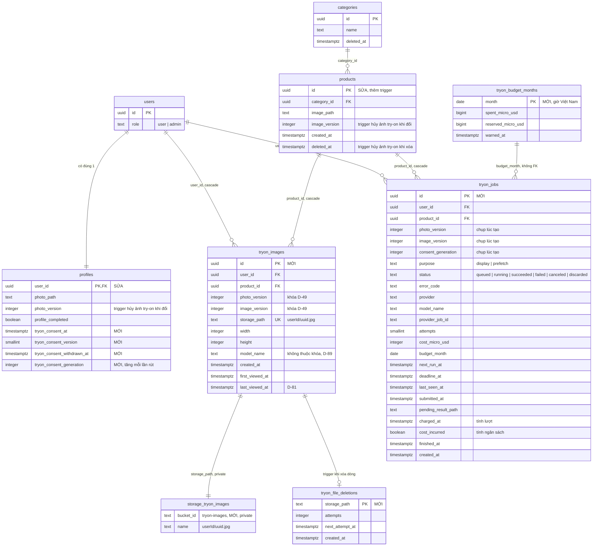
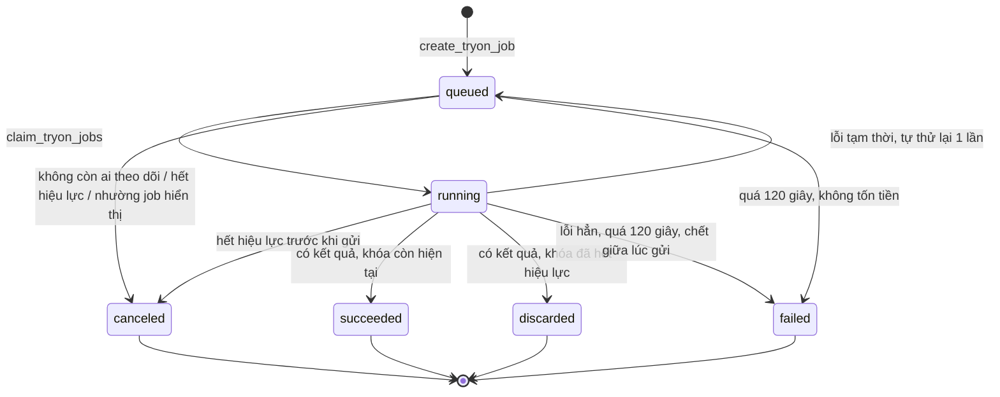

# Sprint 03 — Database & Storage

> Stories: US-05, US-06 · Quyết định: D-71 → D-96 · SQL: [`005_add_tryon_consent.sql`](005_add_tryon_consent.sql), [`006_create_tryon.sql`](006_create_tryon.sql)

**Kế thừa:** [`sprint-01/design/db/README.md`](../../../sprint-01/design/db/README.md), [`sprint-02/design/db/README.md`](../../../sprint-02/design/db/README.md). Bảng `users`, `categories`, `schema_migrations`, bucket `profile-photos`, `product-images` **không đổi**.

## Mục lục
1. [ERD](#1-erd)
2. [Thay đổi so với sprint 02](#2-thay-đổi-so-với-sprint-02)
3. [Schema](#3-schema)
4. [Hàm SQL](#4-hàm-sql)
5. [Rủi ro tương tranh được bảo đảm ở đâu](#5-rủi-ro-tương-tranh-được-bảo-đảm-ở-đâu)
6. [Index](#6-index)
7. [Bảo mật DB](#7-bảo-mật-db)
8. [Supabase Storage](#8-supabase-storage)
9. [Migration & setup](#9-migration--setup)
10. [Đã kiểm tra những gì](#10-đã-kiểm-tra-những-gì)
11. [Trade-off đã cân nhắc](#11-trade-off-đã-cân-nhắc)

---

## 1. ERD

`MỚI` là của sprint này. `SỬA` là bảng cũ có thêm cột hoặc trigger. Bảng khác chỉ liệt kê cột chính.



## 2. Thay đổi so với sprint 02

| Hạng mục | Thay đổi | Lý do |
|---|---|---|
| `profiles` | Thêm 4 cột consent | D-93. Tách khỏi consent lưu ảnh của D-22 |
| `profiles` | Thêm trigger `trg_profiles_tryon_invalidate` | D-79. **`set_profile_photo` không đổi** |
| `products` | Thêm trigger `trg_products_tryon_invalidate` | D-80. **`update_product` và lệnh xóa mềm không đổi** |
| Bảng mới | `tryon_images`, `tryon_jobs`, `tryon_budget_months`, `tryon_file_deletions` | US-05, US-06 |
| Bucket mới | `tryon-images` (private) | D-78 |
| `setup-storage` | Tạo 3 bucket | Mở rộng D-26 |
| D-42 | Ảnh **gốc** của sản phẩm xóa mềm vẫn giữ. Ảnh **try-on** thì xóa (D-80) | Làm rõ, không mâu thuẫn |

## 3. Schema

SQL đầy đủ ở 2 file `.sql`. Mục này chỉ nói những gì SQL không tự giải thích.

### 3.1 `profiles` (thêm cột)

| Cột | Ý nghĩa |
|---|---|
| `tryon_consent_at`, `tryon_consent_version` | Đồng ý gần nhất. **Giữ lại sau khi rút** để còn bằng chứng |
| `tryon_consent_withdrawn_at` | Khác null là đã rút. Đồng ý lại thì về null |
| `tryon_consent_generation` | Tăng mỗi lần rút |

Consent có hiệu lực khi: `at` khác null, `withdrawn_at` null, `version` = `TRYON_CONSENT_VERSION`.

**Vì sao cần `generation`:** rút rồi đồng ý lại trong lúc job đang chạy, các cột khác trở lại hợp lệ. Không có số này thì kết quả về muộn sẽ được lưu, trái D-79.

Không tính consent vào `profile_completed`: hai điều kiện nêu riêng ở D-71, và thiếu mỗi thứ có thông báo khác nhau.

### 3.2 `tryon_jobs`: vòng trạng thái



| Trạng thái kết thúc | Tính lượt (`charged_at`) | Tính ngân sách (`cost_incurred`) |
|---|---|---|
| `succeeded` | Có | Có |
| `discarded` | Có (US-05 R11) | Có |
| `failed`, dịch vụ báo lỗi | Không | Không |
| `failed`, quá 120 giây sau khi gửi | Không | **Có** |
| `failed`, chết giữa lúc gửi; `POST /run` hết giờ | Không | **Có** |
| `failed`, có kết quả nhưng lưu lỗi (E17) | Không | **Có** |
| `canceled` | Không | Không |

Hàng "**Có**" ở cột ngân sách là phần người mua không chịu nhưng nhà cung cấp có thể đã tính. Tính vào để dừng cứng ở D-94 không bị lọt. Đề xuất D-98.

**`next_run_at` có hai nghĩa theo trạng thái**, để chỉ cần một index: `queued` là lúc được nhận (thử lại thì dời 2 giây), `running` là lúc poll tiếp. `running` chưa có `provider_job_id` thì đây là hạn lease của bước gửi; quá hạn nghĩa là tiến trình đã chết.

**Lượt đếm từ `tryon_jobs`, không có bảng đếm riêng:** một nguồn sự thật, không lệch số. Khóa dòng `profiles` làm phép đếm an toàn khi song song. Vì vậy job phải giữ lâu hơn một tháng (`TRYON_JOB_RETENTION_DAYS` = 35).

### 3.3 `tryon_budget_months`

Một dòng mỗi tháng theo giờ Việt Nam. Đơn vị micro USD (`$0.075` = `75000`), số nguyên để không sai số. Giới hạn truyền từ env vào hàm, không lưu trong DB.

**Đây là ước tính theo giá công bố, không phải số dư thật ở FASHN.** Hàm tính đúng cam kết "không tạo thêm job khi đã chi + đang giữ + 1 ảnh > giới hạn", với giả định mỗi job tốn đúng `TRYON_COST_PER_IMAGE_USD`.

### 3.4 `tryon_file_deletions`

Trigger `AFTER DELETE` trên `tryon_images` ghi vào đây **trong cùng transaction**. Bất kỳ đường xóa dòng nào (thay ảnh, rút consent, cascade, SQL tay) cũng không mất dấu file.

Khác với D-25 (xóa file cũ thử lại 1 lần rồi chỉ log): ảnh try-on nhạy cảm và D-79 nói "xóa thật", nên ở đây thử lại tới khi được. Đề xuất D-100.

## 4. Hàm SQL

Tất cả `set search_path = ''`, chỉ `service_role` gọi được, trả trạng thái thay vì `raise`.

| Hàm | Ai gọi | Mục đích |
|---|---|---|
| `accept_tryon_consent`, `withdraw_tryon_consent` | API | Consent. Rút thì xóa ảnh, hủy job chưa gửi trong một transaction |
| `list_tryon_products` | API | Con trỏ `(created_at, id)`, giữ độ chính xác micro giây |
| `create_tryon_job` | API | Toàn bộ kiểm tra và giữ chỗ trong một transaction |
| `get_tryon_result` | API | Trạng thái một sản phẩm, không tạo job |
| `get_tryon_job` | API | Theo dõi job, làm mới `last_seen_at` |
| `get_tryon_usage` | API | Số lượt, cờ ngân sách, không trả số tiền |
| `expire_tryon_jobs` | Worker | Quá hạn 120 giây, chết giữa lúc gửi |
| `claim_tryon_jobs` | Worker | Hủy job không ai theo dõi; nhận job trong giới hạn |
| `check_tryon_job_before_submit` | Worker | Kiểm tra lần cuối ngay trước khi gửi ảnh |
| `mark_tryon_job_submitted` | Worker | Ghi `provider_job_id` |
| `next_tryon_polls` | Worker | Job đến lượt poll |
| `reserve_tryon_result_path` | Worker | Ghi đường dẫn trước khi upload |
| `complete_tryon_job` | Worker | Lưu hoặc bỏ kết quả, tính lượt, chốt ngân sách |
| `fail_tryon_job` | Worker | Thử lại hoặc thất bại |
| `claim_tryon_file_deletions`, `ack_tryon_file_deletions` | Dọn dẹp | Hàng đợi xóa file |
| `purge_stale_tryon_images` | Dọn dẹp | D-81 |
| `purge_old_tryon_jobs` | Dọn dẹp | Job quá 35 ngày |
| `purge_tryon_images_except_model` | Script | D-89 |
| `tryon_budget_settle`, `tryon_cancel_queued`, `tryon_job_key_is_current` | Nội bộ | Dùng chung giữa các hàm trên |

## 5. Rủi ro tương tranh được bảo đảm ở đâu

Node chỉ có **một** tầng đáng tin: DB. Mọi bảo đảm dưới đây vẫn đúng khi có nhiều request song song hoặc nhiều tiến trình; không có bảo đảm nào dựa vào biến trong bộ nhớ của Node.

| Rủi ro | Tầng | Cơ chế |
|---|---|---|
| **Sinh trùng cùng khóa** (D-75, AC-06) | DB | `create_tryon_job` khóa `profiles` `FOR UPDATE`, nên tạo job của một người chạy nối tiếp. **Chốt thứ hai:** unique index một phần `tryon_jobs_one_active_per_key` |
| **Vượt lượt cuối khi song song** (D-77, AC-17) | DB | Cùng khóa `profiles`. Đếm `charged_at` + job `queued`/`running`, tất cả trong transaction |
| **Tối đa 2 job gửi đi/người** (D-90, AC-08) | DB | `claim_tryon_jobs` giữ `pg_advisory_xact_lock`: mỗi lúc một bên nhận, số `running` chỉ tăng ở đây |
| **Không vượt 6 đồng thời toàn hệ thống** | DB | Cùng advisory lock, `TRYON_SYSTEM_CONCURRENCY` |
| **Job hiển thị ưu tiên** (D-90) | DB | `claim` xếp `display` trước. Job `display` mới hủy `prefetch` chưa gửi của chính người đó |
| **Ngân sách dừng cứng** (D-94) | DB | Khóa dòng `tryon_budget_months` `FOR UPDATE`, kiểm `spent + reserved + cost ≤ limit`, rồi giữ chỗ |
| **Kết quả về muộn** (D-79, AC-11) | DB | `complete_tryon_job` khóa `profiles` `FOR SHARE` → `products` `FOR SHARE` → job `FOR UPDATE`, rồi so khóa, `generation`, consent. Thay ảnh, rút consent, đổi sản phẩm giữ khóa `FOR UPDATE` trên cùng dòng, nên hai bên chạy nối tiếp, không có khe |
| **Ảnh cũ còn sót sau khi hủy hiệu lực** | DB | Trigger xóa `tryon_images` cùng transaction với việc đổi version |
| **File còn sót trên Storage** | DB + Node | Hàng đợi `tryon_file_deletions`, ghi cùng transaction; Node xóa, lỗi thì thử lại |
| **Chết giữa lúc upload** | DB + Node | `pending_result_path` ghi **trước** khi upload |
| **Gửi ảnh sau khi rút consent** | DB + Node | `check_tryon_job_before_submit` ngay trước `POST`. **Còn một khe rất nhỏ** giữa lần kiểm và lúc HTTP tới nơi, không thể bịt ở phía ta. Yêu cầu đã kiểm trước khi rút thuộc phần "đã xử lý trước đó" trong câu consent |
| **Job kẹt khi server chết** (E19) | DB | Trạng thái ở DB, worker không giữ gì trong bộ nhớ. `expire_tryon_jobs` chạy mỗi tick |
| **Poll trùng khi nhiều tiến trình** | DB | `next_tryon_polls` dời lịch trong cùng lệnh, `SKIP LOCKED` |
| **Rate limit** (D-88) | Node | Bộ đếm in-memory như D-31, chỉ để chống spam. **Không** phải chốt của lượt và ngân sách |
| **Chờ dừng 400 ms, tab ẩn, tiết kiệm dữ liệu** | FE | Chỉ để đỡ tốn. Backend vẫn tự kiểm mọi điều kiện còn lại |

### Thứ tự khóa

Mọi hàm lấy khóa theo một chiều, để không deadlock:

```
profiles -> products -> tryon_jobs -> tryon_budget_months
```

`tryon_cancel_queued` là một lệnh SQL duy nhất: khóa xong mọi job rồi mới chạm dòng ngân sách. Bản đầu dùng vòng lặp, khóa job xen kẽ với ngân sách, có thể deadlock với `claim`, đã sửa. `claim_tryon_jobs` và `expire_tryon_jobs` chỉ lấy job bằng `SKIP LOCKED`, không bao giờ đợi.

**AC-11 ghi "không có file mới trong bucket".** Khi rút consent đúng lúc file đang được upload, file vẫn tồn tại vài giây tới khi hàng đợi xóa xong: `complete_tryon_job` trả `discarded` và đưa file vào hàng đợi, người mua không bao giờ thấy. Giảm khe này bằng cách kiểm ở `reserve_tryon_result_path` trước khi upload. Test AC-11 phải kiểm sau khi hàng đợi đã chạy.

## 6. Index

| Bảng | Index | Phục vụ |
|---|---|---|
| `tryon_images` | UNIQUE `tryon_images_cache_key (user_id, photo_version, product_id, image_version)` | Tra cache D-49; xóa theo người dùng |
| `tryon_images` | `tryon_images_product_idx (product_id)` | Xóa theo sản phẩm, FK cascade |
| `tryon_images` | `tryon_images_last_viewed_idx (last_viewed_at)` | Dọn 90 ngày |
| `tryon_images` | `tryon_images_model_idx (model_name)` | Đổi model |
| `tryon_jobs` | UNIQUE một phần `tryon_jobs_one_active_per_key` | D-75 |
| `tryon_jobs` | một phần `tryon_jobs_active_run_idx (status, next_run_at)` | Nhận job, poll, hết hạn |
| `tryon_jobs` | một phần `tryon_jobs_user_active_idx (user_id, status)` | Đếm job đang chạy của một người |
| `tryon_jobs` | một phần `tryon_jobs_user_charged_idx (user_id, charged_at)` | Đếm lượt |
| `tryon_jobs` | một phần `tryon_jobs_blocked_key_idx` | Nhớ kết quả bị chặn |
| `tryon_jobs` | `tryon_jobs_product_idx (product_id)` | Hủy job theo sản phẩm, FK cascade |
| `tryon_jobs` | một phần `tryon_jobs_finished_idx (finished_at)` | Dọn job cũ |
| `tryon_file_deletions` | `tryon_file_deletions_due_idx (next_attempt_at)` | Lấy file đến hạn |
| `products` | Dùng lại `products_active_category_created_idx` (sprint 02) | Danh sách theo con trỏ |

## 7. Bảo mật DB

Giống D-27: bật RLS không policy trên 4 bảng mới; `revoke all` với `anon`, `authenticated`; grant tường minh cho `service_role`; `revoke execute` mọi hàm mới với `public`, `anon`, `authenticated`.

**Hàm trigger và hàm nội bộ cũng phải grant cho `service_role`:** các hàm chạy dưới quyền người gọi (`SECURITY INVOKER`). `set_profile_photo` do `service_role` gọi sẽ kích hoạt trigger.

Kiểm tra sau migration (T-62): `get_advisors` loại security không có cảnh báo mới; `GET /rest/v1/tryon_jobs`, `POST /rest/v1/rpc/create_tryon_job` bằng anon key bị từ chối.

## 8. Supabase Storage

### 8.1 Bucket mới

| Thuộc tính | Giá trị |
|---|---|
| Tên | `tryon-images` (env `TRYON_IMAGE_BUCKET`) |
| `public` | **`false`** (D-78) |
| `fileSizeLimit` | `TRYON_IMAGE_MAX_MB` (5 MB, ước lượng; đầu ra 864 × 1296 JPEG nhỏ hơn nhiều) |
| `allowedMimeTypes` | `['image/jpeg']` |
| Policy trên `storage.objects` | **Không tạo** (D-26) |
| Tạo bằng | `npm run setup:storage`, idempotent |

### 8.2 Đường dẫn & truy cập

```
tryon-images/
  <user_id>/
    <uuid v4>.jpg
```

Upload: `contentType: 'image/jpeg'`, `upsert: false`. Đọc qua signed URL 15 phút (`SIGNED_URL_TTL_SECONDS`). Tên file không chứa `productId` hay version, để URL không tiết lộ thêm gì. `createPhotoStorage` (`services/storage.js`) dùng lại được nguyên trạng, chỉ khác tên bucket; thêm `download` để lấy ảnh hồ sơ.

### 8.3 Vòng đời file

| Sự kiện | File |
|---|---|
| Có kết quả, khóa còn hiện tại | Upload, giữ |
| Có kết quả, phát hiện hết hiệu lực trước khi upload | Không upload |
| Hết hiệu lực trong lúc upload | Vào hàng đợi xóa |
| Thay/xóa ảnh hồ sơ, rút consent | Mọi file của người đó vào hàng đợi (D-79) |
| Thay ảnh sản phẩm, xóa mềm sản phẩm | Mọi file của sản phẩm đó vào hàng đợi (D-80) |
| 90 ngày không được xem | Vào hàng đợi (D-81) |
| Đổi model | Vào hàng đợi (D-89) |
| Xóa lỗi | Thử lại sau `TRYON_DELETE_RETRY_SECONDS`, log `ORPHAN_TRYON_IMAGE` từ lần thứ 5, không log đường dẫn |

Signed URL cũ có thể còn mở khoảng 90 giây sau khi xóa (D-39). `tryon-images` dùng cùng cơ chế với `profile-photos`, chưa đo riêng.

## 9. Migration & setup

| Thứ tự | File / script | Nội dung | Task | Branch |
|---|---|---|---|---|
| 1 | `migrations/005_add_tryon_consent.sql` | 4 cột `profiles` | T-62 | `feature/US-05-tryon-room` |
| 2 | `migrations/006_create_tryon.sql` | 4 bảng, trigger, hàm, RLS | T-62 | `feature/US-05-tryon-room` |
| 3 | `backend/scripts/setup-storage.js` (mở rộng) | Bucket `tryon-images` | T-63 | `feature/US-05-tryon-room` |

Số 005, 006 nối tiếp `004_create_products.sql`. **Chưa áp dụng lên Supabase.**

## 10. Đã kiểm tra những gì

Chỉ chạy cục bộ trong thư mục tạm, không đụng Supabase. Migration 001 → 006 đều áp dụng được.

| Môi trường | Kiểm tra | Kết quả |
|---|---|---|
| **PGlite** (một kết nối) | 95 kiểm tra tuần tự: chuyển trạng thái, cache, kết quả về muộn, nhớ bị chặn, retry, lượt, generate trước, ngân sách, hết hạn, con trỏ gồm cả tie-break `id` và micro giây, dọn dẹp, quyền theo role | 95/95 đạt |
| **PostgreSQL 18.6 thật** (`embedded-postgres`, pool 30 kết nối) | 14 kiểm tra **song song** ở bảng dưới | 14/14 đạt, 0 lỗi SQL |

| Kiểm tra song song | Quy mô | Kết quả |
|---|---|---|
| Cùng khóa, tạo job | 10 vòng × 20 request | Đúng 1 `created`, mọi request cùng 1 job id |
| Lượt cuối, khác sản phẩm | 10 vòng × 4 request | Đúng 1 job giữ được lượt |
| Ngân sách, nhiều người | 40 request, giới hạn đủ 10 ảnh | Đúng 10 job, 30 `budget_exceeded`, cảnh báo 80% đúng 1 lần |
| Nhận job | 10 worker song song, 24 job | Đúng 6 `running`, mỗi người ≤ 2 |
| `complete` đua với rút consent; rút rồi đồng ý lại; thay ảnh hồ sơ; thay ảnh sản phẩm; xóa sản phẩm | 5 loại × 40 vòng | Không ảnh nào sống sót, file luôn vào hàng đợi, luôn tính lượt. Cả hai thứ tự thắng đều xảy ra (`complete` thắng 7–25 lần mỗi loại) |
| Tải hỗn hợp | 400 thao tác song song | Không deadlock (`40P01`), không lỗi. Sau khi mọi job kết thúc, `reserved` về 0 |

**Chưa kiểm:**
- Trên **Supabase thật** (PG 17, Supavisor, PostgREST). T-75 chạy lại các kịch bản này qua `rpc`, cần cho phép ở bước 5.
- Trên PG 17. Không thấy tính năng nào đang dùng khác giữa 17 và 18, nhưng chưa chạy thử.

Script để chạy lại: [`checks/`](checks/README.md).

## 11. Trade-off đã cân nhắc

### Hủy hiệu lực: trigger hay gọi từ service

| Tiêu chí | Trigger (chọn) | Service gọi hàm hủy |
|---|---|---|
| Bỏ sót đường ghi | Không thể, kể cả SQL tay (D-42 ghi có cứu bằng SQL) | Mỗi đường ghi phải nhớ gọi |
| Sửa code US-02, US-04 | Chỉ thêm 1 dòng "kick" xóa file | Đổi kết quả trả về, phải sửa hàm SQL cũ |
| Cùng transaction với đổi version | Luôn | Phải sửa `set_profile_photo`, `update_product` |
| Khó đọc | Logic ẩn trong DB, phải ghi rõ ở tài liệu | Dễ đọc hơn |

### Hàng đợi job: Postgres hay Redis/BullMQ

| Tiêu chí | Postgres (chọn) | Redis + BullMQ |
|---|---|---|
| Hạ tầng | Không thêm gì | Thêm một dịch vụ, ngoài stack đã chốt |
| Bảo đảm cùng transaction với lượt, ngân sách, consent | Có | Phải làm hai pha |
| Thông lượng | Đủ cho vài job đồng thời, giới hạn 6 của FASHN | Cao hơn, chưa cần |
| Đổi hướng về sau | Dễ: worker là một module riêng | — |

### Worker: trong tiến trình Express hay tiến trình riêng

Chọn **trong tiến trình Express** (`startWorker: true`, giống `startSweeper`). Dự án đang chạy một instance (D-31). Mọi bảo đảm ở DB nên tách ra sau không phải đổi logic, chỉ đổi nơi khởi động. Rủi ro: xử lý ảnh bằng sharp chung tiến trình với API, nhưng tối đa 6 job đồng thời và sharp chạy trên threadpool của libuv. Đề xuất D-99.

### Lịch sử consent: cột hay bảng sự kiện

Chọn **cột**, đủ cho hành vi của sprint. Nhược điểm: đồng ý rồi rút rồi đồng ý lại chỉ giữ lần gần nhất. Nên xem lại khi có người chuyên môn pháp lý (D-96).
