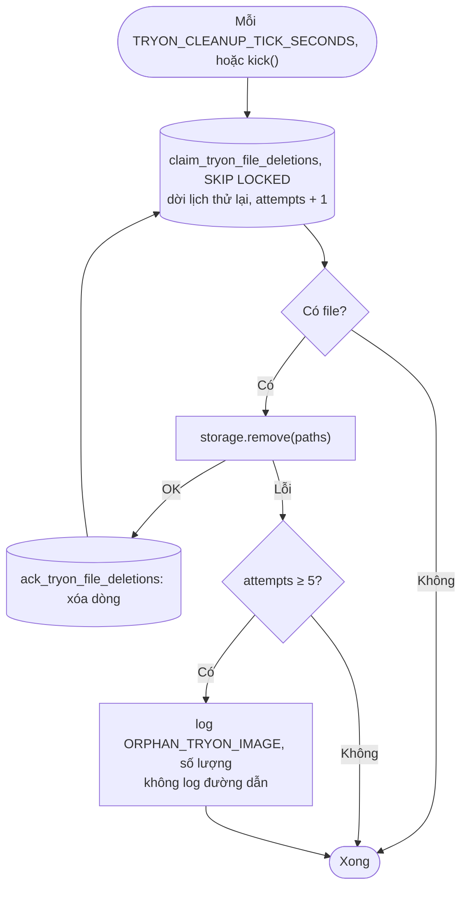
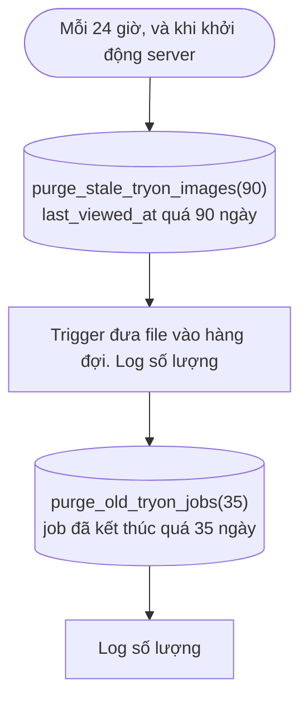

# Luồng: Xóa file, dọn 90 ngày, dọn job

> US-05 R13, E17, AC-09 · D-25, D-39, D-79, D-81

Chạy trong tiến trình Express, không dùng `pg_cron` để không phụ thuộc cấu hình Supabase.

## 1. Hàng đợi xóa file

Giữ dòng khi lỗi: lịch đã dời, lần sau thử lại. Không bỏ cuộc sau N lần, vì đây là dữ liệu nhạy cảm và D-79 nói xóa thật.

## 2. Việc hằng ngày

Chạy khi khởi động: server có thể không sống đủ 24 giờ liên tục ở dev.

## 3. Quy tắc quan trọng

| Quy tắc | Lý do |
|---|---|
| Xem lại ảnh sau khi bị dọn | Sinh lại, tính lượt (US-05 R13) |
| `last_viewed_at` cập nhật tối đa 1 lần/ngày | Giảm ghi khi lướt qua lại; mốc 90 ngày không cần chính xác tới phút |
| Generate trước chưa từng xem | `last_viewed_at` bằng lúc tạo, cũng được dọn sau 90 ngày |
| Job giữ 35 ngày | Đếm lượt tháng cần job của tháng hiện tại. Ghi nhớ bị chặn cũng hết sau 35 ngày: có thể thử lại, lỗi không tốn credit theo tài liệu FASHN |
| Dòng ngân sách giữ lâu dài | Không có dữ liệu cá nhân, để đối chiếu chi phí |
| `provider_job_id` mất cùng job | Yêu cầu FASHN xóa bản ghi request cần id này, nên phải làm trong 35 ngày. Cần xem lại nếu ra mắt thật (D-96) |
