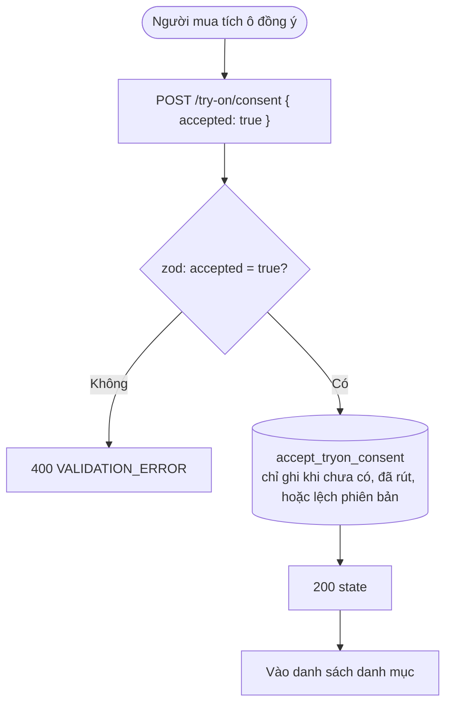
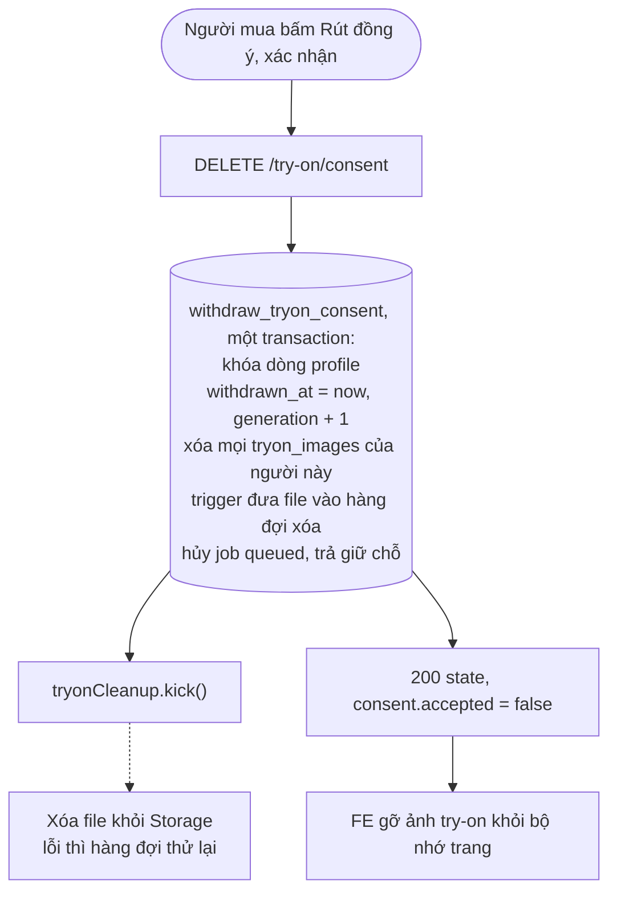
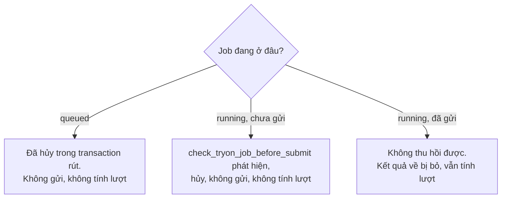

# Luồng: Đồng ý và rút đồng ý gửi ảnh

> US-05 §5.2, R4, E3, AC-02, AC-10, AC-11 · `POST`, `DELETE /api/try-on/consent` · D-10, D-22, D-79, D-93

## 1. Đồng ý

## 2. Rút

Nút ở trang Hồ sơ, có hộp thoại xác nhận nói rõ ảnh thử đồ sẽ bị xóa, ảnh hồ sơ giữ nguyên.

## 3. Job đang gửi lúc rút

## 4. Quy tắc quan trọng

| Quy tắc | Lý do |
|---|---|
| Consent lưu ảnh (D-22) và consent gửi ảnh (D-93) độc lập | Ảnh có consent cũ giữ nguyên, upload không bị ảnh hưởng, nhưng không gửi đi |
| `PHOTO_CONSENT_VERSION` giữ 1, chỉ sửa modal chi tiết ở Hồ sơ | Tăng số này sẽ chặn upload của mọi người (phương án đã loại ở Q3). Việc gửi ảnh đã được chặn bởi consent mới. Đề xuất D-102 |
| `generation` tăng mỗi lần rút | Rút rồi đồng ý lại vẫn bỏ kết quả về muộn (D-79) |
| Rút là idempotent | Bấm hai lần, hai tab không lỗi |
| Không xóa được phần đã gửi | Câu consent đã nói rõ. Bản ghi request ở FASHN không tự xóa; dùng `provider_job_id` nếu phải yêu cầu xóa qua email |
| Tuổi là tự khai, không thu ngày sinh | D-08, D-93 |
