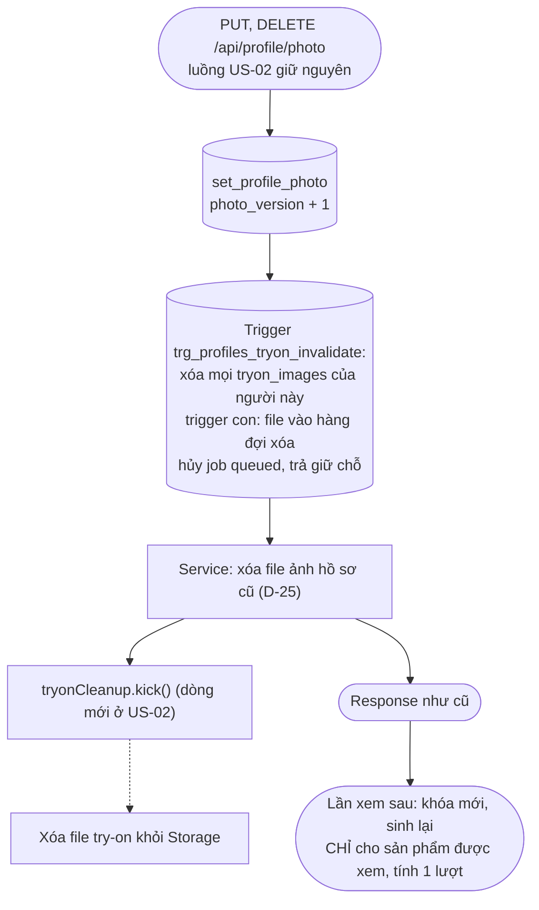
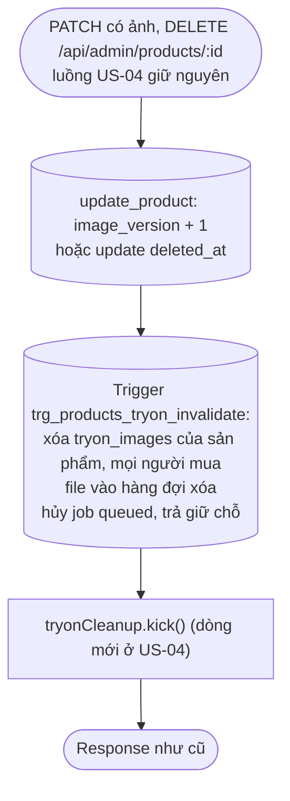

# Luồng: Xóa ảnh try-on khi ảnh gốc đổi

> US-05 R3, R5, §5.5, AC-08, AC-09, AC-12, AC-13 · D-24, D-42, D-49, D-79, D-80

Thực hiện bằng **trigger DB**, chạy trong cùng transaction với việc đổi ảnh. `set_profile_photo`, `update_product` và lệnh xóa mềm sản phẩm **không đổi**.

## 1. Thay hoặc xóa ảnh hồ sơ

## 2. Thay ảnh hoặc xóa mềm sản phẩm

Trigger chỉ chạy khi `image_version` đổi hoặc `deleted_at` từ null sang có giá trị. **Đổi tên, giá, danh mục không chạy** (AC-12, D-49).

Sản phẩm phổ biến có thể có nhiều dòng `tryon_images`; lệnh `DELETE` nằm trong request của admin. Có index theo `product_id`, chấp nhận ở quy mô hiện tại. File xóa ở nền, không làm chậm response.

## 3. Quy tắc quan trọng

| Quy tắc | Lý do |
|---|---|
| Không sinh lại hàng loạt | Kiểm soát chi phí (D-79). Không có đường sinh nào ngoài yêu cầu của người mua |
| Giữ dòng sản phẩm và ảnh gốc khi xóa mềm | D-42. Ảnh try-on chứa thân thể người dùng nên vẫn xóa (D-80) |
| Cứu sản phẩm bằng SQL | Đặt `deleted_at = null`: trigger không chạy, ảnh try-on đã mất, được sinh lại khi xem |
| Job đã gửi không hủy | Kết quả bị bỏ khi về, xem [tryon-job-finish](tryon-job-finish.md) |
| `tryonCleanup.kick()` là best-effort | Lỗi không làm hỏng request. Nếu không chạy được, tick của hàng đợi sẽ xử lý trong tối đa `TRYON_CLEANUP_TICK_SECONDS` |
| Không xóa bằng cách quét theo prefix `userId/` | Hàng đợi có danh sách chính xác; quét bucket chậm, có thể xóa nhầm file của job đang upload hợp lệ |
| Nội dung hộp thoại ở Hồ sơ | Thêm câu về ảnh thử đồ (US-05 §5.5), bước 4 chốt chữ |
