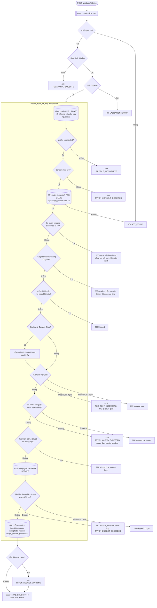
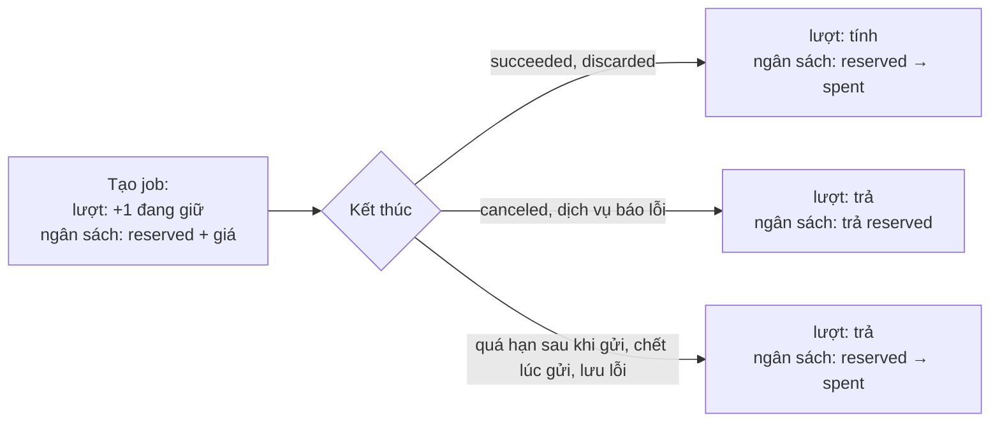

# Luồng: Tạo job, cache, lượt, ngân sách

> US-05 R1, R2, R9, R11, R12, E2, E3, E8–E11, AC-01, AC-02, AC-04, AC-06, AC-16, AC-17, AC-21 · `POST /api/try-on/products/:productId/jobs` · D-49, D-71, D-75, D-76, D-77, D-88, D-90, D-94

Phần trong khung DB là **một transaction** của `create_tryon_job`. Đây là chỗ giữ các bảo đảm khi chạy song song.

`TRYON_ENABLED=false` hoặc đang tạm dừng do lỗi cấu hình: service gọi `get_tryon_result` trước. Có ảnh thì trả ảnh, chưa có thì 503, không tạo job.

## Vòng đời giữ chỗ

## Quy tắc quan trọng

| Quy tắc | Lý do |
|---|---|
| Client không gửi version hay URL | Khóa đọc từ DB trong transaction (US-05 mục 7) |
| Tra cache trước mọi giới hạn | Ảnh đã có luôn xem được (D-94) |
| Lượt không có bảng đếm riêng | Đếm từ `tryon_jobs`, không lệch số; khóa profile bảo đảm đúng khi song song |
| Không kiểm danh mục riêng | Sản phẩm chưa xóa thì danh mục chưa xóa (D-41) |
| `quota_pending` có nguyên nhân khác `quota_day` | Lượt cuối đang giữ cho job đang chạy, có thể được trả lại, nên `retryAfterSeconds` = 15 |
| Giới hạn ngày, tháng theo giờ Việt Nam | Quyết định ở Q4, `Asia/Ho_Chi_Minh` trong SQL |
| Điều kiện chỉ FE biết (tab ẩn, tiết kiệm dữ liệu, ảnh hiện tại đang lỗi) | Xem [tryon-prefetch](tryon-prefetch.md) |
