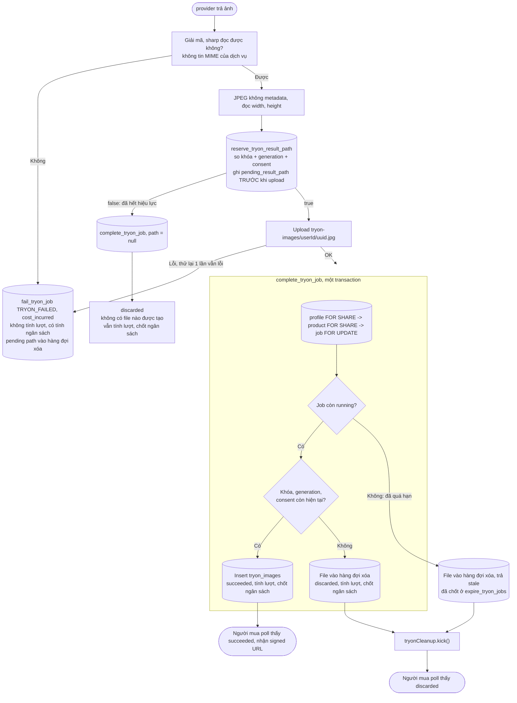

# Luồng: Có kết quả, kết quả về muộn

> US-05 R6, R7, R11, E17, AC-03, AC-11, AC-19 · `complete_tryon_job` · D-77, D-78, D-79, D-80

## Vì sao không có khe

| Thao tác song song | Giữ khóa | Hai thứ tự có thể xảy ra |
|---|---|---|
| Thay/xóa ảnh hồ sơ | `profiles` `FOR UPDATE` | Thay trước: `complete` thấy version khác → bỏ. `complete` trước: ảnh được ghi, rồi trigger xóa ngay trong transaction thay ảnh |
| Rút consent | `profiles` `FOR UPDATE` | Như trên, `generation` khác |
| Rút rồi đồng ý lại | Như trên, 2 lần | Các cột consent hợp lệ trở lại, nhưng `generation` đã khác → bỏ |
| Thay ảnh sản phẩm | `products` `FOR UPDATE` | Như trên, `image_version` khác |
| Xóa mềm sản phẩm | `products`, do lệnh `update` | Như trên, `deleted_at` khác null |

Đã chạy song song trên PostgreSQL thật, xem [`db/README.md`](../db/README.md#10-đã-kiểm-tra-những-gì).

## Quy tắc quan trọng

| Quy tắc | Lý do |
|---|---|
| **Tính lượt cả khi bị bỏ** | Dịch vụ đã sinh xong, tiền đã mất (US-05 R11). Đã nêu rõ ở D-77 |
| Không tính lượt khi lưu lỗi (E17) | Người mua không nhận được gì. Ngân sách vẫn tính vì tiền đã mất |
| Ghi `pending_result_path` trước khi upload | Chết sau upload vẫn biết file nào cần xóa, không phải quét bucket |
| Upload rồi mới ghi DB | Giống D-25. Không bao giờ có dòng trỏ tới file chưa tồn tại |
| Bản tạm và ảnh giải mã không xuống đĩa | D-82 |
| Mã hóa lại dù nhà cung cấp đã trả JPEG | Bỏ metadata (D-78), và chứng minh file đọc được là ảnh (US-05 mục 7) |
