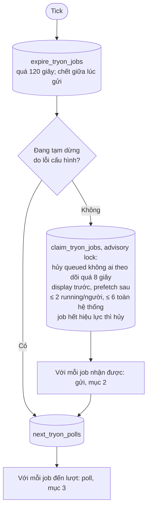
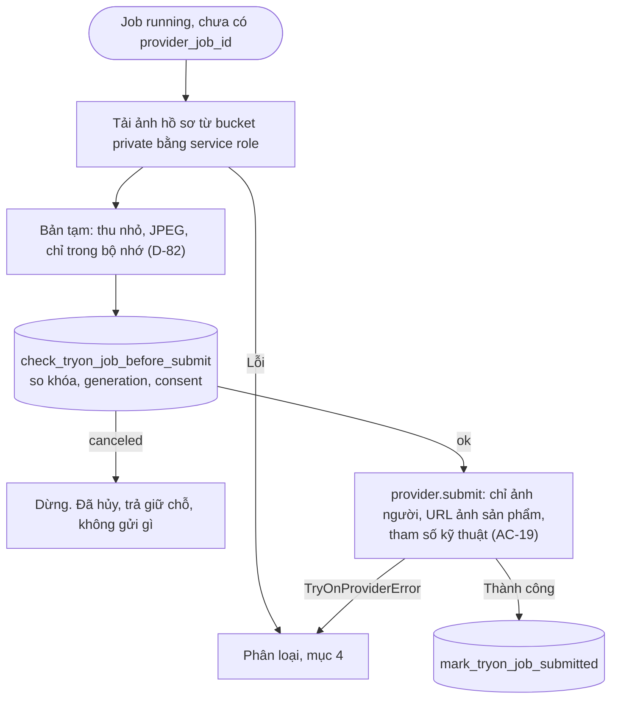
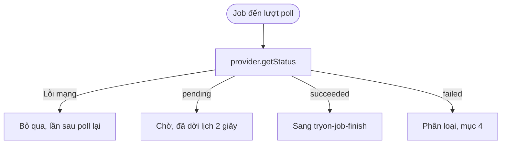
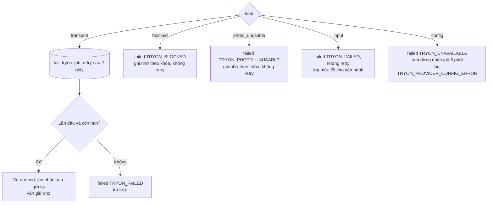

# Luồng: Worker gửi, poll, retry, lỗi

> US-05 R7, R8, R10, R12, E12–E19, AC-14, AC-15, AC-19, AC-20; US-06 R4, R6, AC-07, AC-08 · D-75, D-76, D-82, D-86, D-90, D-91

Worker là vòng lặp trong tiến trình Express, tick mỗi `TRYON_WORKER_TICK_MS` (1 giây), được đánh thức ngay khi có job mới. **Không giữ trạng thái job trong bộ nhớ**; khởi động lại thì chạy tiếp từ DB.

## 1. Mỗi tick

## 2. Gửi đi

Tiến trình chết sau khi gửi mà chưa kịp ghi `provider_job_id`: hết lease 30 giây, `expire_tryon_jobs` đánh dấu `failed`, tính vào ngân sách vì không biết request đã tới chưa.

## 3. Poll

## 4. Phân loại lỗi

Bảng ánh xạ đầy đủ ở [`tryon-provider.md`](../tryon-provider.md#4-phân-loại-lỗi).

## 5. Hủy và ưu tiên

| Tình huống | Xử lý | Bảo đảm ở |
|---|---|---|
| Rời sản phẩm khi job `queued`, không tab nào poll nữa | Quá 8 giây không poll, `claim` hủy, trả giữ chỗ (AC-07) | DB |
| Rời sản phẩm khi job đã gửi | Không hủy được (D-86). Kết quả vẫn lưu, tính lượt (AC-06) | DB |
| Hai tab cùng theo dõi một job | Một tab rời đi không ảnh hưởng tab kia, vì không có lệnh hủy, chỉ dựa vào lần poll cuối | DB |
| Job `display` mới khi đã đủ 2 job | Hủy `prefetch` chưa gửi; job mới xếp hàng, đi trước `prefetch` ở lần nhận sau (R6) | DB |
| Đã có 2 job `running`, không còn `prefetch` chưa gửi | Job `display` nằm `queued`, người mua thấy trạng thái chờ bình thường (E10) | DB |

## 6. Không có gì được log

Log có: `jobId`, `productId`, `userId`, `providerCode`, thời gian. Không có: ảnh, base64, signed URL, đường dẫn, số đo, API key, message gốc của nhà cung cấp (AC-20). Message của nhà cung cấp có thể lặp lại nội dung đầu vào.
