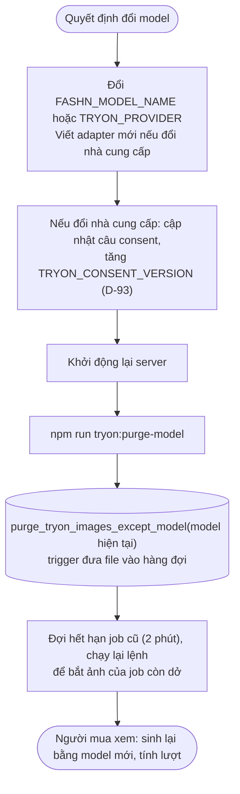

# Luồng: Đổi model

> US-05 R15 · D-49, D-89, D-91

Khóa cache D-49 không chứa model, nên đổi model phải xóa cache bằng lệnh. Lệnh này do người vận hành chủ động chạy, không tự động: nó làm mọi người mua phải sinh lại ảnh, tốn lượt và tiền.

## Quy tắc quan trọng

| Quy tắc | Lý do |
|---|---|
| Chạy lại được, chỉ xóa ảnh **khác** model hiện tại | Job gửi bằng model cũ có thể về sau lần chạy đầu |
| Ghi nhớ bị chặn theo cả `model_name` | Model mới có thể chấp nhận cùng cặp ảnh, nên được thử lại mà không cần xóa job |
| Giá khác thì sửa `TRYON_COST_PER_IMAGE_USD` | Job cũ giữ `cost_micro_usd` lúc tạo, sổ ngân sách vẫn đúng |
| Giới hạn và ngân sách không reset | Đổi model không phải lý do cho thêm lượt. Nếu nhiều người bị ảnh hưởng, user quyết định riêng |
| Đổi `mode`, `moderation_level` | **Không** xóa cache trừ khi user muốn; ảnh cũ vẫn dùng được |
