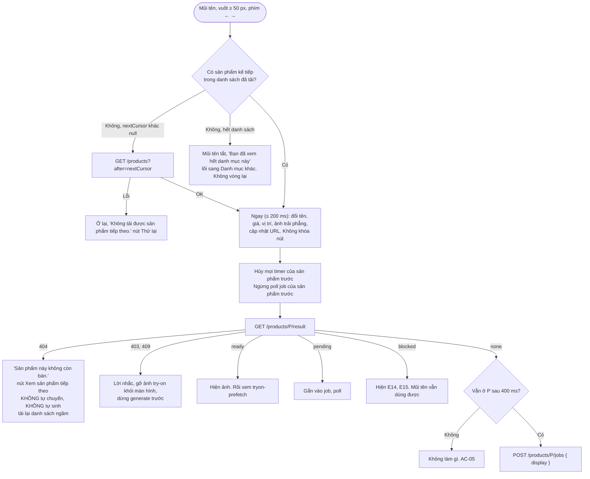
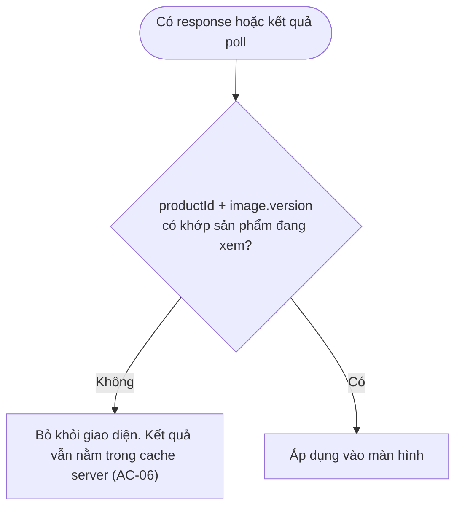
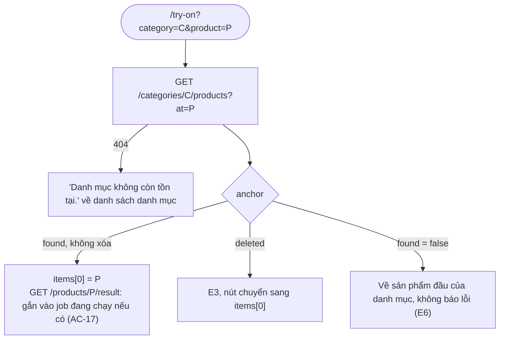

# Luồng: Chuyển sản phẩm

> US-06 §4, R1–R10, E1–E10, AC-01, AC-02, AC-05, AC-06, AC-09 → AC-18 · D-44, D-84, D-86, D-87

## 1. Một lần chuyển

Thứ tự: `GET /result` chạy ngay; đếm 400 ms bắt đầu từ lúc **chuyển tới**, không phải lúc có response.

## 2. Xử lý kết quả về khi đã đổi sản phẩm

## 3. Mở trang bằng URL, tải lại

## 4. Quy tắc quan trọng

| Quy tắc | Lý do |
|---|---|
| Con trỏ `(created_at, id)`, không theo số thứ tự | Thêm, xóa sản phẩm không làm lặp hay bỏ sót (AC-11) |
| Con trỏ của sản phẩm đã xóa vẫn dùng được | Hàm so vị trí, không yêu cầu dòng còn hiệu lực. Tìm được sản phẩm kế tiếp sau khi xóa (AC-12) |
| Sản phẩm mới chỉ hiện khi chọn lại danh mục | Vị trí đang xem không nhảy (E7) |
| Lỗi nằm tại sản phẩm đó | Mũi tên không khóa (AC-14) |
| Hết lượt vẫn lướt được | Ảnh đã có hiện bình thường (E2, AC-15) |
| Khóa bộ nhớ tạm ở FE có `image.version` | Không hiện ảnh cũ sau khi đổi ảnh sản phẩm (R9) |
| Signed URL chỉ trong bộ nhớ trang | US-06 mục 9. URL của trang chỉ có id, không có URL ảnh |
| Tải trước ảnh liền kề | Chỉ `GET /result` + ``, không bao giờ `POST /jobs` (R10) |
| Sản phẩm đang xem bị xóa mà không thao tác | Giữ ảnh tới lần gọi API kế tiếp, không cập nhật thời gian thực (E4) |
