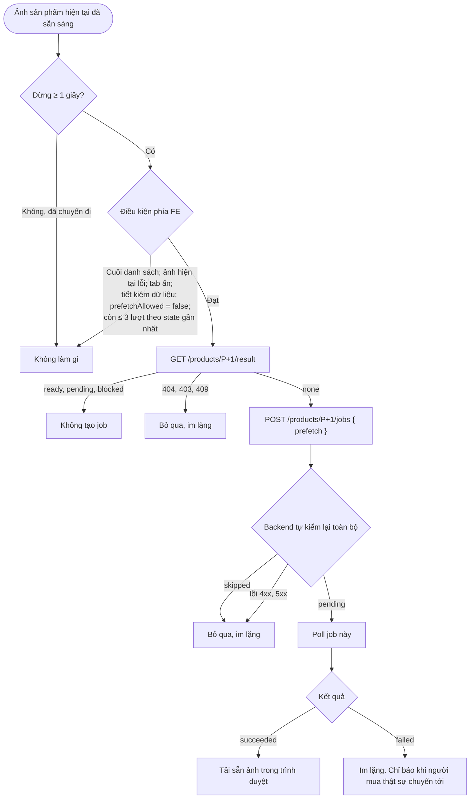
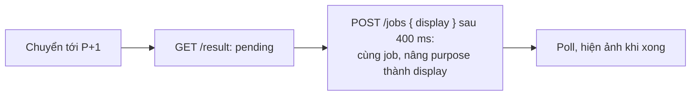

# Luồng: Generate trước

> US-06 §4.3, R5, R6, AC-03, AC-04, AC-08 · D-85, D-90, D-94

Chỉ chạy khi có `TRYON_PREFETCH_ENABLED=true`. Ảnh chưa được chuyển tới thì người mua không thấy.

## Phân chia trách nhiệm

| Điều kiện | FE | BE | Vì sao |
|---|---|---|---|
| Dừng ≥ 1 giây, ảnh hiện tại sẵn sàng hoặc lỗi | Có | — | Chỉ FE biết |
| Tab ẩn, tiết kiệm dữ liệu | Có | — | Chỉ FE biết |
| Cuối danh sách | Có | — | FE đang giữ danh sách |
| Ảnh kế tiếp đã có, đang chạy, bị chặn | Có | **Có** | |
| Còn ≤ 3 lượt | Có | **Có** | Client không ép được (US-06 mục 6) |
| Đã có 2 job của người này | — | **Có** | |
| Hệ thống bận (`queued + running ≥ 6`) | — | **Có** | |
| Từ 80% ngân sách | Có | **Có** | |
| Quyền, consent, hồ sơ, sản phẩm | — | **Có** | |

## Chuyển tới khi generate trước đang chạy

Nâng `purpose` để job còn `queued` đi trước và không bị job hiển thị khác hủy. Khi nâng, ảnh này được tính là người mua đã xem.

## Đo hiệu quả

US-06 mục 9: nếu ảnh generate trước được xem dưới 50% thì báo lại để cân nhắc tắt. `npm run tryon:report` tính từ `tryon_jobs.purpose = 'prefetch'` và `tryon_images.first_viewed_at`.
