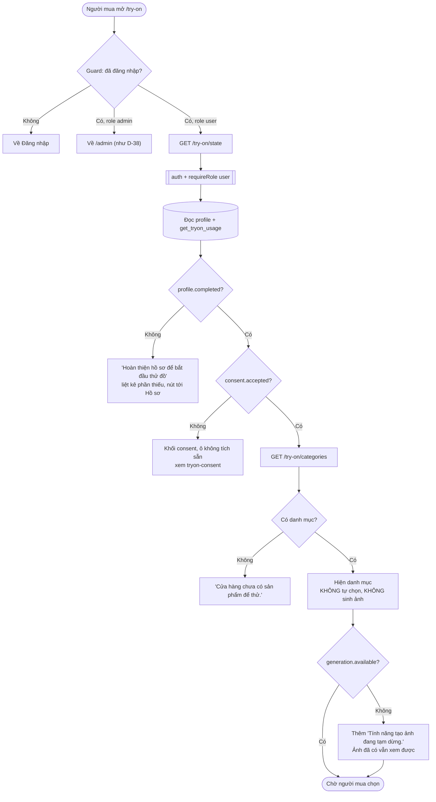

# Luồng: Vào phòng thử đồ

> US-05 §5.1, E1–E5, E10, AC-01, AC-02, AC-21 · `GET /api/try-on/state` · D-09, D-71, D-72, D-93, D-95

## Quy tắc quan trọng

| Quy tắc | Lý do |
|---|---|
| `GET /state` không chặn, chỉ báo trạng thái | Một chỗ để FE quyết định màn hình. Chốt thật nằm ở backend khi tạo job (D-71) |
| Không tự chọn danh mục | Tránh tốn lượt ngoài ý muốn (D-72) |
| Không có URL ảnh nào trong `/state` | Không ký URL khi chưa cần |
| Số đo vẫn là điều kiện dù model không dùng | D-95. Nói rõ ở màn hình nếu cần, xử lý ở bước 4 |
