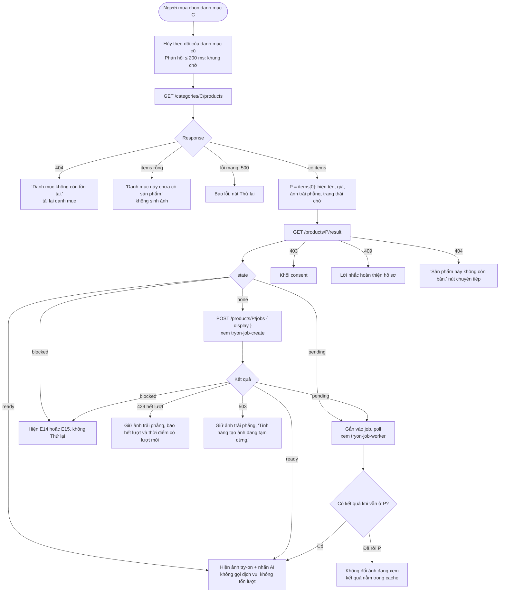
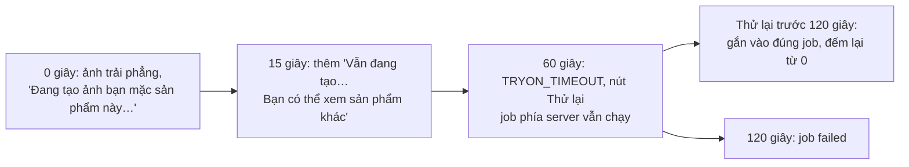

# Luồng: Chọn danh mục, hiện sản phẩm đầu tiên

> US-05 §4, §5.3, §5.4, E5–E8, E20–E22, AC-03 → AC-07 · D-44, D-72, D-73, D-74

## Trạng thái chờ theo thời gian (D-74)

## Quy tắc quan trọng

| Quy tắc | Lý do |
|---|---|
| `GET /result` trước, `POST /jobs` sau | Tải lại trang, quay lại sản phẩm không có nguy cơ tạo job thừa |
| Mọi trạng thái lỗi đều giữ thông tin và ảnh trải phẳng | Không bao giờ là màn hình trống; US-07 cần thêm vào giỏ được cả khi ảnh lỗi |
| Không có phần trăm giả | US-05 mục 4 |
| Ảnh tải về lỗi dù API thành công | E22: nút **Tải lại ảnh**, gọi lại `GET /result`, không tốn lượt |
| Signed URL hết hạn lúc đang xem | E20: gọi lại `GET /result`, không báo lỗi |
