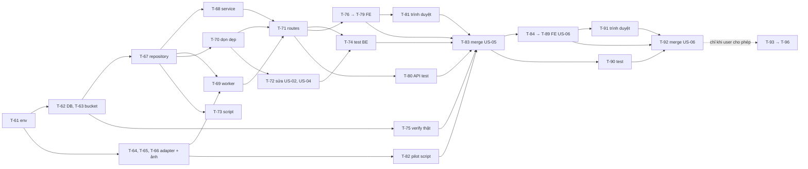

# Sprint 03 — Sprint backlog

> Epic 3: Phòng thử đồ · Stories: [US-05](US-05.md), [US-06](US-06.md) · Thiết kế: [`design/`](design/api.md) · Quyết định: D-71 → D-96

## Mục lục
1. [Mục tiêu sprint](#1-mục-tiêu-sprint)
2. [Quy ước](#2-quy-ước)
3. [Thư viện](#3-thư-viện)
4. [Biến môi trường](#4-biến-môi-trường)
5. [Danh sách task](#5-danh-sách-task)
6. [Thứ tự thực hiện](#6-thứ-tự-thực-hiện)
7. [Phụ thuộc vào thiết kế bước 3/4](#7-phụ-thuộc-vào-thiết-kế-bước-34)
8. [Definition of Done của sprint](#8-definition-of-done-của-sprint)

---

## 1. Mục tiêu sprint

Người mua chọn danh mục, thấy ảnh chính mình mặc sản phẩm, chuyển sản phẩm bằng mũi tên hoặc vuốt. Chi phí bị chặn cứng, ảnh nhạy cảm được xóa thật khi hết hiệu lực.

Sprint có **hai mức hoàn thành**:

| Mức | Nội dung | Ai quyết |
|---|---|---|
| **A. Xong với adapter giả** | Toàn bộ chức năng và test, không gọi dịch vụ thật, không tốn tiền | agent-coder làm, user xác nhận merge |
| **B. Nghiệm thu thật** | API key, pilot ảnh người thật, đo độ trễ và chi phí | **Chỉ làm khi user cho phép riêng** (D-91) |

## 2. Quy ước

| Mục | Quy ước |
|---|---|
| Đánh số | Tiếp nối sprint 02 (kết thúc ở T-60) |
| Ước lượng | **S** ≤ 2 giờ · **M** nửa ngày · **L** ~1 ngày |
| Branch | US-05: `feature/US-05-tryon-room`. US-06: `feature/US-06-product-navigation`, **tạo sau khi US-05 đã merge** vì dùng toàn bộ lõi của US-05. Tạo bằng `/branch` từ `main` mới nhất |
| Merge | Chỉ `/merge` khi unit test + API test pass **và user xác nhận**; ghi `PROGRESS.md` |
| Thứ tự trong story | Migration → Backend → Unit test BE → Frontend → Test FE → API test → Merge |
| API test | Nguồn chuẩn: `backend/tests/postman/` + `npm run test:postman` (D-40) |
| Không gọi dịch vụ thật khi test | `TRYON_PROVIDER=fake` là mặc định. Xem chốt chặn ở [`design/tryon-provider.md`](design/tryon-provider.md#2-adapter-giả) |
| Không gửi ảnh người | Mọi test dùng ảnh fixture sinh bằng sharp. Bộ ảnh pilot không nằm trong repo |
| Trạng thái | `[ ]` chưa làm · `[x]` xong · `[U]` chờ user |

## 3. Thư viện

**Không cần cài thêm thư viện.** agent-coder vẫn tra Context7 trước khi dùng API mới.

| Thư viện có sẵn | Dùng mới ở sprint này |
|---|---|
| `@supabase/supabase-js` 2.118 | `storage.from().download`, `remove` nhiều đường dẫn, `rpc` trả nhiều cột |
| `sharp` 0.35 | Thu nhỏ bản tạm chỉ trong bộ nhớ; đọc `metadata()` ảnh kết quả; mã hóa lại JPEG không metadata |
| `file-type` 22 | Kiểm ảnh kết quả theo magic bytes, không tin MIME của dịch vụ |
| `express-rate-limit` 8 | Hai bộ đếm tách nhau: tạo job, đọc |
| `zod` 4 | Schema query con trỏ, `purpose`, env mới |
| `pg` 8 | `verify:tryon` chạy song song (đã dùng cho `migrate`) |
| `fetch`, `AbortSignal.timeout` có sẵn của Node 24 | Adapter FASHN. **Không dùng SDK của FASHN**: chỉ cần 2 endpoint, adapter tự quản lý lỗi và timeout, và dễ thay `fetchImpl` khi test |

Frontend không thêm thư viện. Vuốt dùng Pointer Events, ảnh chờ dùng component có sẵn.

## 4. Biến môi trường

### `backend/.env.example` (thêm mới; thêm vào `src/config/env.js`, có default trừ `FASHN_API_KEY`)

| Biến | Ví dụ | Ghi chú |
|---|---|---|
| `TRYON_ENABLED` | `true` | Công tắc tắt ngay (US-05 mục 10). `false`: ảnh đã có vẫn xem được, không tạo job |
| `TRYON_PREFETCH_ENABLED` | `true` | Tắt riêng generate trước (US-06 mục 9) |
| `TRYON_PROVIDER` | `fake` | `fake` \| `fashn`. **Giữ `fake` cho tới khi user cho phép** |
| `TRYON_FAKE_DELAY_MS` | `1500` | Chỉ adapter giả |
| `TRYON_IMAGE_BUCKET` | `tryon-images` | Bucket private (D-78) |
| `TRYON_IMAGE_MAX_MB` | `5` | Ước lượng |
| `TRYON_DAILY_LIMIT` | `20` | D-94 |
| `TRYON_MONTHLY_LIMIT` | `100` | D-94 |
| `TRYON_MONTHLY_BUDGET_USD` | `50` | D-94 |
| `TRYON_BUDGET_WARN_PERCENT` | `80` | D-94 |
| `TRYON_COST_PER_IMAGE_USD` | `0.075` | D-91. Giá công bố, chưa đo |
| `TRYON_PREFETCH_MIN_REMAINING` | `3` | D-85 |
| `TRYON_MAX_RUNNING_PER_USER` | `2` | D-90 |
| `TRYON_MAX_ACTIVE_PER_USER` | `4` | Đề xuất D-97 |
| `TRYON_SYSTEM_CONCURRENCY` | `6` | Giới hạn mặc định của FASHN theo tài liệu |
| `TRYON_JOB_DEADLINE_SECONDS` | `120` | US-05 R7 |
| `TRYON_MAX_ATTEMPTS` | `2` | D-76: gửi lần đầu + 1 lần thử lại |
| `TRYON_RETRY_DELAY_SECONDS` | `2` | US-05 R8 |
| `TRYON_POLL_SECONDS` | `2` | Poll nhà cung cấp |
| `TRYON_SUBMIT_LEASE_SECONDS` | `30` | Quá hạn thì coi tiến trình gửi đã chết |
| `TRYON_QUEUE_STALE_SECONDS` | `8` | Job `queued` không ai poll quá mức này thì hủy. Ước lượng |
| `TRYON_WORKER_TICK_MS` | `1000` | |
| `TRYON_PROVIDER_PAUSE_SECONDS` | `300` | Tạm dừng khi hết credit, sai key |
| `TRYON_CLEANUP_TICK_SECONDS` | `30` | Hàng đợi xóa file |
| `TRYON_DELETE_RETRY_SECONDS` | `60` | |
| `TRYON_IMAGE_RETENTION_DAYS` | `90` | D-81 |
| `TRYON_JOB_RETENTION_DAYS` | `35` | Phải lớn hơn một tháng để đếm lượt tháng |
| `TRYON_JOB_CREATES_PER_MIN` | `30` | D-88 |
| `TRYON_READS_PER_MIN` | `240` | Ước lượng |
| `FASHN_API_KEY` | để trống | **Bắt buộc khi `TRYON_PROVIDER=fashn`**. Không commit |
| `FASHN_BASE_URL` | `https://api.fashn.ai/v1` | |
| `FASHN_MODEL_NAME` | `tryon-v1.6` | D-91 |
| `FASHN_MODE` | `balanced` | |
| `FASHN_MODERATION_LEVEL` | `permissive` | |
| `FASHN_OUTPUT_FORMAT` | `jpeg` | |
| `FASHN_MODEL_IMAGE_MAX_SIDE` | `1536` | Ước lượng, kiểm trong pilot |
| `FASHN_REQUEST_TIMEOUT_MS` | `15000` | Từng request, khác hạn của job |

Hằng số trong code, không phải env: `TRYON_CONSENT_VERSION = 1`, giống `PHOTO_CONSENT_VERSION` (D-22).

### `frontend/.env.example`

Không đổi (D-02).

### `backend/tests/postman/run.js`

Ép `TRYON_PROVIDER=fake`, nâng `TRYON_JOB_CREATES_PER_MIN`, `TRYON_READS_PER_MIN`, giảm `TRYON_FAKE_DELAY_MS`, cho tiến trình server. **Ghi đè cả `.env`**, để máy đã có key thật vẫn không gọi dịch vụ.

## 5. Danh sách task

### 5.1 US-05 — Phòng thử đồ (branch `feature/US-05-tryon-room`)

**Backend**

| ID | Task | Phụ thuộc | Ước lượng | Definition of Done | TT |
|---|---|---|---|---|---|
| T-61 | Thêm biến mục 4 vào `.env.example` + `env.js`. `fashn` thiếu key → không khởi động; `NODE_ENV=test` + `fashn` → không khởi động | — | S | Test env: default, sai kiểu, hai chốt chặn | [x] |
| T-62 | Chép `design/db/005_*.sql`, `006_*.sql` sang `migrations/`, chạy `npm run migrate` trên Supabase dev | T-61, Thiết kế DB | S | `get_advisors` security không có cảnh báo mới; gọi REST `tryon_jobs`, `/rpc/create_tryon_job` bằng anon key bị chặn; test US-02, US-04 vẫn pass với trigger mới | [x] |
| T-63 | `storageSetup`: thêm `ensureTryonImageBucket`; `setup-storage.js` tạo bucket thứ 3; thêm `download` vào `createPhotoStorage`; cập nhật mô tả lệnh trong `CLAUDE.md`. Chạy trên Supabase dev | T-61 | S | Chạy lần 2 báo `unchanged`; `tryon-images` private; truy cập file không có token bị từ chối | [x] |
| T-64 | `services/tryon/provider.js` (JSDoc, `TryOnProviderError`), `fakeProvider.js` đủ kịch bản ở `tryon-provider.md` mục 2 | T-61 | S | Test: từng kịch bản trả đúng `kind`; mảng `calls` ghi lại request | [x] |
| T-65 | `services/tryon/fashnProvider.js` theo `tryon-provider.md` mục 3–4, nhận `fetchImpl` | T-64 | M | Test bằng `fetchImpl` giả: body đúng tham số, `num_samples: 1`, không có số đo/email/`userId`; **mọi dòng** bảng lỗi mục 4 ra đúng `kind` và `costMaybeIncurred`; `_expired`, trạng thái lạ, `POST` hết giờ không tự retry. Không có `fetch` thật | [x] |
| T-66 | `services/tryon/tryonImage.js`: `prepareModelImage`, `normalizeResult` (magic bytes, decode, JPEG không metadata, width/height) | T-61 | S | Test: ảnh hỏng → lỗi; kết quả không còn EXIF; không ghi file tạm | [x] |
| T-67 | `repositories/tryonRepository.js`: bọc mọi hàm SQL ở `db/README.md` mục 4, map snake_case | T-62 | M | Service không biết tới `rpc`; `create_tryon_job` nhận cấu hình từ env một chỗ duy nhất | [x] |
| T-68 | `services/tryonService.js` + `validation/tryonSchemas.js`: state, consent, danh mục (lọc `productCount > 0`), danh sách con trỏ, result, tạo job, map `out_status` sang HTTP theo `api.md`. Con trỏ giữ `created_at_raw` | T-67 | M | Test: mọi `out_status` ra đúng HTTP và mã; con trỏ hỏng → 400; `at` với sản phẩm đã xóa, sai danh mục | [x] |
| T-69 | `services/tryon/worker.js` theo `flows/tryon-job-worker.md`, `tryon-job-finish.md`: tick, wake, expire, claim, gửi, poll, phân loại lỗi, tạm dừng khi `config` | T-64, T-66, T-67 | L | Worker test được bằng fake + repository giả, điều khiển thời gian bằng tham số, không `setTimeout` thật trong test | [x] |
| T-70 | `services/tryon/cleanup.js` theo `flows/tryon-cleanup.md`: `kick()`, tick hàng đợi, việc hằng ngày, log `ORPHAN_TRYON_IMAGE` | T-67 | S | Test: Storage lỗi → dòng còn trong hàng đợi, không làm hỏng request; không log đường dẫn | [x] |
| T-71 | Controller, routes `/api/try-on/*`, 2 rate limiter, lắp vào `container.js`, `server.js` (`startWorker`, tắt worker khi shutdown; `createApp` trong test không tự chạy worker) | T-68, T-69, T-70 | M | Khớp `api.md`; thứ tự: auth → role → uuid → rate limit → body; admin 403 | [x] |
| T-72 | **Sửa US-02, US-04 (backend):** gọi `tryonCleanup.kick()` sau `replacePhoto`, `deletePhoto` trong `profileService`, sau `update` có ảnh và `remove` trong `productService`. Không sửa migration 002, 004 đã chạy: phần DB nằm ở trigger của `006` | T-70 | S | Test cũ pass; lỗi `kick` không làm request lỗi; contract không đổi | [x] |
| T-73 | Script `npm run tryon:purge-model` (D-89), `npm run tryon:report` (số job theo trạng thái, p50/p95 từ gửi tới xong, tỉ lệ generate trước được xem, ước tính chi phí; không có dữ liệu cá nhân) | T-67 | S | Chạy trên dev với adapter giả; output không có id người dùng | [x] |
| T-74 | Test BE tập trung rủi ro (Supertest, adapter giả, repository giả): AC-01, AC-02, AC-13, AC-14 → AC-21 của US-05; không gọi dịch vụ khi thiếu điều kiện; log không chứa base64, URL, đường dẫn, số đo (AC-20) | T-71, T-72 | M | Pass; không có test trivia | [x] |
| T-75 | Script `npm run verify:tryon` chạy thật trên Supabase dev, chuyển từ `design/db/checks/concurrency-test.mjs`: song song cùng khóa, lượt cuối, ngân sách, `claim`, `complete` đua với 5 thao tác hủy hiệu lực, tải hỗn hợp. **Không gọi dịch vụ, không có ảnh người**: chỉ dòng DB tổng hợp, tự dọn | T-62 | M | 0 vi phạm, 0 deadlock qua PostgREST + Supavisor; ghi kết quả vào `PROGRESS.md`; dọn sạch dữ liệu | [x] |

**Frontend**

| ID | Task | Phụ thuộc | Ước lượng | Definition of Done | TT |
|---|---|---|---|---|---|
| T-76 | `features/tryon/`: `tryonApi.js`, route `/try-on` (admin về `/admin`), mục điều hướng, màn hình theo `flows/tryon-room-entry.md` | T-71, Màn hình bước 4 | S | AC-01; lazy-load route | [x] |
| T-77 | Khối consent ở phòng (ô không tích sẵn, chi tiết). **Sửa US-02 (frontend):** khối rút consent ở `/profile`, nội dung modal `ConsentBlock`, hộp thoại xóa và thay ảnh (US-05 §5.5). `PHOTO_CONSENT_VERSION` giữ nguyên | T-76 | M | AC-02, AC-10 trên UI; câu consent nêu đủ theo D-93 | [x] |
| T-78 | Trang phòng thử đồ: danh mục, sản phẩm đầu, khung ảnh ổn định, chờ theo mốc 200 ms / 15 giây / 60 giây, hook poll, nhãn AI, E2–E22, số lượt khi ≤ 5, đổi danh mục giữa chừng | T-76 | L | AC-03 → AC-07, AC-15 trên UI, ≥ 360 px; `aria-live`, `prefers-reduced-motion` | [x] |
| T-79 | Test FE: hook poll (dừng khi rời, kết quả muộn không đổi ảnh), mốc thời gian bằng fake timer, map lỗi, consent; schema dùng chung bảng case với BE (D-21) | T-77, T-78 | M | Pass | [x] |
| T-80 | API test `tryon.collection.json`, thêm vào `run.js`: US-05 AC-01 → AC-04, AC-06 → AC-13, AC-16 → AC-18, AC-21 với adapter giả (sản phẩm `FAKE-*`). Có poll như D-39 cho link bị từ chối. Không đưa service role key vào collection | T-71, T-47 | L | `npm run test:postman` pass cả bộ; chạy lại lần 2 vẫn pass; không có request nào ra ngoài | [x] |
| T-81 | Kiểm tra trình duyệt thật ở 360, 768, 1280 px với adapter giả: vào phòng, consent, chọn danh mục, chờ, lỗi, rút consent, xóa ảnh hồ sơ | T-78 | S | Không lỗi console, không tràn ngang, không xê dịch khung ảnh | [x] |
| T-82 | Script `npm run tryon:pilot` **chỉ viết, không chạy**: đọc thư mục ảnh ngoài repo qua tham số, gọi adapter FASHN, ghi độ trễ, `x-fashn-credits-used`, mã lỗi. Yêu cầu cờ `--confirm-people-consented` và giới hạn `--max 20`. Không ghi ảnh hay đường dẫn vào log | T-65 | S | Chạy với `TRYON_PROVIDER=fake` ra đúng báo cáo; thiếu cờ thì thoát | [x] |
| T-83 | Review + user xác nhận → `/merge`, ghi `PROGRESS.md` | T-74, T-75, T-79 → T-82 | S | `main` có US-05, test pass sau merge | [x] |

### 5.2 US-06 — Chuyển sản phẩm (branch `feature/US-06-product-navigation`, tạo sau T-83)

| ID | Task | Phụ thuộc | Ước lượng | Definition of Done | TT |
|---|---|---|---|---|---|
| T-84 | Hook điều hướng: danh sách theo con trỏ cả hai chiều, trạng thái trên URL, `at` khi tải lại, vị trí "3 / 12" | T-83 | M | US-06 AC-11, AC-17 | [ ] |
| T-85 | Mũi tên, vuốt (≥ 50 px và ngang > dọc), phím ←/→ (không khi đang gõ), đầu và cuối danh sách, `aria-label`, thông báo `aria-live` | T-84, Màn hình bước 4 | M | AC-01, AC-09, AC-18, mục 9 Usability | [ ] |
| T-86 | Chờ dừng 400 ms, gắn lại job đang chạy, chỉ kết quả đúng sản phẩm mới đổi ảnh, khóa bộ nhớ tạm có `image.version`, tải trước ảnh liền kề | T-84 | M | AC-02, AC-05, AC-06, AC-10 | [ ] |
| T-87 | Generate trước phía FE theo `flows/tryon-prefetch.md`: dừng ≥ 1 giây, các điều kiện dừng, lỗi im lặng, nâng lên `display` khi chuyển tới | T-86 | S | AC-03, AC-04; `prefetchAllowed = false` không gửi | [ ] |
| T-88 | Lỗi điều hướng E1–E10: xóa giữa chừng có nút chuyển tiếp, danh mục trống, hết lượt vẫn lướt, consent hết hiệu lực gỡ ảnh | T-86 | M | AC-12 → AC-16 | [ ] |
| T-89 | Test FE: rút gọn chuyển nhanh, kết quả về trễ, con trỏ, vuốt dọc không chuyển, điều kiện generate trước | T-85 → T-88 | M | Pass | [ ] |
| T-90 | Test BE và API test bổ sung vào `tryon.collection.json`: `prefetch` bị từ chối khi còn ≤ 3 lượt, đủ 2 job, ≥ 80% ngân sách, gọi thẳng API (AC-04, AC-08); con trỏ khi thêm, xóa sản phẩm (AC-11); job chưa gửi bị hủy, không tính lượt (AC-07) | T-83 | M | `npm run test:postman` pass cả bộ | [ ] |
| T-91 | Kiểm tra trình duyệt thật ở 360, 768, 1280 px: lướt nhanh, vuốt trên màn hình cảm ứng giả lập, hết lượt giữa chừng | T-85 → T-88 | S | Không lỗi console; khung ảnh không xê dịch | [ ] |
| T-92 | Review + user xác nhận → `/merge`, ghi `PROGRESS.md`; main agent chạy `/wrap-up` | T-89, T-90, T-91 | S | `main` có US-06, toàn bộ test sprint pass với adapter giả. **Mức A đạt** | [ ] |

### 5.3 Chờ user: dịch vụ thật (mức B)

**Không task nào dưới đây được bắt đầu nếu user chưa cho phép riêng.** Không task nào ở 5.1, 5.2 phụ thuộc vào chúng.

| ID | Task | Ai làm | Cần gì từ user | Definition of Done | TT |
|---|---|---|---|---|---|
| T-93 | Lấy API key FASHN, nạp credit, đặt vào `backend/.env` trên máy user. `TRYON_PROVIDER` vẫn `fake` | **User** | Tài khoản, tối thiểu $7.50 theo công bố; lưu ý gói mới từ tuần 4/1/2027 và credit hết hạn sau 12 tháng | Key không xuất hiện trong repo, chat, log | [U] |
| T-94 | Pilot 10–20 ảnh, so A với B, thử chân váy và đầm trải phẳng, thử `FASHN_MODEL_IMAGE_MAX_SIDE`, đo đủ 20 lượt theo US-05 mục 10 | **User chạy**, hoặc agent nếu user cho phép rõ | Ảnh của người **đã đồng ý cho dùng**, ngân sách khoảng $3, cho phép gửi ảnh ra nước ngoài | Có p50/p95, tỉ lệ `auto` sai; quyết định: giữ D-91 hay đổi, D-92 có phải thêm trường không. p95 > 30 giây thì báo user | [U] |
| T-95 | Chạy thử cả luồng trên dev với `TRYON_PROVIDER=fashn`, đúng 1 tài khoản của người đã đồng ý, ngân sách thấp (`TRYON_MONTHLY_BUDGET_USD=2`) | Agent, khi user cho phép | Xác nhận tài khoản và ngân sách | Luồng thành công, bị chặn, sai ảnh chạy đúng; `x-fashn-credits-used` khớp ước tính; đường dẫn `/v1/status` và các mục "chưa xác minh" ở `tryon-provider.md` được cập nhật | [U] |
| T-96 | Chốt ngưỡng ước lượng theo số đo thật (D-74, D-85, D-86, D-88, 8 giây stale, 1536 px), đo tỉ lệ generate trước được xem | agent-ba + user | Xem kết quả T-94, T-95 | `DECISIONS.md` cập nhật, generate trước < 50% thì user quyết định có tắt không | [U] |
| T-97 | Việc **trước khi ra mắt thật**, ngoài sprint nếu chưa ra mắt: người chuyên môn pháp lý xem câu consent, hồ sơ theo Luật 91/2025/QH15 Điều 20 | **User** | D-96 | Ghi kết luận vào `DECISIONS.md` | [U] |

**Tổng:** 37 task — US-05 23, US-06 9, chờ user 5.

**Ghi chú test:**
- API test để lại job và dòng ngân sách trên Supabase dev. Ngân sách tháng tính cả chúng, nên `run.js` đặt `TRYON_MONTHLY_BUDGET_USD` rất cao cho tiến trình server, và kịch bản hết ngân sách kiểm ở unit test và `verify:tryon`.
- AC-11 của US-05 và mọi kiểm tra "file đã xóa" phải chờ hàng đợi chạy xong, không kiểm ngay.
- Không kiểm p95 ở test tự động. T-81, T-91 quan sát; số thật thuộc T-94.

## 6. Thứ tự thực hiện

**Vì sao US-05 phải merge trước:** US-06 không có ý nghĩa nếu thiếu job, cache, lượt, consent. API `prefetch` và con trỏ đã nằm trong lõi US-05, US-06 chủ yếu là giao diện và test bổ sung.

## 7. Phụ thuộc vào thiết kế bước 3/4

| Tài liệu | Bước | Task cần |
|---|---|---|
| `design/db/README.md`, `005_*.sql`, `006_*.sql` | 3 | T-62, T-63, T-67, T-75 |
| `design/api.md` | 3 | T-68, T-71, T-74, T-76, T-80, T-90 |
| `design/tryon-provider.md` | 3 | T-64, T-65, T-69, T-82, T-95 |
| `design/flows/tryon-room-entry, consent, select-category` | 3 | T-68, T-76 → T-78 |
| `design/flows/tryon-job-create, job-worker, job-finish` | 3 | T-68, T-69 |
| `design/flows/tryon-invalidate, cleanup, model-switch` | 3 | T-70, T-72, T-73 |
| `design/flows/tryon-navigation, prefetch` | 3 | T-84 → T-88 |
| `design/design-system.md` (cập nhật nếu cần) | 4 | T-76 → T-78, T-85 |
| `screens/`: phòng thử đồ (mọi trạng thái, mũi tên, vuốt, đầu/cuối), consent, rút consent ở Hồ sơ, hộp thoại Hồ sơ | 4 | T-76 → T-78, T-85, T-88 |

Mọi task thuộc bước 5, chỉ bắt đầu sau khi bước 3 và bước 4 được user xác nhận.

## 8. Definition of Done của sprint

**Mức A: xong với adapter giả**

- [ ] Toàn bộ AC của US-05 (AC-01 → AC-21) và US-06 (AC-01 → AC-18) đạt, kiểm bằng test hoặc trên UI với adapter giả.
- [ ] `npm test`, `npm run lint`, `npm run build` (FE) pass. `npm run test:postman` pass trên Supabase dev.
- [ ] `npm run verify:tryon` 0 vi phạm, 0 deadlock trên Supabase dev.
- [ ] Không test nào gọi dịch vụ thật. Không ảnh người nào rời khỏi máy.
- [ ] Bucket `tryon-images` private; anon không truy cập được bảng và hàm mới.
- [ ] Migration trong `migrations/` khớp ERD sprint. `.env.example` đầy đủ, `TRYON_PROVIDER=fake`, không có secret.
- [ ] Mỗi story nằm trên branch riêng, merge **sau khi user xác nhận**; `PROGRESS.md` có merge log.
- [ ] `DECISIONS.md` có các quyết định đã duyệt của sprint này.
- [ ] Giao diện dùng được ở 360 px và desktop, thông báo lỗi tiếng Việt.

**Mức B: nghiệm thu thật (chỉ khi user cho phép)**

- [ ] T-94, T-95 đạt; các mục "chưa xác minh" ở `tryon-provider.md` được cập nhật.
- [ ] US-05 mục 10: p95 sinh ảnh đo trên 20 lượt, đã báo user nếu > 30 giây.
- [ ] D-91, D-92 được chốt lại theo kết quả pilot.

**Không thuộc sprint:** ra mắt thật cho người dùng (D-96, T-97).
