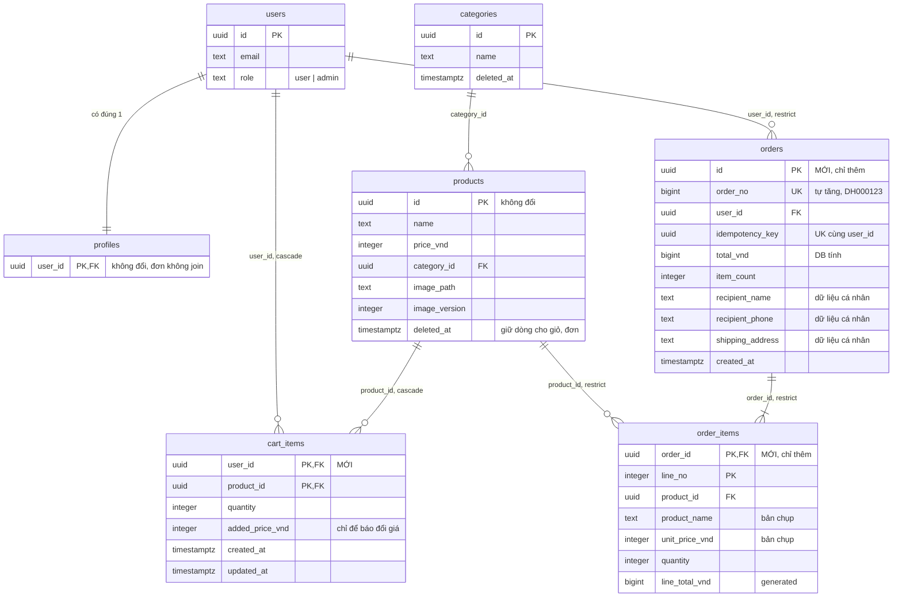

# Sprint 04 — Database

> Stories: US-07, US-08, US-09 · Đề xuất: D-137 → D-151 · SQL: [`007_create_cart.sql`](007_create_cart.sql), [`008_create_orders.sql`](008_create_orders.sql)

**Kế thừa:** `sprint-01/design/db/README.md`, `sprint-02/design/db/README.md`, `sprint-03/design/db/README.md`. Mọi bảng và hàm cũ **không đổi**. Không có bucket mới: đơn và giỏ dùng ảnh public `product-images`.

## Mục lục
1. [ERD](#1-erd)
2. [Thay đổi so với sprint 03](#2-thay-đổi-so-với-sprint-03)
3. [Schema](#3-schema)
4. [Hàm SQL](#4-hàm-sql)
5. [Rủi ro tương tranh được bảo đảm ở đâu](#5-rủi-ro-tương-tranh-được-bảo-đảm-ở-đâu)
6. [Index](#6-index)
7. [Bảo mật DB](#7-bảo-mật-db)
8. [Migration](#8-migration)
9. [Đã kiểm tra những gì](#9-đã-kiểm-tra-những-gì)
10. [Trade-off đã cân nhắc](#10-trade-off-đã-cân-nhắc)

---

## 1. ERD

`MỚI` là của sprint này. Bảng cũ chỉ liệt kê cột liên quan. Các bảng `tryon_*` từ sprint 03 không đổi, không có quan hệ với giỏ, đơn nên không vẽ lại.



## 2. Thay đổi so với sprint 03

| Hạng mục | Thay đổi | Lý do |
|---|---|---|
| Bảng mới | `cart_items`, `orders`, `order_items` | US-07, US-08 |
| Hàm mới | `get_cart`, `add_cart_item`, `set_cart_item_quantity`, `remove_cart_item`, `place_order` | Supabase-js không có transaction |
| `products` | **Không đổi cấu trúc.** `update_product`, xóa mềm có thể chờ rất ngắn khi một `place_order` giữ `FOR SHARE` | Bảo đảm giá trong đơn |
| `users` | **Không đổi cấu trúc.** Dòng `users` được dùng làm khóa nối tiếp theo người | D-145 |
| `tryon_*`, `profiles` | Không đổi, không đọc | D-146 |
| Storage | Không đổi | Ảnh trải phẳng public (D-46). D-42 giữ file nên ảnh trên giỏ, đơn vẫn còn sau khi xóa mềm |
| D-49 | Ảnh trên đơn **có thể khác** lúc đặt nếu admin thay ảnh. Tên và giá thì không | D-142 |

## 3. Schema

SQL đầy đủ ở 2 file `.sql`. Mục này chỉ nói những gì SQL không tự giải thích.

### 3.1 `cart_items`

- Khóa chính `(user_id, product_id)`: mỗi sản phẩm một dòng (D-52, D-140).
- `added_price_vnd` **không bao giờ dùng để tính tiền**. Hàm `get_cart` luôn lấy `products.price_vnd`.
- Giới hạn 10 món, 30 dòng truyền từ env vào hàm. `check (quantity between 1 and 999)` chỉ chặn dữ liệu sai.

### 3.2 `orders`

- **Không có `status`, không có cột thanh toán** (D-138). Thêm sau khi có story.
- `total_vnd` kiểu `bigint`: `3 × 10¹⁰` vượt `integer`. supabase-js nhận được số vì vẫn trong khoảng an toàn; T-100 kiểm.
- `recipient_phone` lưu dạng đã chuẩn hóa. `check` trong DB rộng hơn zod (`^0[0-9]{9}$`), để nới đầu số sau không phải sửa schema.
- `idempotency_key` chỉ lưu khi có đơn. Lần thử bị `CART_CHANGED` không để lại gì.
- `order_no` là `generated always as identity`: có thể có khoảng trống khi transaction hoàn tác. Không có nghĩa nghiệp vụ.
- `on delete restrict` với `users`: chưa có chức năng xóa tài khoản (D-10). Khi làm, phải quyết định có ẩn danh đơn hay không, ràng buộc này buộc phải nghĩ tới.

### 3.3 `order_items`

- `product_name`, `unit_price_vnd`, `quantity`: bản chụp (D-142).
- `product_id` `on delete restrict`: ảnh và nhãn "Đã ngừng bán" đọc qua FK này. Xóa mềm vẫn giữ dòng `products` (D-42).
- `line_total_vnd` là cột generated, nên không thể lệch với đơn giá × số lượng.

**Tổng tiền không có ràng buộc giữa hai bảng trong DB:** `total_vnd = Σ line_total_vnd` do `place_order` bảo đảm, và là đường ghi duy nhất của backend. Đã kiểm ở tải hỗn hợp. Trigger deferred cho việc này là thừa khi bảng chỉ thêm và chỉ có một đường ghi.

### 3.4 `fingerprint`

```
md5( jsonb_agg( [product_id, quantity, price_vnd, name, available] order by product_id ) )
```

Không có `added_price_vnd`, `updated_at`, `image_*`: thay đổi các trường này không ảnh hưởng số tiền hay món hàng người mua đã xem. md5 chỉ để phát hiện thay đổi; client giả được giá trị khớp thì cũng chỉ là xác nhận giỏ hiện tại, vì số tiền vẫn do DB tính.

## 4. Hàm SQL

Tất cả `set search_path = ''`, chỉ `service_role` gọi được, trả trạng thái thay vì `raise`.

| Hàm | Mục đích | `out_status` |
|---|---|---|
| `get_cart(user)` | Ảnh chụp giỏ trong một lệnh: dòng dạng `jsonb`, tổng, số món, `fingerprint` | — |
| `add_cart_item(user, product, max_qty, max_lines)` | Thêm hoặc +1 | `ok`, `user_not_found`, `not_found`, `quantity_limit`, `cart_full` |
| `set_cart_item_quantity(user, product, qty, max_qty)` | Số tuyệt đối | `ok`, `user_not_found`, `not_in_cart`, `unavailable`, `quantity_limit` |
| `remove_cart_item(user, product)` | Idempotent | `ok`, `user_not_found` |
| `place_order(user, key, fingerprint, name, phone, address)` | Đặt hàng | `ok`, `replayed`, `user_not_found`, `cart_empty`, `cart_has_unavailable`, `cart_changed` |

Đọc đơn dùng `.from('orders')` kèm embed của PostgREST, không cần hàm: chỉ đọc, không cần transaction. T-113, T-123 kiểm embed trên Supabase thật.

`user_not_found` gần như không xảy ra vì `authenticate` đã đọc `users`; nếu có thì trả 401.

## 5. Rủi ro tương tranh được bảo đảm ở đâu

| Rủi ro | Tầng | Cơ chế |
|---|---|---|
| **Đặt trùng, cùng khóa** (AC-10, AC-11) | DB | Khóa `users` + tra khóa trước. **Chốt thứ hai:** unique `(user_id, idempotency_key)` |
| **Hai tab, khác khóa** (AC-12) | DB | Khóa `users` nối tiếp; đặt hàng làm rỗng giỏ cùng transaction, tab sau thấy `cart_empty` |
| **Giỏ đổi giữa lúc đặt** (AC-13) | DB | `fingerprint` so với giỏ đọc **sau** khi có khóa |
| **Mất món thêm cùng lúc** (AC-13) | DB | Mọi hàm ghi giỏ cùng khóa `users`. Thiếu khóa này, `delete` có thể xóa một dòng chưa từng được đọc vào đơn |
| **Đơn ở giá người mua chưa thấy** (AC-07) | DB | `FOR SHARE` trên `products` rồi đọc lại bằng lệnh mới; `update_product` cần khóa mạnh hơn nên phải đợi |
| **Đặt sản phẩm vừa xóa** (AC-08) | DB | Cùng `FOR SHARE`; xóa mềm là `UPDATE` nên cũng phải đợi |
| **Vượt 10 món, 30 dòng khi song song** (US-07 AC-08) | DB | Khóa `users`, đếm trong cùng transaction |
| **Tổng tiền do client** (AC-04) | API + DB | API không nhận, hàm không có tham số |
| **Ghi nửa chừng** (AC-14) | DB | Một transaction của một lệnh `rpc` |
| **Sửa bản chụp từ backend** (R8) | DB | `service_role` chỉ có `SELECT`, `INSERT` |
| **Rate limit** | Node | In-memory, chỉ chống spam. **Không** phải chốt |
| **Bấm đúp, chuyển sản phẩm nhanh** | FE | Chỉ để đỡ thừa request; đúng sai vẫn do DB |

### Thứ tự khóa

```
users -> products -> orders, order_items, cart_items
```

Không có đường nào đi ngược: `update_product`, xóa mềm, trigger try-on không chạm `users`. `FOR NO KEY UPDATE` trên `users` không chặn `FOR KEY SHARE` của các FK, nên `create_tryon_job` và thao tác giỏ của người khác không bị ảnh hưởng. Khóa `products` lấy theo `id`.

**Vì sao đọc lại bằng lệnh riêng sau `FOR SHARE`:** trong `READ COMMITTED`, mỗi lệnh có ảnh chụp mới. `get_cart` chạy sau khi đã giữ khóa nên thấy mọi thay đổi đã commit trong lúc chờ, kể cả giá vừa đổi. Phép thử K1 khóa chặt điều này.

**Khe hở chấp nhận được:** `POST /cart/items` đọc sản phẩm không khóa. Thêm đúng lúc admin xóa có thể tạo dòng của sản phẩm vừa ngừng bán. Vô hại: dòng hiện "Không còn bán" và `place_order` chặn lại.

## 6. Index

| Bảng | Index | Phục vụ |
|---|---|---|
| `cart_items` | PK `(user_id, product_id)` | Đọc giỏ, upsert |
| `cart_items` | `cart_items_product_idx (product_id)` | FK cascade |
| `orders` | UNIQUE `(user_id, idempotency_key)` | Chống trùng |
| `orders` | UNIQUE `(order_no)` | Số đơn |
| `orders` | `orders_created_idx (created_at desc, id desc)` | Danh sách admin |
| `orders` | `orders_user_created_idx (user_id, created_at desc, id desc)` | Đơn của tôi |
| `order_items` | PK `(order_id, line_no)` | Dòng của một đơn |
| `order_items` | UNIQUE `(order_id, product_id)` | Một sản phẩm một dòng |
| `order_items` | `order_items_product_idx (product_id)` | FK restrict |

Không có index tìm theo số điện thoại, tên: không có chức năng tìm kiếm.

## 7. Bảo mật DB

Giống D-27: bật RLS không policy trên 3 bảng mới; `revoke all` với `anon`, `authenticated`; `revoke execute` mọi hàm mới với `public`, `anon`, `authenticated`.

**Khác D-27:** `orders`, `order_items` chỉ grant `SELECT`, `INSERT` cho `service_role`. Sequence `orders_order_no_seq` cũng revoke khỏi `anon`, `authenticated`. Identity không cần quyền trên sequence, đã thử bằng `set role service_role`.

Khi test cần dọn đơn: dùng `DATABASE_URL` (role `postgres`), xóa `order_items` → `orders` → user.

Kiểm tra sau migration: `get_advisors` loại security không có cảnh báo mới; `GET /rest/v1/orders`, `POST /rest/v1/rpc/place_order` bằng anon key bị từ chối; `PATCH /rest/v1/orders` bằng service role key bị từ chối.

**Dữ liệu cá nhân trong lỗi:** vi phạm `check` trên `orders` trả `details: "Failing row contains (...)"`, chứa số điện thoại, địa chỉ. Zod chặn trước trong đường đi bình thường, nhưng repository vẫn phải làm sạch lỗi (T-112), vì `errorHandler` ở dev log nguyên đối tượng.

## 8. Migration

| Thứ tự | File | Nội dung | Task | Branch |
|---|---|---|---|---|
| 1 | `migrations/007_create_cart.sql` | Bảng giỏ, 4 hàm | T-99 | `feature/US-07-add-to-cart` |
| 2 | `migrations/008_create_orders.sql` | 2 bảng đơn, `place_order` | T-110 | `feature/US-08-cart-checkout` |

Số 007, 008 nối tiếp `006_create_tryon.sql`. US-09 không có migration. **Chưa áp dụng lên Supabase.**

## 9. Đã kiểm tra những gì

Chỉ chạy cục bộ trong thư mục tạm, không đụng Supabase. Migration 001 → 008 đều áp dụng được. Script: [`checks/`](checks/README.md).

| Môi trường | Kiểm tra | Kết quả |
|---|---|---|
| **PGlite** (PG 18.6, một kết nối) | 97 kiểm tra tuần tự: giỏ, giới hạn, đổi giá, xóa mềm, `fingerprint`, bản chụp, từ chối, idempotency, ràng buộc, tổng > 2³¹, không đụng `tryon_*`, FK, quyền theo role | 97/97 đạt |
| **PostgreSQL 18.6 thật** (`embedded-postgres`, pool 30) | 24 kiểm tra song song, 3 lần chạy | 24/24 mỗi lần, 0 lỗi SQL, 0 deadlock |
| **PostgreSQL 17.11 thật**, cùng bản major với Supabase | Cùng bộ, 3 lần chạy | 24/24 mỗi lần, 0 lỗi SQL, 0 deadlock |

Số dưới đây là khoảng của cả 6 lần chạy cuối, trên hai phiên bản.

| Kiểm tra song song | Quy mô | Kết quả |
|---|---|---|
| A. Cùng khóa | 10 vòng × 20 request | Đúng 1 `ok`, 19 `replayed`, 1 đơn, cùng id |
| B. Hai tab, khác khóa | 20 vòng × 10 request | Đúng 1 `ok`, 9 `cart_empty`, 1 đơn |
| C. Thêm món khi đang đặt | 40 vòng | Không mất món, không đặt món chưa thấy. Đặt trước 27–29 lần, thêm trước 11–13 lần |
| D. Đổi số lượng khi đang đặt | 40 vòng | Đơn đúng số lượng đã thấy, hoặc bị từ chối. Đặt trước 25–35, đổi trước 5–15 |
| E. Admin đổi giá khi đang đặt | 40 vòng | Không có đơn ở giá chưa thấy. Giá cũ 8–17, từ chối 23–32 |
| F. Admin xóa mềm khi đang đặt | 40 vòng | Từ chối đúng. Đơn trước 11–23, từ chối 17–29 |
| G. Thêm song song, cùng sản phẩm; nhiều sản phẩm | 10 vòng × 20; 10 vòng × 12 | Đúng 10 `ok`, số lượng 10; đúng 5 dòng |
| H. Sửa số lượng nhiều tab | 10 vòng × 5 | Giá trị cuối là một trong các giá trị đã gửi |
| I. 30 người cùng sản phẩm, admin đổi giá 2 lần | 1 lượt | Mọi đơn ở giá đã thấy (ok 16–30, đổi 0–14). Có lần cả 30 đơn xong trước khi giá đổi, nên K mới là phép kiểm hai thứ tự |
| J. Tải hỗn hợp có `create_tryon_job`, sửa giá | 600 thao tác, 25 worker, 15 người | 41–51 đơn, tổng khớp từng dòng, không deadlock |
| K. Xen kẽ tất định bằng transaction giữ tay | 8 kiểm tra | Đổi giá đang mở: đặt hàng chờ rồi `cart_changed`; đổi giá hoàn tác: chờ rồi `ok` giá cũ; xóa đang mở: chờ rồi từ chối; thêm cùng người đang mở: chờ rồi `cart_changed`; đơn đang mở: admin và giỏ cùng người phải chờ, người khác không bị chặn |

**Thử đột biến (test có bắt được lỗi thật không):** sửa SQL ở bản sao tạm rồi chạy lại, một lần mỗi loại trên PG 18, trước khi bỏ một kiểm tra về độ phủ khỏi script (không chạy lại sau đó, số dưới đây đã trừ kiểm tra đó).

| Bỏ đi | Số kiểm tra hỏng | Ví dụ |
|---|---|---|
| `FOR SHARE` trên `products` | 4 | Có đơn ở giá chưa thấy; đơn đặt được sản phẩm vừa xóa |
| Khóa `users` ở mọi hàm | 11, thêm 142 lỗi SQL | Đặt trùng, mất món, vượt giới hạn, đơn không có dòng |
| So `fingerprint` | 6 | Đơn ở giá chưa thấy, đơn thiếu món đã thêm |

**Điều phát hiện trong lúc thử:** bản đầu của phép E, F, J thực ra chỉ chạy một thứ tự, và J không tạo được đơn nào do thao tác xếp hết vào hàng đợi của pool, nên kiểm tổng tiền là vô nghĩa. Đã sửa bằng khóa sinh trước, jitter, worker, và thêm K để không phụ thuộc may rủi.

**Chưa kiểm:**
- Trên **Supabase thật** (Supavisor, PostgREST, embed, số `bigint` qua supabase-js). T-114 chạy lại các kịch bản này.
- Độ trễ `p95`: số trên đây chỉ đúng về tính đúng đắn, không nói gì về tốc độ.
- Mã lỗi của `ON DELETE RESTRICT`: PG 18 báo `23001` (đã thấy trên PGlite). Script giả định PG 17 báo `23503` nhưng phần FK chỉ chạy trên PGlite 18. Backend không phụ thuộc mã này.

## 10. Trade-off đã cân nhắc

### Khóa nối tiếp theo người: dòng `users`, `profiles` hay advisory lock

| Tiêu chí | `users FOR NO KEY UPDATE` (chọn) | `profiles FOR UPDATE` | `pg_advisory_xact_lock` |
|---|---|---|---|
| Đụng tới try-on | Không | **Có:** `create_tryon_job`, `complete_tryon_job` cùng khóa, mua hàng phải đợi job | Không |
| Chặn FK | Không chặn `FOR KEY SHARE` | Không liên quan | Không |
| Va chạm | Không | Không | Có thể do hash, vô hại |
| Dễ đọc | Có | Có | Kém hơn |

### Đơn và dữ liệu nhận hàng: một bảng hay hai

Chọn **một bảng**. Tách bảng cho phép xóa riêng dữ liệu cá nhân khi hết thời hạn lưu, nhưng thời hạn chưa chốt (Q3). Khi cần, thêm migration chuyển dữ liệu, không phá API. Quyền `INSERT` chỉ ở một đường.

### Đọc đơn: hàm SQL hay PostgREST

Chọn **PostgREST**, vì chỉ đọc một lệnh và `.select()` giới hạn cột tường minh. Không cần con trỏ micro giây như `list_tryon_products`: đơn phân trang theo `page` giống sản phẩm (D-61). Đổi lại, danh sách có thể lệch khi có đơn mới giữa hai trang; chấp nhận được với 1 admin.
