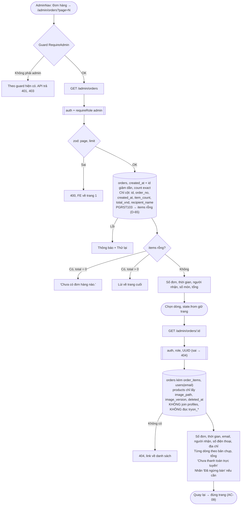

# Luồng: Admin xem đơn

> US-09 §4, R1–R6, E1–E8, AC-01 → AC-09 · `GET /api/admin/orders`, `GET /api/admin/orders/:id` · D-14, D-28, D-61, D-65, D-138, D-151

## Quy tắc quan trọng

| Quy tắc | Lý do |
|---|---|
| Chỉ đọc, không có endpoint ghi | D-138. DB cũng không cho `service_role` sửa |
| Danh sách chỉ `select` đúng cột | Dữ liệu cá nhân không rời DB khi chưa cần, không chỉ lọc ở response (AC-03) |
| Không join `profiles`, `tryon_*` | D-14: không có đường nào lộ ảnh, số đo (AC-06) |
| `item_count`, `total_vnd` đọc từ cột đã lưu | Nhanh, và không tính lại từ dữ liệu có thể đổi |
| Không có "Xem giỏ của người mua" | PB không yêu cầu; D-14 |
| Không cập nhật thời gian thực | Tải lại trang là đủ cho MVP (AC-08) |
