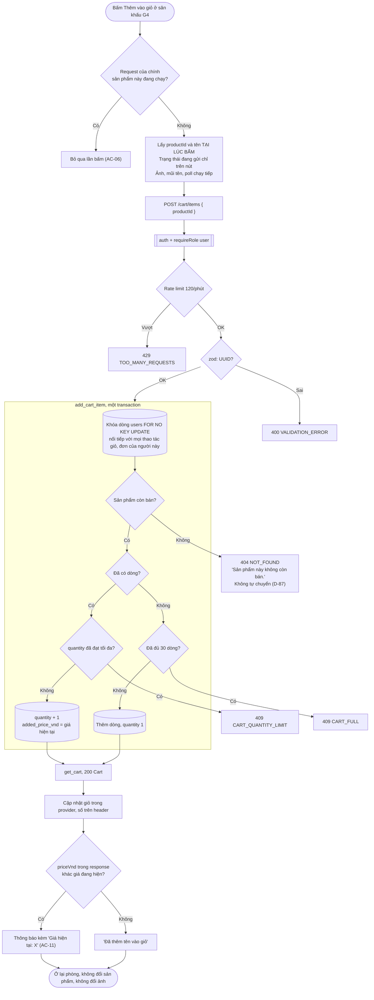

# Luồng: Thêm vào giỏ từ phòng thử đồ

> US-07 §4, R1–R8, E1–E10, AC-01 → AC-13 · `POST /api/cart/items` · D-52, D-87, D-119, D-140, D-146

Nhánh này **độc lập với máy trạng thái ảnh**: không đọc, không đổi, không chờ job. Đó là lý do nút dùng được khi ảnh đang chờ, lỗi, bị chặn, hết lượt.

## Quy tắc quan trọng

| Quy tắc | Lý do |
|---|---|
| Không gọi `/try-on/*` nào, không đọc `tryon_*` | Không tốn lượt, ngân sách (AC-03) |
| `productId` và tên chụp lúc bấm, thông báo dùng tên đó | `ProductStage` mount lại khi đổi sản phẩm; response về muộn vẫn đúng sản phẩm (AC-05) |
| Trạng thái request giữ ở `CartProvider`, không ở `ProductStage` | Đổi sản phẩm không hủy request, không mất thông báo |
| Khóa theo từng sản phẩm, không khóa toàn cục | Lướt sang sản phẩm khác vẫn thêm được ngay |
| Nhiều request chồng nhau: khi hết request gọi `GET /cart` một lần | Response có thể về khác thứ tự gửi; không để số trên header lệch |
| Đổi số trong giỏ không làm đổi `key` của `ProductStage` | Không mất ảnh, không dừng poll (AC-02) |
| Không tự gửi lại khi lỗi mạng | `POST` không idempotent. Nếu thực tế đã ghi, người mua thấy và sửa được ở `/cart` |
| Cổng G1, G2 hiện thì không có nút, nhưng giỏ vẫn còn | Giỏ không phụ thuộc hồ sơ, consent (R6) |
