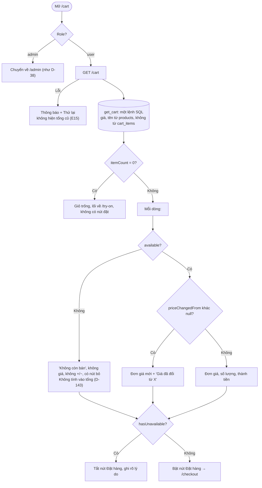
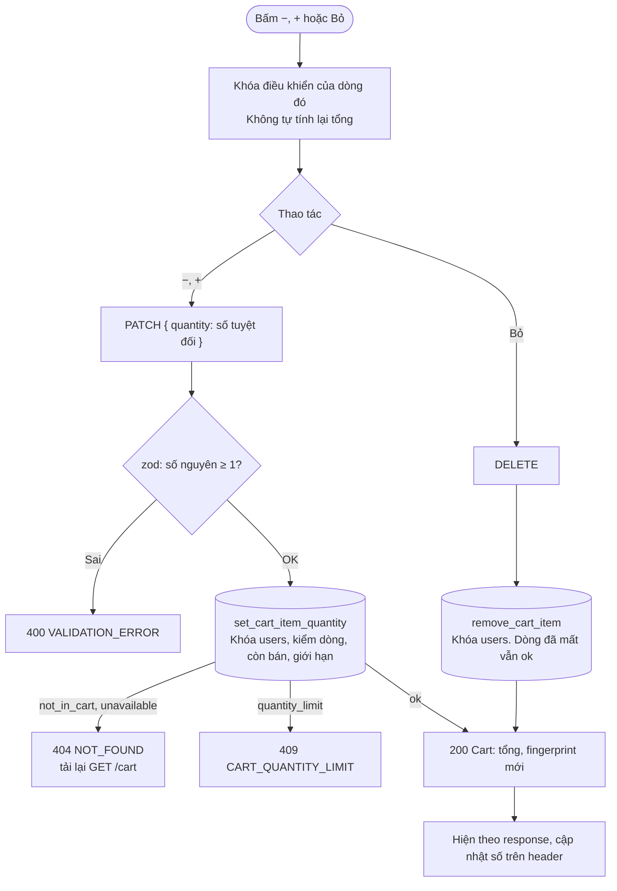

# Luồng: Xem giỏ, đổi số lượng, bỏ dòng

> US-08 §4.1, §4.2, R1–R4, E1–E3, E15, AC-01 → AC-03, AC-05, AC-08 · `GET /api/cart`, `PATCH`, `DELETE /api/cart/items/:productId` · D-42, D-142, D-143

## 1. Xem giỏ

## 2. Đổi số lượng, bỏ dòng

## 3. Quy tắc quan trọng

| Quy tắc | Lý do |
|---|---|
| FE không bao giờ tự tính tổng, kể cả cập nhật lạc quan | Backend là nguồn duy nhất của tiền (R1) |
| `PATCH` gửi số tuyệt đối | Gửi lại không cộng dồn (AC-03) |
| Dòng ngừng bán giữ nguyên trong giỏ | Không có món nào biến mất không giải thích (D-143) |
| Ảnh dòng ngừng bán vẫn hiện | D-42 giữ file |
| Hai tab: không đồng bộ thời gian thực | `fingerprint` bắt được ở lúc đặt hàng; tab cũ tự đúng lại khi có response tiếp theo |
| Đổi giá báo cả khi giảm | Người mua nên biết số tiền đã đổi |
