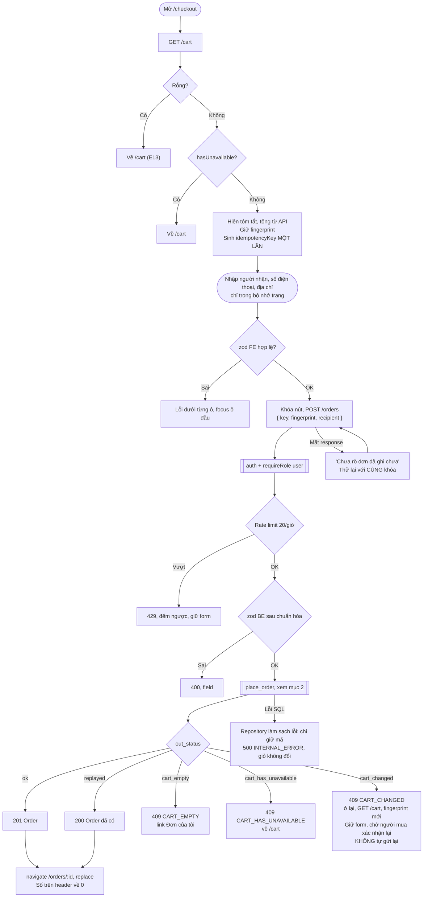
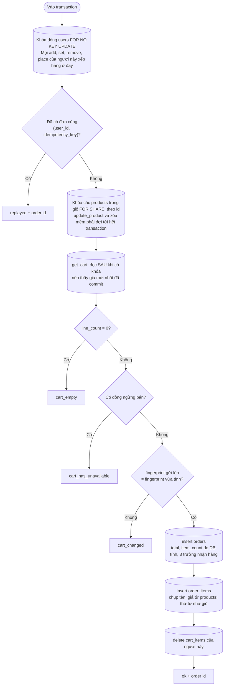

# Luồng: Đặt hàng

> US-08 §4.3, R1, R5–R11, E4–E13, AC-04, AC-06 → AC-14, AC-16 → AC-18 · `POST /api/orders` · D-138, D-139, D-142, D-144, D-145

Phần trong khung DB là **một transaction** của `place_order`. Mọi bảo đảm về giá, đặt trùng, giỏ đổi nằm ở đây.

## 1. Trang đặt hàng và gửi

## 2. `place_order`, một transaction

**Lỗi ở bất kỳ bước ghi nào** (D8 → D10): cả transaction hoàn tác, không có đơn, giỏ giữ nguyên (AC-14).

## 3. Các tình huống tương tranh

| Tình huống | Điều xảy ra | Kết quả | AC |
|---|---|---|---|
| Bấm đúp, thử lại sau timeout, cùng khóa | Yêu cầu sau xếp hàng ở khóa `users`, thấy đơn đã có | 1 đơn, yêu cầu sau nhận đúng đơn đó | AC-10, AC-11 |
| Hai tab, khác khóa | Tab sau thấy giỏ đã rỗng | 1 đơn, tab sau 409 `CART_EMPTY` | AC-12 |
| Thêm món ở tab khác **trước** khi đặt | `fingerprint` lệch | 409 `CART_CHANGED`, không đơn | AC-13 |
| Thêm món ở tab khác **sau** khi đặt | Chờ khóa, rồi ghi vào giỏ đã rỗng | Món nằm ở giỏ mới, không mất | AC-13 |
| Admin đổi giá, commit **trước** | Đọc sau khóa thấy giá mới, `fingerprint` lệch | 409, người mua thấy giá mới | AC-06, AC-07 |
| Admin đổi giá **sau** khi có `FOR SHARE` | Admin đợi tới khi đơn commit | Đơn ở giá cũ người mua đã thấy | AC-07 |
| Admin xóa mềm, commit trước | Thấy dòng ngừng bán | 409 `CART_HAS_UNAVAILABLE` | AC-08 |
| Admin xóa mềm sau | Admin đợi, đơn vẫn ghi | Đơn hợp lệ, xóa diễn ra ngay sau | AC-09 |
| Hai người mua cùng sản phẩm | `FOR SHARE` không chặn nhau | Cả hai đều được | — |

## 4. Quy tắc quan trọng

| Quy tắc | Lý do |
|---|---|
| Client không gửi tiền | Mọi số tiền lấy từ `products` trong transaction (AC-04) |
| Sau `CART_CHANGED` không tự gửi lại | Người mua phải thấy giá mới rồi mới đồng ý (D-144) |
| Khóa dùng lại được sau `CART_CHANGED`, `CART_HAS_UNAVAILABLE` | Khóa chỉ lưu khi có đơn |
| Khóa chỉ sống cùng form | Tải lại trang sinh khóa mới. An toàn: nếu lần trước đã đặt thì giỏ đã rỗng (`CART_EMPTY`) |
| Sinh khóa bằng `crypto.getRandomValues` | `crypto.randomUUID` không có trên HTTP thường (thử bằng điện thoại qua LAN) |
| `recipient` khác nhưng cùng khóa vẫn trả đơn cũ | Khóa xác định "lần đặt này". FE chuyển tới trang đơn, người mua thấy đúng địa chỉ đã lưu |
| Không ghi form xuống trình duyệt | Dữ liệu cá nhân (R9). Đánh đổi: hết phiên thì nhập lại |
| Làm sạch lỗi rpc | `errorHandler` dev log nguyên lỗi, lỗi ràng buộc chứa "Failing row contains" (AC-17) |
