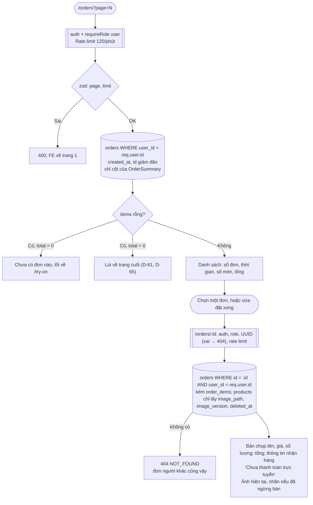

# Luồng: Đơn của tôi

> US-08 §4.4, R6, E14, AC-09, AC-15, AC-19 · `GET /api/orders`, `GET /api/orders/:id` · D-61, D-65, D-142, D-151

## Quy tắc quan trọng

| Quy tắc | Lý do |
|---|---|
| `user_id` nằm ngay trong câu truy vấn, không kiểm sau khi đọc | Không thể đọc nhầm rồi quên chặn (AC-15) |
| Tên, giá lấy từ `order_items`, không từ `products` | Bản chụp (AC-09) |
| Danh sách không có thông tin nhận hàng | Không tải dữ liệu cá nhân khi chưa cần (AC-19) |
| Không hiện nhãn trạng thái | Không có trạng thái (D-138) |
| `Cache-Control: no-store` | Trình duyệt dùng chung không giữ lại địa chỉ, số điện thoại |
