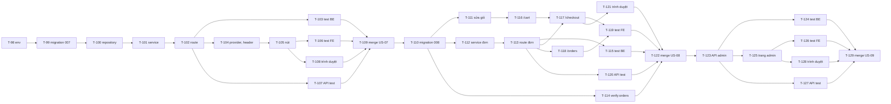

# Sprint 04 — Sprint backlog

> Epic 4: Mua sắm & Giỏ hàng · Stories: [US-07](US-07.md), [US-08](US-08.md), [US-09](US-09.md) · Thiết kế: [`design/`](design/api.md) · Đề xuất: D-137 → D-151

## Mục lục
1. [Mục tiêu sprint](#1-mục-tiêu-sprint)
2. [Quy ước](#2-quy-ước)
3. [Thư viện](#3-thư-viện)
4. [Biến môi trường](#4-biến-môi-trường)
5. [Danh sách task](#5-danh-sách-task)
6. [Thứ tự thực hiện](#6-thứ-tự-thực-hiện)
7. [Phụ thuộc vào thiết kế bước 3/4](#7-phụ-thuộc-vào-thiết-kế-bước-34)
8. [Definition of Done của sprint](#8-definition-of-done-của-sprint)
9. [Quyết định đề xuất](#9-quyết-định-đề-xuất)
10. [Câu hỏi còn mở](#10-câu-hỏi-còn-mở)

---

## 1. Mục tiêu sprint

Người mua bấm "Thêm vào giỏ" ngay ở phòng thử đồ, xem giỏ và tổng tiền, đặt hàng. Admin xem được đơn đã đặt. Không thu tiền, không gọi thêm GenAI.

Sprint không phụ thuộc mức B của sprint 3 (T-93 → T-97): mọi thứ chạy với `TRYON_PROVIDER=fake`.

## 2. Quy ước

| Mục | Quy ước |
|---|---|
| Đánh số | Tiếp nối sprint 03 (kết thúc ở T-97) |
| Ước lượng | **S** ≤ 2 giờ · **M** nửa ngày · **L** ~1 ngày |
| Branch | `feature/US-07-add-to-cart`, `feature/US-08-cart-checkout`, `feature/US-09-admin-orders`. Tạo tuần tự bằng `/branch` từ `main` mới nhất: story sau tạo **sau khi** story trước đã merge, vì dùng bảng của nó |
| Merge | Chỉ `/merge` khi unit test + API test pass **và user xác nhận** (theo CLAUDE.md); ghi `PROGRESS.md` |
| Thứ tự trong story | Migration → Backend → Test BE → Frontend → Test FE → API test → Trình duyệt → Merge |
| API test | Nguồn chuẩn: `backend/tests/postman/` + `npm run test:postman` (D-40) |
| Migration | Áp dụng lên Supabase dev ở T-99, T-110 bằng `npm run migrate`. **Bước 3 chưa áp dụng** |
| Không gọi dịch vụ thật | `TRYON_PROVIDER=fake`. Mọi test giỏ, đơn dùng tài khoản test, không có ảnh người |
| Trạng thái | `[ ]` chưa làm · `[x]` xong · `[U]` chờ user |

## 3. Thư viện

**Không cần cài thêm thư viện**, ở cả backend và frontend. `pg` có sẵn dùng cho `verify:orders`, `zod` cho schema, `express-rate-limit` cho rate limit.

## 4. Biến môi trường

### `backend/.env.example` (thêm mới; thêm vào `src/config/env.js`, đều có default)

| Biến | Ví dụ | Thêm ở | Ghi chú |
|---|---|---|---|
| `CART_MAX_QUANTITY` | `10` | T-98 | D-140, ước lượng. Thông báo lỗi lấy từ `details.maxQuantity` |
| `CART_MAX_LINES` | `30` | T-98 | D-140, ước lượng |
| `CART_REQUESTS_PER_MIN` | `120` | T-98 | D-149. Một bộ đếm cho mọi route `/cart*` |
| `ORDER_CREATES_PER_HOUR` | `20` | T-110 | D-148. Đếm cả request bị từ chối (D-31) |
| `ORDER_READS_PER_MIN` | `120` | T-110 | D-148. `GET /orders*` của người mua |

### `frontend/.env.example`

Không đổi (D-02).

### `backend/tests/postman/run.js`

Nâng `CART_REQUESTS_PER_MIN`, `ORDER_CREATES_PER_HOUR` cho server test, như các bộ giới hạn trước. Giữ `TRYON_PROVIDER=fake`. Có một lượt riêng với `ORDER_CREATES_PER_HOUR=3` để kiểm 429 qua HTTP thật (cách của D-132).

## 5. Danh sách task

### 5.1 US-07 — Thêm vào giỏ (branch `feature/US-07-add-to-cart`)

| ID | Task | Phụ thuộc | Ước lượng | Definition of Done | TT |
|---|---|---|---|---|---|
| T-98 | Thêm 3 biến `CART_*` vào `.env.example`, `env.js` | — | S | Test env: default, sai kiểu | [x] |
| T-99 | Chép `design/db/007_create_cart.sql` sang `migrations/`, `npm run migrate` trên Supabase dev | T-98, Thiết kế DB | S | `get_advisors` security không có cảnh báo mới; REST `cart_items`, `/rpc/add_cart_item` bằng anon key bị chặn; test cũ vẫn pass | [x] |
| T-100 | `repositories/cartRepository.js` bọc `get_cart`, `add_cart_item`, `set_cart_item_quantity`, `remove_cart_item`; `out_total_vnd` là số, không phải chuỗi | T-99 | S | Service không biết tới `rpc`; giới hạn từ env truyền một chỗ | [x] |
| T-101 | `services/cartService.js`, `validation/cartSchemas.js`: `getCart`, `addItem`. Map dòng sang `CartItem` theo `api.md` mục 7: `image_path` thành URL public, dòng ngừng bán `priceVnd: null`, tính `priceChangedFrom`. Map `out_status` sang HTTP | T-100 | M | Test: mọi `out_status`; response không có `image_path`, `added_price_vnd`, `userId` | [x] |
| T-102 | `controllers/cartController.js`, route `GET /cart`, `POST /cart/items`, rate limit, lắp vào `container.js`. Thứ tự auth → role → rate limit → body | T-101 | S | Khớp `api.md`; admin 403 | [x] |
| T-103 | Test BE tập trung rủi ro (Supertest, repository giả): AC-03 không gọi repository try-on hay provider; AC-07; AC-09; AC-10; AC-11 | T-102 | M | Pass; không có test trivia | [x] |
| T-104 | `features/cart/`: `cartApi.js`, `CartProvider` giữ giỏ trong bộ nhớ, tải khi role `user` đăng nhập, xóa khi đăng xuất. Nhiều request chồng nhau thì sau khi hết request gọi `GET /cart` một lần. Số trên header (chưa có link ở story này, T-116 bật link, như D-62) | T-102, Màn hình bước 4 | M | AC-12; admin không gọi API giỏ; provider đổi không làm mount lại `ProductStage` | [x] |
| T-105 | `AddToCartButton` trong `ProductInfo`: `productId` lấy lúc bấm, khóa theo từng sản phẩm, "Trong giỏ: N", thông báo qua `announce` và toast, lỗi theo `error.code`, so `priceVnd` để báo giá đã cũ. Giữ focus khi đổi sản phẩm bằng phím | T-104 | M | AC-01, AC-02, AC-05, AC-06, AC-07, AC-11, AC-13; mọi trạng thái ảnh ở `try-on-states.md` vẫn bấm được | [x] |
| T-106 | Test FE: chuyển sản phẩm khi request đang chạy, bấm đúp, không gọi `/jobs`, poll không dừng, lỗi theo mã | T-105 | S | Pass | [x] |
| T-107 | API test `cart.collection.json`, thêm vào `run.js`: AC-03 (đếm lượt qua `/try-on/state`; đếm job thuộc T-103), AC-04, AC-07 → AC-11 | T-102 | M | `npm run test:postman` pass cả bộ; chạy lần 2 vẫn pass | [x] |
| T-108 | Trình duyệt thật 360, 768, 1280 px với adapter giả: thêm khi đang chờ, lỗi, hết lượt, tạm dừng; vuốt và bấm; bàn phím | T-105 | S | Không lỗi console, không tràn ngang, khung ảnh không xê dịch | [x] |
| T-109 | Review → user xác nhận → `/merge`, ghi `PROGRESS.md` | T-103, T-106 → T-108 | S | `main` có US-07, test pass sau merge | [x] |

### 5.2 US-08 — Giỏ, tổng tiền, đặt hàng (branch `feature/US-08-cart-checkout`, tạo sau T-109)

**Backend**

| ID | Task | Phụ thuộc | Ước lượng | Definition of Done | TT |
|---|---|---|---|---|---|
| T-110 | Thêm 2 biến `ORDER_*`. Chép `design/db/008_create_orders.sql` sang `migrations/`, `npm run migrate` | T-109, Thiết kế DB | S | `get_advisors` sạch; anon bị chặn; `service_role` không `UPDATE`, `DELETE` được `orders` qua REST | [ ] |
| T-111 | Giỏ: `PATCH /cart/items/:productId`, `DELETE /cart/items/:productId` | T-110 | S | US-08 AC-03, E1, E2, E3 | [ ] |
| T-112 | `repositories/orderRepository.js`, `services/orderService.js`, `validation/orderSchemas.js`: chuẩn hóa và kiểm mục 6, gọi `place_order`, map `out_status`. **Làm sạch lỗi:** lỗi rpc được thay bằng `Error` chỉ có mã, trước khi tới `errorHandler` | T-110 | M | Test bảng case; AC-04; AC-16; lỗi 23514 giả lập có "Failing row contains" không xuất hiện trong log (AC-17) | [ ] |
| T-113 | Controller, route `POST /orders`, `GET /orders`, `GET /orders/:id`, rate limit, `Cache-Control: no-store`. 201 khi `ok`, 200 khi `replayed`. Đọc đơn theo `id` + `user_id` | T-112 | M | Khớp `api.md`; AC-15; AC-19 | [ ] |
| T-114 | Script `npm run verify:orders` chạy trên Supabase dev, chuyển từ `design/db/checks/concurrency-test.mjs`: đặt trùng, hai tab, thêm và sửa khi đang đặt, đổi giá và xóa khi đang đặt, giới hạn song song, tải hỗn hợp. Kịch bản đọc bằng rpc, chỉ dòng DB tổng hợp, tự dọn bằng `DATABASE_URL` vì `service_role` không xóa được đơn. Thêm lệnh vào `CLAUDE.md` | T-110 | M | 0 vi phạm, 0 deadlock qua PostgREST + Supavisor; cả hai thứ tự thắng đều xảy ra; dọn sạch; ghi kết quả vào `PROGRESS.md` | [ ] |
| T-115 | Test BE tập trung rủi ro: AC-06, AC-08, AC-10 → AC-14, AC-18 (service + repository giả); log không có họ tên, số điện thoại, địa chỉ | T-113 | M | Pass | [ ] |

**Frontend**

| ID | Task | Phụ thuộc | Ước lượng | Definition of Done | TT |
|---|---|---|---|---|---|
| T-116 | Trang `/cart`: dòng, số lượng, bỏ, tổng từ API, "Giá đã đổi từ X", dòng ngừng bán, rỗng, lỗi. Bật link trên header. Admin về `/admin`. Lazy-load | T-111, Màn hình bước 4 | M | AC-01, AC-02, AC-03, AC-05, AC-08 trên UI | [ ] |
| T-117 | Trang `/checkout`: tóm tắt, form 3 ô, khóa sinh một lần, giữ `fingerprint`, E4 → E13. Sinh UUID bằng `crypto.getRandomValues`, vì `crypto.randomUUID` không có trên HTTP thường khi thử bằng điện thoại qua LAN. Dữ liệu form chỉ trong bộ nhớ | T-113, T-116 | M | AC-06, AC-11, AC-12, AC-13; `sessionStorage`, `localStorage` không có dữ liệu form | [ ] |
| T-118 | Trang `/orders`, `/orders/:id`: bản chụp, câu "Chưa thanh toán trực tuyến", phân trang (D-61) | T-113 | S | AC-09, AC-19 | [ ] |
| T-119 | Test FE: `CART_CHANGED` giữ form và tải lại tóm tắt, thử lại cùng khóa, schema cùng bảng case với BE (D-21), không tự tính tổng | T-116 → T-118 | M | Pass | [ ] |
| T-120 | API test `orders.collection.json`, thêm vào `run.js`: AC-03 → AC-06, AC-08 → AC-10, AC-12, AC-15, AC-16, AC-18, AC-19; 429 ở lượt server riêng | T-113 | L | `npm run test:postman` pass cả bộ; chạy lần 2 vẫn pass | [ ] |
| T-121 | Trình duyệt thật 360, 768, 1280 px: thêm, sửa, đặt, hai tab, admin đổi giá giữa chừng, mất mạng rồi thử lại | T-116 → T-118 | S | Không lỗi console, không tràn ngang | [ ] |
| T-122 | Review → user xác nhận → `/merge`, ghi `PROGRESS.md` | T-114, T-115, T-119 → T-121 | S | `main` có US-08, test pass sau merge | [ ] |

### 5.3 US-09 — Admin xem đơn (branch `feature/US-09-admin-orders`, tạo sau T-122)

| ID | Task | Phụ thuộc | Ước lượng | Definition of Done | TT |
|---|---|---|---|---|---|
| T-123 | Service, repository, route `GET /admin/orders`, `GET /admin/orders/:id`, `no-store`. Danh sách chỉ chọn cột của `AdminOrderSummary`. Bắt PGRST103 (D-65). **Không migration mới** | T-122 | M | Khớp `api.md`; AC-01, AC-02 | [ ] |
| T-124 | Test BE: AC-03, AC-05, AC-06, AC-07. Kiểm cả danh sách cột thực sự gửi tới Supabase, không chỉ response | T-123 | S | Pass | [ ] |
| T-125 | `features/admin/`: `OrdersPage`, `OrderDetailPage`, `ordersApi.js`. Bỏ `soon`, `sidebarOnly` ở `AdminNav`, thêm `to` cho card `/admin` | T-123, Màn hình bước 4 | M | AC-04, AC-08, AC-09 trên UI; 360 px | [ ] |
| T-126 | Test FE: phân trang, về đúng trang, nhãn "Đã ngừng bán", không có nhãn trạng thái | T-125 | S | Pass | [ ] |
| T-127 | API test bổ sung vào `orders.collection.json`: AC-01 → AC-07 của US-09. Dùng đơn do chính collection tạo, không giả định DB rỗng | T-123 | M | `npm run test:postman` pass cả bộ | [ ] |
| T-128 | Trình duyệt thật 360, 768, 1280 px: luồng từ người mua đặt tới admin xem, cả khi sản phẩm đã xóa | T-125 | S | Không lỗi console, không tràn ngang | [ ] |
| T-129 | Review → user xác nhận → `/merge`, ghi `PROGRESS.md`; main agent chạy `/wrap-up` | T-124, T-126 → T-128 | S | `main` có US-09, toàn bộ test sprint pass | [ ] |

**Tổng:** 32 task, T-98 → T-129 — US-07 12, US-08 13, US-09 7.

**Ghi chú test:**
- `orders` không xóa được bằng `service_role`, nên newman để lại đơn trên Supabase dev. Thêm vào mục dọn dữ liệu test ở `PROGRESS.md`. User test có đơn không xóa được vì FK `restrict`; dọn bằng `DATABASE_URL`, xóa đơn trước.
- Kiểm đua giữa đặt hàng và admin không làm được ổn định qua newman: thuộc T-114.
- Không kiểm p95 ở test tự động, chỉ quan sát.

## 6. Thứ tự thực hiện

## 7. Phụ thuộc vào thiết kế bước 3/4

| Tài liệu | Bước | Task cần |
|---|---|---|
| `design/db/README.md`, `007_*.sql`, `008_*.sql` | 3 | T-99, T-100, T-110, T-112, T-114 |
| `design/api.md` | 3 | T-101, T-102, T-111 → T-113, T-120, T-123, T-127 |
| `design/flows/cart-add` | 3 | T-101, T-104, T-105 |
| `design/flows/cart-view` | 3 | T-111, T-116 |
| `design/flows/order-place` | 3 | T-112, T-113, T-117 |
| `design/flows/order-view`, `admin-orders` | 3 | T-118, T-123, T-125 |
| `screens/`: nút và số giỏ trên phòng thử đồ, `/cart`, `/checkout`, `/orders`, `/orders/:id`, `/admin/orders`, `/admin/orders/:id` | 4 | T-104, T-105, T-116 → T-118, T-125 |

Mọi task thuộc bước 5, chỉ bắt đầu sau khi bước 3 và bước 4 xong.

## 8. Definition of Done của sprint

- [ ] Toàn bộ AC của US-07 (AC-01 → AC-13), US-08 (AC-01 → AC-19), US-09 (AC-01 → AC-09) đạt, kiểm bằng test hoặc trên UI.
- [ ] `npm test`, `npm run lint`, `npm run format:check`, `npm run build` (FE) pass. `npm run test:postman` pass trên Supabase dev với `TRYON_PROVIDER=fake`.
- [ ] `npm run verify:orders` 0 vi phạm, 0 deadlock trên Supabase dev.
- [ ] Không có request nào tới dịch vụ AI do thao tác giỏ, đơn; không có trường thẻ, cổng thanh toán nào trong code.
- [ ] Log và bộ nhớ bền của trình duyệt không chứa họ tên, số điện thoại, địa chỉ.
- [ ] Migration trong `migrations/` khớp ERD sprint. `.env.example` đầy đủ, không có secret.
- [ ] Mỗi story nằm trên branch riêng, merge theo quy trình; `PROGRESS.md` có merge log.
- [ ] `DECISIONS.md` có các quyết định đã chốt của sprint.
- [ ] Giao diện dùng được ở 360 px và desktop, thông báo lỗi tiếng Việt.

**Không thuộc sprint:** ra mắt thật (D-96), thanh toán, trạng thái đơn.

## 9. Quyết định đề xuất

Số tiếp nối D-136. Main agent chốt và ghi `DECISIONS.md`.

| # | Đề xuất | Lý do | Phương án đã loại |
|---|---|---|---|
| D-137 | **Thêm thao tác đặt hàng vào US-08**, gồm `/checkout`, trang xác nhận, "Đơn của tôi". Đây là diễn giải, PB không có câu này | US-09 cần đơn, Epic 4 nói "hoàn thành luồng cơ bản" | Thêm US-10: phải sửa cấu trúc PB. Seed đơn giả cho US-09: luồng không hoàn chỉnh. Bỏ "Đơn của tôi": người mua không có chỗ kiểm tra khi mất response |
| D-138 | **Không thanh toán, không thu thông tin thẻ, không có trạng thái đơn, không hủy, không sửa.** Đơn chỉ thêm, `service_role` chỉ có `SELECT`, `INSERT` | PB không yêu cầu. Trạng thái không có ai đổi thì là dữ liệu giả. Không có quyền ghi thì bản chụp không thể bị sửa từ backend | Cột `status` cố định `new`: thừa. Thu tiền khi giao như một lựa chọn trên giao diện: là cam kết nghiệp vụ user chưa đưa ra |
| D-139 | **Thu đúng 3 trường trên từng đơn:** người nhận, số di động Việt Nam, địa chỉ một ô. Không lưu vào hồ sơ. Coi là dữ liệu cá nhân: không log, không lưu trình duyệt, danh sách admin không trả số điện thoại, địa chỉ. Cụ thể hóa phần "để Epic 4" của D-08 | Không có chúng thì đơn không dùng được; do D-52 thiếu size, số điện thoại là cách duy nhất để chốt size | Không thu gì, chỉ dùng email: email chưa xác thực (D-04), admin không giao được. Tách tỉnh, huyện, xã: thêm dữ liệu danh mục, không cần cho MVP. Lưu sổ địa chỉ: giữ dữ liệu cá nhân lâu hơn mức cần |
| D-140 | **Giữ D-52.** Mỗi sản phẩm một dòng; tối đa 10 món/sản phẩm, 30 dòng/giỏ (ước lượng). Đơn không có size, màu; không có kiểm tồn kho, không có "hết hàng" | PB chỉ yêu cầu thêm vào giỏ. Giới hạn chỉ chặn dữ liệu bất thường | Đổi D-52 thêm size: phải sửa US-04 và chưa có dữ liệu size. Ô ghi chú tự do cho size: dữ liệu không kiểm soát được |
| D-141 | Giỏ lưu ở server theo tài khoản, không có giỏ khách, không tự hết hạn | Phòng thử đồ yêu cầu đăng nhập nên không có khách. Dùng được nhiều thiết bị | `localStorage`: đổi thiết bị mất giỏ, client sửa được. Tự hết hạn: chưa có nhu cầu, thêm job dọn |
| D-142 | Trong giỏ luôn tính giá hiện tại. `added_price_vnd` chỉ để báo đổi giá. Đơn chụp tên, đơn giá, số lượng, tổng. **Không chụp ảnh**, đơn hiện ảnh hiện tại của sản phẩm | Người mua không thể giữ giá cũ. Chụp ảnh phải chép file vì D-49 xóa file cũ; tên và giá mới là phần có giá trị đối chiếu | Khóa giá lúc thêm vào giỏ: admin đổi giá không có tác dụng, có thể bán dưới giá. Chép file ảnh cho mỗi đơn: tốn Storage, ít giá trị |
| D-143 | Sản phẩm xóa mềm trong giỏ: giữ dòng, "Không còn bán", không tính tổng, **chặn đặt** tới khi bỏ dòng | Người mua phải biết đơn thiếu món gì trước khi đặt | Tự xóa dòng khi đọc giỏ: món biến mất không giải thích. Tự bỏ qua khi đặt: đơn khác điều người mua đã xem |
| D-144 | **`fingerprint`:** md5 do DB tính trên từng dòng, số lượng, giá, tên, còn bán; `POST /orders` gửi lại, lệch thì 409 `CART_CHANGED`. Chỉ để phát hiện thay đổi, không phải chốt bảo mật | Bắt được mọi loại thay đổi, gồm cả đổi giá của admin, không thêm cột | Cột `cart_version`: không bắt được đổi giá của admin. Client gửi `expectedTotal`: hai thay đổi có thể bù trừ. Client gửi lại cả dòng: thừa và dễ làm hiểu nhầm là tin dữ liệu client |
| D-145 | **Chống đặt trùng hai lớp:** `idempotencyKey` do client sinh, unique `(user_id, key)`, trả lại đơn cũ; khóa dòng `users` `FOR NO KEY UPDATE` nối tiếp mọi thao tác giỏ, đơn của một người. Khóa nằm trong body | Lớp 1 cho thử lại sau timeout, lớp 2 cho hai tab. Header riêng phải đổi `allowedHeaders` của CORS mà không được thêm gì | Chỉ khóa nút ở FE: không chịu được thử lại, hai tab. `SERIALIZABLE` + retry: supabase-js không retry được gọn. Advisory lock theo hash: dòng `users` có sẵn, không có va chạm |
| D-146 | Giỏ, đơn không phụ thuộc hồ sơ, consent, lượt, ngân sách, `TRYON_ENABLED`, không chạm `tryon_*` | Mua hàng không tốn tiền GenAI; rút consent không làm mất giỏ, đơn | Dùng chung cổng G1, G2 ở API giỏ: chặn người đã có giỏ xem lại đơn |
| D-147 | **Xem lại D-95:** giữ D-09 trong sprint này, ghi nợ bắt buộc trước khi ra mắt (cùng D-96) | Đúng phạm vi PB, chưa ra mắt. Nhưng sau Epic 4, số đo không còn công dụng nào, và muốn mua phải đồng ý gửi ảnh ra dịch vụ AI | Bỏ số đo ngay: sửa `profile_completed`, banner, test US-02, ngoài PB. Thêm trang sản phẩm thường ngay: là story mới |
| D-148 | Rate limit đơn: 20 tạo/người/giờ đếm cả bị từ chối; 120 đọc/người/phút (ước lượng) | Không có thanh toán nên dễ tạo đơn giả; chỉ làm chậm, không ngăn | Không giới hạn: bảng đơn lớn không kiểm soát |
| D-149 | Rate limit giỏ: 120 request/người/phút, một bộ đếm (ước lượng), in-memory như D-31 | Không xử lý ảnh, không tốn tiền, chỉ chống spam. Chốt giới hạn số lượng nằm ở DB | Tách đọc, ghi: chưa có lý do như poll job của D-88 |
| D-150 | Số đơn `order_no` tự tăng, hiển thị `DH000123`. Có thể có khoảng trống | Admin và người mua cần số dễ đọc. Đánh đổi: người mua đoán được xấp xỉ số đơn của cửa hàng, chấp nhận ở MVP | Hiện 8 ký tự đầu UUID: khó đọc qua điện thoại, không có unique |
| D-151 | **Quyền đọc đơn:** người mua chỉ đơn của mình, đơn người khác 404. Admin đọc mọi đơn nhưng không có ảnh, số đo, consent (D-14); danh sách chỉ có tên người nhận, chi tiết mới có số điện thoại, địa chỉ, email. `Cache-Control: no-store`. Chưa có nhật ký truy cập | Admin cần để liên hệ, giao hàng; tách để giảm lộ hàng loạt | Che số điện thoại ở chi tiết: admin không làm được việc. Bảng riêng cho dữ liệu nhận hàng: chưa có nhu cầu xóa riêng |

**Cập nhật quyết định cũ:** D-08 phần "để Epic 4" nay được cụ thể bởi D-139, và là thu trên đơn chứ không vào hồ sơ. D-95 được xem lại ở D-147.

## 10. Câu hỏi còn mở

| # | Câu hỏi | Khuyến nghị | Ai chốt |
|---|---|---|---|
| Q1 | Có thu thông tin nhận hàng không? PB không nói | **Có, 3 trường** (D-139). Đổi sang "không thu" chỉ cần bỏ 3 cột và form, không ảnh hưởng phần còn lại | Main agent |
| Q2 | Muốn mua thì bắt buộc có ảnh, số đo, consent AI, vì phòng thử đồ là nơi duy nhất thêm vào giỏ | **Giữ ở sprint này, đưa vào điều kiện trước khi ra mắt** cùng D-96 (D-147). Ghi vào `PROGRESS.md` mục Blockers trước ra mắt | Main agent, user trước khi ra mắt |
| Q3 | Giữ thông tin nhận hàng bao lâu? Đơn hiện không xóa được, không có chức năng xóa tài khoản (D-10) | **Chưa chốt số ngày,** đưa vào danh sách cho người chuyên môn pháp lý ở D-96, cùng nghĩa vụ về thương mại điện tử (chưa đối chiếu văn bản). Giữ trước đơn giản vì chưa có dữ liệu thật | User trước khi ra mắt |
| Q4 | Hứa "xác nhận size, giao hàng" hay "thanh toán khi nhận hàng" trên giao diện là cam kết nghiệp vụ chưa ai đưa ra | **Dùng câu trung tính ở bước 4:** "Chưa thanh toán trực tuyến. Cửa hàng sẽ liên hệ theo số điện thoại bạn cung cấp." Không nêu COD | Main agent |
| Q5 | Đơn giả do không thanh toán, email không xác thực | **Chấp nhận khi chưa ra mắt,** chỉ rate limit | Main agent |
| Q6 | Người mua muốn hủy đơn thì sao? Chưa có kênh liên hệ nào | **Không làm ở sprint này** (D-138). Không hiện lời hứa hủy. Là việc trước khi ra mắt | Main agent |
